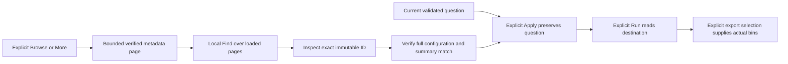

# Discover native histogram displays — 373

In Measurements, validate the destination question, then open **Save or share →
Native histogram view**. **Browse saved interval displays** loads metadata.
**More saved interval displays** loads the next page. **Find loaded interval
displays** filters only the pages already loaded, without a request.

Rows reuse the shared definition-library presenter and show title, Histogram or
Table, exact unit and compatibility with the current question. **Inspect** loads
and verifies that exact immutable configuration. Its title, kind and unit must
match the row before Apply becomes available. An incompatible unit remains
inspectable, with Apply disabled. The exact-ID input remains available.

Browse, Find, Inspect and Apply acquire no telemetry. Apply clears the old result
and stages the unchanged current question. Run and actual destination export
selection remain explicit. A row carries no observations, read clock, source
basis or completeness witness. Complete-bin authority comes from the existing
evaluated distribution, as described in the
[native reuse contract](NATIVE_HISTOGRAM_VIEW_REUSE.md).

## Bounded listing

`GET /api/native-histogram-views` accepts only an optional `after` cursor containing
one lowercase 64-character hex ID. Each page scans at most **20 candidate IDs**
in lexical order, verifying at most 20 artifacts under the existing 128 KiB
artifact limit. The metadata response is bounded to **64 KiB**.

The response contains `items`, `partial`, `diagnostics` and an optional
`nextCursor`. Each scanned candidate produces either a verified summary or an
`unavailable-artifact` diagnostic. A continuation cursor names the last scanned
candidate, including when that candidate is damaged. It accompanies exactly 20
scanned candidates. Missing or corrupt artifacts cannot turn into a false empty
catalog. Directory enumeration uses the existing 10,000-entry cap; exceeding it
refuses browsing while direct IDs remain available.

Ordering describes IDs, not recency. There is no total or transactional catalog
snapshot. Concurrent additions before a cursor can require a new Browse. Find
does not search unloaded artifacts. Invalid responses show a listing error rather
than an empty state. Existing configuration storage is unchanged; there is no new
index, registry or persistence service.

## Current ownership and wire consistency

List, detail and row-render leases keep late or hidden work from changing the
current selection. Find redraws retire old row callbacks; a new Inspect retires
the previous request. Selection state updates in place. Closing the native or
parent disclosure pauses pending metadata work; reopening retains loaded summary
pages without fetching. Replacing the validated plan clears them. Save
acknowledgments remain independent of same-question browsing.

A finite shared input bank checks Go and JavaScript runtime admission, including
omission/null/empty identity strings, Unicode and nanosecond bounds. The API schema
checks recorded shape outcomes separately: the enclosing millisecond/nanosecond
relationship remains runtime validation. This is a bounded consistency check,
not a second evaluator or a universal schema validator.

See [validation](../VALIDATION.md) and the
[executable storyboard](../journeys/373-native-view-library-storyboard.md).
