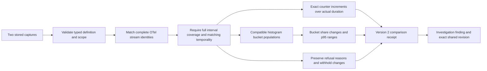
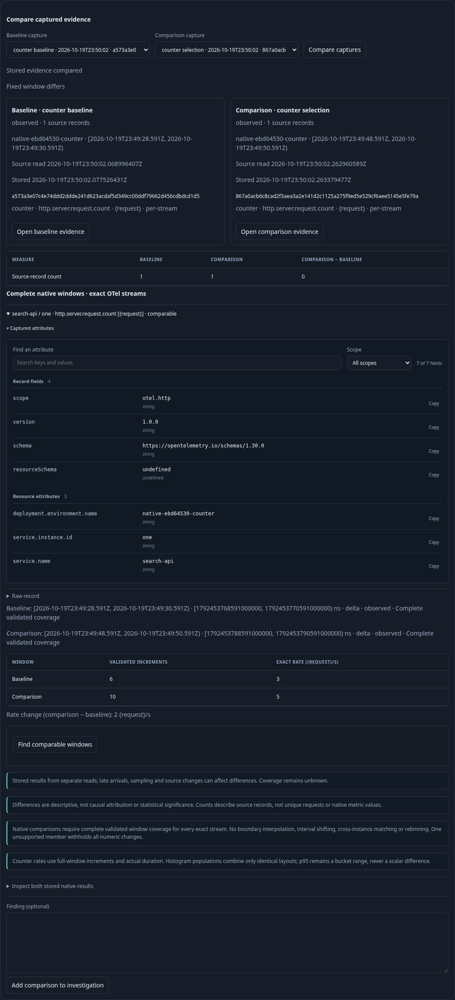
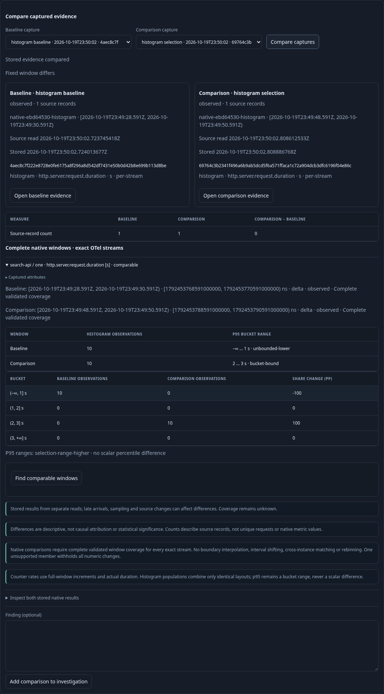
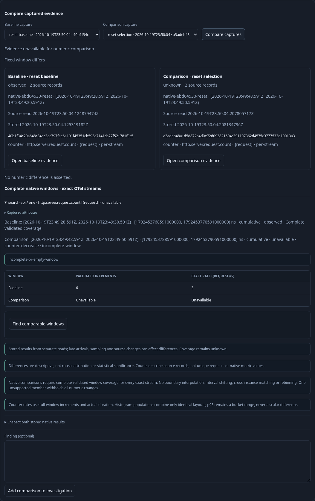
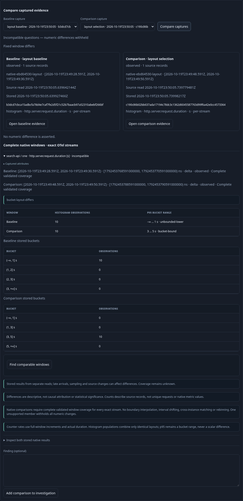
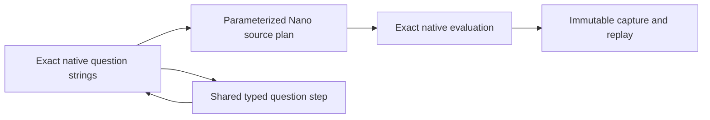

# Compare complete native windows

Counter and explicit-histogram captures now compare complete fixed windows for
each exact OTel stream. The comparison view displays actual bounds, temporality,
coverage decisions and refusal reasons, and can be saved with a finding through
the existing [comparison cards](SAVED_COMPARISONS.md).

A stream identity includes the entire resource (including instance and resource
schema), instrumentation scope/version/schema, metric name/unit and attributes.
Missing and empty attributes remain distinct. No instance removal, discovered
fleet merging or unit conversion occurs.

## Complete-window policy

Every interval must be valid, ordered, contiguous and cover the entire declared
window exactly. The existing counter/histogram kernels determine reset, decrease,
epoch, gap, boundary-crossing and no-recorded-value states. The comparison keeps
those reasons and refuses incomplete windows. Actual windows may have different
bounds or lengths: this compares their complete populations, not a pairing of
individual intervals. No boundary interpolation or interval shifting occurs.

Every exact stream must exist on both sides. A temporality mismatch is
incompatible. If any member is unavailable or incompatible, **all numeric changes
for the pair are withheld**; valid stored observations can still be inspected.
This intentionally avoids selecting a healthy subset or substituting zero for
missing data. Empty histogram populations retain no-data uncertainty.

Measurement questions accept exact native nanosecond bounds (see below). The
interactive editor still authors millisecond bounds, so SDK exports may be refused
unless an exact question is supplied.
[Observed-support discovery](OBSERVED_WINDOW_DISCOVERY.md) offers explicit
sub-scope selection; comparisons never silently trim requested scope.

## Counter rates

Sum validated interval increments within each complete stream window and divide
by its actual duration. Totals and rate subtraction use arbitrary-precision
integers and exact rational strings, including fractional rates and increments
above JavaScript's exact integer range. Zero recorded increments are a valid
observed zero rate; a missing interval is not.

A two-second window with 6 increments has rate 3 units/s. A later two-second
window with 10 increments has rate 5 units/s and change +2 units/s. A four-second
window with 20 increments also has rate 5 units/s; no rate is inferred from source
row counts or an unweighted average of interval rates. Resets/decreases cannot be
made healthy by ignoring their intervals or choosing a later endpoint.

## Histogram populations

Within each stream window, sum interval bucket populations only if the explicit
bucket layout and unit are identical. Counts must remain valid uint64 values;
overflow fails closed. Across the two windows, require the same layout and
matching temporality. Do not rebin incompatible distributions.

Show both whole-window observation counts, bucket populations, exact
percentage-point share changes and the p95 range computed from the combined
bucket population. Never average interval percentiles or subtract scalar p95s.
The range relationship distinguishes strictly separated higher/lower ranges from
potentially overlapping or unbounded ranges. It is descriptive and makes no
statistical-significance or causal claim.

## Versioned saved evidence

New receipts use `goo/evidence-comparison/v2`. Their stored result includes native
window summaries, decisions and supported changes. Version 1 receipts retain
their original byte-compatible schema and reopen without reevaluation; the loader
accepts both versions. Existing saved documents and receipt IDs are unchanged.
The existing 128 KiB complete-receipt limit still fails rather than dropping
streams. Lifecycle deltas, fleet aggregates, exponential histograms, automatic
rebinning and statistical inference remain future work.

Storyboard 54 ingests standard OTLP monotonic sums and explicit histograms into
the real collector. It compares whole-window rates/distributions, shares a frozen
version 2 receipt with a fresh browser, checks mobile containment, and refuses a
cumulative counter decrease, incomplete coverage and changed bucket layout. Hegel
checks exact rate arithmetic, bucket-share conservation, layout refusal, reversal,
immutability and reset refusal; existing
saved-evidence state/swarm tests cover revision history. Quint validates observed
source-free compare/reopen/refuse transitions with six rejecting mutations;
Bombadil reopens the frozen native comparison.

## Exact scope transport

Native measurement questions optionally carry canonical decimal `fromNS` and
`toNS` strings. Their `fromMs` is the floor of the start and `toMs` the ceiling
of the end. Conflicting, partial, noncanonical or lifecycle nanosecond bounds
are rejected. Exact bounds drive parameterized ClickHouse Nano predicates,
including cumulative warmup, and the native evaluation kernels. Captures and
shared measurement steps preserve the strings; omitted fields retain legacy
serialization and millisecond SQL. The comparison panel now discovers supported
intervals and captures explicitly selected exact sub-scopes. Editing UTC bounds in the ordinary editor creates a
millisecond question.

