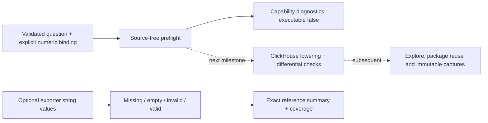

# Numeric attribute preflight and reference semantics

Implemented: a source-free Go planner, exact reference evaluator and HTTP preflight.
Live numeric-attribute SQL execution, UI controls, saved definitions and captures
are **not implemented**. Existing record measures remain unchanged.

This separates declaring a meaning from discovering a storage value. The exporter
stores record/resource attribute maps as strings. A numeric-looking value, an OTel
name or a unit label cannot recover its original OTLP scalar type or certify
semantic-convention conformance. This works for custom keys and standard OTel keys
without requiring goo annotations; convention profiles must eventually supply
versioned bindings rather than guess from names.

## Preflight

`POST /api/telemetry-packages/numeric-plan` accepts one strict JSON object:

```json
{
  "question": {
    "signal": "logs", "environment": "demo",
    "fromMs": 1000, "toMs": 61000, "limit": 100, "offset": 0
  },
  "binding": {
    "field": {"kind": "attribute", "key": "db.response.returned_rows"},
    "type": "uint64", "unit": "{row}", "parse": "canonical-decimal"
  }
}
```

The Go endpoint omits the `/api` prefix. No credentials or source connection are
needed. The response retains detached shared question scope, the explicit binding,
sum/min/max/mean operators, coverage states and `meanDenominator: "valid"`.
`executable` is always false in this slice. Structured diagnostics include stable
`code`, `path` and explanatory `message` fields. An otherwise supported binding has
`execution_unavailable`; invalid fields, types, parsing policies and units produce
additional diagnostics. An invalid question or transport shape returns HTTP 400.
HTTP 200 means preflight completed, not that execution is supported.

| Capability | Current contract |
| --- | --- |
| Signals / fields | Span or log question; explicit record-attribute or resource-map key |
| Types | Declared int64 or uint64, with range validation |
| Parsing | Canonical decimal integers; no trimming or coercion |
| Units | Required declared label, at most 64 UTF-8 bytes; no whitespace/control characters; `1` is dimensionless |
| Calculations | Reference sum, min, max and rational mean |
| Conversion | None; the unit labels the input, it never rescales values |
| Floats, decimals, quantiles, expressions | Unsupported in this slice |
| Source lowering / Explore / persistence | Unavailable; no numeric payload is added to existing Query/package/capture formats |

## Exact reference evaluation

`exploration.EvaluateNumericValues(binding, values)` consumes one optional exporter
map value per record: nil means absent key, pointer-to-empty means present empty.
Canonical forms are `0`, positive digits without leading zeros, or a minus sign
followed by nonzero-leading digits for signed values. `-0`, `+1`, `01`, whitespace,
fractions, exponents, NaN, infinity and out-of-range integers are invalid. An
unsigned binding rejects negative values. Empty values have their own category.

`count = valid + missing + empty + invalid`. Only valid values enter arithmetic.
All outputs are exact decimal strings; the reference sum uses arbitrary-precision
integers and mean is represented by `sum / valid`. Future backends must declare
overflow policies and match these semantics rather than substitute float64 or
`to*OrZero`. Zero is an observed value. With no valid values extrema are unavailable
and state is `no_valid_values`; an empty record population is `no_data`. Sum is the
additive identity zero in these states, not evidence of an observed zero or a
defined mean. With some valid values state is `observed`; coverage counters still
expose excluded values and must travel with the result.



## Validation and next acceptance gate

Native boundary tests cover signed/unsigned extrema, sums above uint64, canonical
syntax, coverage states, invalid units, detached scope and strict HTTP decoding.
Hegel checks partition conservation and valid-only denominators across arbitrary
mixtures and partitions. There is no new UI journey or screenshot: this milestone
has no browser-visible behavior. Existing screenshots still describe existing
features. A live source-free HTTP check exercises the Python proxy after deploy.

Next, lower one explicit integer binding to ClickHouse and compare real OTLP
fixtures against this evaluator, including all four coverage partitions. Before
adding controls, define exact sum overflow and cross-read disagreement behavior,
then carry the typed result through groups/time cells, captures and reusable YAML.
That live journey should add Bombadil actions, Quint ledger validation/rejecting
controls and new documentation frames; this preflight is not that acceptance gate.
