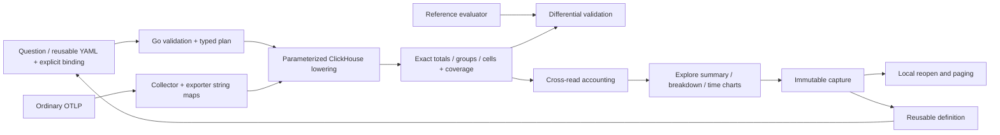
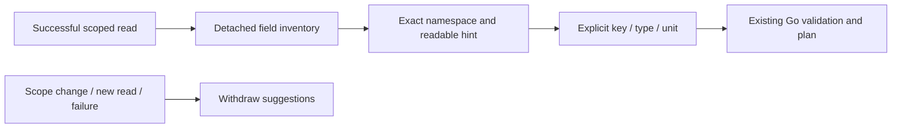

# Numeric attributes: plan, measure and retain evidence

Implemented in the Go record adapter, Explore and telemetry packages. One explicit
integer attribute binding can accompany record count, span duration and recorded
status. It applies to the full selected span/log population independently of the
inspection page, with the same result contract in totals, breakdowns, time cells,
split charts and immutable captures. Native metric kernels remain separate.

## Declare a meaning over ordinary OTel data

In Explore, expand **Numeric attribute measure** under Measures and chart. Enable
it, choose record or resource attributes, enter a key, declare int64 or uint64 and
a unit, then Run. Available keys are suggestions; custom keys can be
entered even when bounded inventory did not discover them. Missing/empty/invalid
values remain visible beside arithmetic. Units label inputs; no rescaling occurs.

The exporter stores attribute maps as strings. A numeric-looking value or an OTel
name cannot recover its original OTLP scalar type or establish semantic-convention
conformance. This works for ordinary standard/custom keys without goo annotations.
Convention profiles must eventually supply explicit versioned bindings. The example
uses a familiar database convention key without claiming coverage or version binding.

Reusable YAML and record questions add the optional `numeric` field:

```yaml
numeric:
  field:
    kind: attribute
    key: db.response.returned_rows
  type: uint64
  unit: '{row}'
  parse: canonical-decimal
```

All four operators (sum, min, max, mean) are available together. `RecordMeasures()`
exposes typed operators and the detached binding, including parsing policy. The
mean merge rule is sum-and-valid-count; coverage partitions merge by aligned sums.
Optional fields are omitted when disabled, preserving old questions, package
revisions, default SQL and captures. No old evidence is rewritten.

## Source-free capability preflight

`POST /api/telemetry-packages/numeric-plan` accepts one strict JSON object with
`question` (an existing valid record question) and `binding` (the object above).
The Go endpoint omits `/api`. It needs no source credentials or source access.
The response retains detached shared scope, binding, operators, coverage states
and `meanDenominator: "valid"`. Supported bindings now return `executable: true`
and empty diagnostics. This means the adapter supports the binding; it does not
mean the source supplied any valid values or met runtime budgets.

Unsupported fields/types/parsing policies/units return `executable: false` with
structured `code`, `path`, `message` diagnostics. Invalid questions or transport
shapes return HTTP 400. Execute/plan/save reject invalid bindings. Run
`python3 scripts/check_numeric_preflight.py` against the local stack to check both
supported and unsupported paths through the proxy.

| Capability | Contract |
| --- | --- |
| Signals / fields | Span or log question; explicit record-attribute or resource-map key |
| Types | Declared int64 or uint64 with range validation |
| Parsing | Canonical decimal integers; no trimming or coercion |
| Units | Nonempty label, at most 64 UTF-8 bytes; no whitespace/control characters; `1` is dimensionless |
| Calculations | Exact sum, min, max and rational mean |
| Coverage | `count = valid + missing + empty + invalid` in every result/cell |
| Conversion, floats, decimals, numeric quantiles, expressions | Unsupported |
| Comparisons of numeric measures | Unsupported; baseline/previous-window controls disabled when the question-level numeric measure is enabled. Typed-filtered count/duration populations remain distinct. |

## Exact arithmetic and unavailable states

`EvaluateNumericValues(binding, values)` consumes one optional exporter map value
per record: nil means absent key, pointer-to-empty means present empty. Canonical
forms are `0`, positive digits without leading zeros, or a minus sign followed by
nonzero-leading digits for signed values. `-0`, `+1`, `01`, whitespace, fractions,
exponents, NaN/infinity and out-of-range values are invalid. Unsigned bindings
reject negatives. Empty values have their own category.

Only valid values enter arithmetic. Decimal-string outputs preserve full precision;
the mean is exactly `sum / valid`, displayed rounded to three decimals. The reference
sum uses arbitrary-precision integers. ClickHouse roundtrip-checks nullable integer
parsing against the original string to reject permissive casts and overflow wraps.
Only validated values enter an Int256 accumulator. Given UInt64 record counts and
64-bit inputs, absolute sum is below 2^128, so Int256 cannot overflow. Values never
pass through float64 or `to*OrZero`.

Zero is observed. With no valid values extrema and mean are unavailable and state
is `no_valid_values`; an empty record population is `no_data`. Sum retains the
additive identity zero in those states, not evidence of an observed zero or defined
mean. With valid values state is `observed`, while coverage retains exclusions.

## Charts, custody and disagreement

Breakdown rankings and split-chart bars use **absolute magnitude**, explicitly
labelled; signed value labels remain intact. Local search retains the full captured
scale, and local chart selection reads no telemetry. Count charts also expose
numeric values/coverage when an interval is selected. Split charts retain their
existing limits of eight observed series, 1,000 observed cells and 240 intervals.
A no-record cell and a cell containing only invalid numbers are distinct.

Totals, groups and charts are separate reads. The adapter compares exact numeric
sum, extrema and all coverage partitions across them, including split cells per
group and per interval. Disagreement yields `changed_between_reads`; malformed
summaries fail. Matching aggregates cannot establish identical raw records,
transactional snapshots, completeness or health. Mean denominators are never pooled
from rounded means. Capture load validates numeric shapes/units/accounting and
preserves declared disagreement. Reopen and saved paging read stored evidence;
package reuse reads fresh data while old evidence remains unchanged.



[Storyboard 44](journeys/README.md#44--measure-numeric-attributes-with-explicit-coverage)
uses controlled ordinary OTLP spans/logs through the real collector and ClickHouse.
It compares signed/unsigned/resource bindings and every cell with the Go reference,
checks page-independent totals, UI authoring, capture/reuse/reopen and mobile layout.
Hegel covers partition conservation and state/swarm edits; Quint validates observed
plan/execute/inspect/capture/reuse/reopen steps with rejecting numeric mutations;
Bombadil explores local measures/search with frozen-evidence/coverage invariants.
This fixture is integration evidence, not production traffic or OTel completeness.

Next: multiple named measures, explicit decimal/float policies, unit conversions
and numeric cohort comparisons. Databricks raw-source lowering remains future work.

## Field guidance — reviewed 2026-10-24

The numeric editor shares the field-presentation catalog while retaining its own
explicit binding controls. Attribute and resource suggestions show readable labels
and exact raw keys in separate namespaces; custom keys remain supported. The
returned-row semantic-convention hint is advisory: neither numeric type nor unit
is inferred. Binding-only edits preserve the numeric editor's detached suggestion
snapshot. Population changes, new reads and failures clear suggestions; canceled
responses cannot restore a prior scope's inventory. Editing does not read sources.



Storyboard 44 now exercises namespace switching, unchanged explicit defaults,
source-free edits, cancellation of an actual held response, failed-read withdrawal
and immutable capture reuse. Updated frames 44a–44c show the running application.


[Typed numeric predicates](TYPED_NUMERIC_FILTERS.md) now filter attribute/resource
record populations independently of this question-level numeric measure. They
share canonical parsing but have their own explicit binding; choosing a filter
does not silently add or change an aggregate measure. Count/duration comparisons
and time-chart children preserve those predicates, while sum/mean measure
comparisons remain unsupported.
