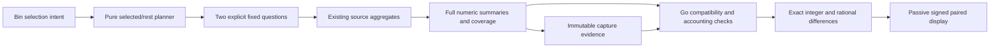

# Numeric measure comparisons

Implementation in progress. This extends the existing record comparison flow to
explicit integer attribute measures. It uses existing source aggregates and
passive comparison components; it adds no query language or automatic source read.

## Compatibility and evidence

Both sides must have identical numeric field namespace/key, integer type, unit
and canonical parsing policy. Selectors and fixed windows may differ, and remain
visible as independently read scopes. Histogram presentation may differ without
changing numeric meaning. No type inference, unit conversion or duration/rate
normalization is implied. Sums over different population sizes or window lengths
must be read with their corresponding counts and coverage.

The new `POST /compare` request explicitly opts into numeric semantics with
`numeric: true`. Legacy
count-only requests, including old numeric questions whose comparison payloads
omitted numeric summaries, retain their bytes and count-only behavior. New
numeric requests require complete totals and group summaries: inspection rows
cannot supply missing aggregates. Immutable captures are never rewritten.

## Exact arithmetic and state

Go validates canonical per-side coverage and integer bounds, group-to-total
accounting and extrema. It computes selected minus baseline for sum/min/max as
integers and mean as a reduced exact rational, using valid-value count as the
denominator. Rational values are strings rather than JSON numbers. No decimal
rounding becomes arithmetic authority.

Missing, present-empty and invalid values remain visible in coverage. An absent
group or a side without valid values has unavailable numeric arithmetic; it does
not become a measured zero. A real zero remains valid. Changed source reads
withhold deltas as unknown. Coverage counts retain their separate semantics.

## Product flow

With one breakdown field configured, pin a numeric baseline, change the selected
population and compare, or explicitly
read the previous fixed window. The existing range-selection tray also offers a
numeric comparison against the whole rest, alongside the existing count-only
comparison. Go derives the same selected/rest predicates and one shared breakdown
(first declared field, otherwise service name); neither UI nor chart evaluates
records. Staging remains source-free and Run is explicit.

Four compact rows show mean, sum, minimum and maximum. Each row uses one signed
scale shared by both sides with a visible zero, so a large sum does not hide mean
or extrema. Exact values/deltas accompany the bars, with valid/missing/empty/
invalid counts beside them. Ranking uses exact changes, including negative values;
one-sided groups remain unavailable for arithmetic.

Stored capture comparisons also support ungrouped numeric totals. Live pinning
and previous-window comparison retain the existing one-breakdown requirement;
choosing that field stages configuration without a source read.

Saved comparisons retain both summaries and the exact numeric intent. Reopening
uses stored evidence. Reusable questions preserve the original numeric binding;
opening a definition does not silently pin a new baseline.

## Review gates

NC1: Go validation, exact comparison, legacy compatibility and saved evidence;
independent semantic review plus property/source parity checks.

NC2: Existing live/stored comparison owners, signed passive display, baseline and
range continuation; component/protocol tests and independent UI review.

NC3: Ordinary OTel live journey with capture/reopen, explicit source-read counts,
negative/zero/nonvalid and large-integer cases, screenshots, native model replay
and Bombadil; final review, commit and push.
