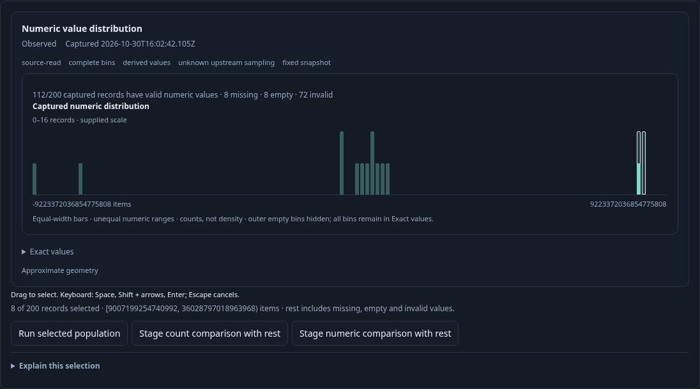
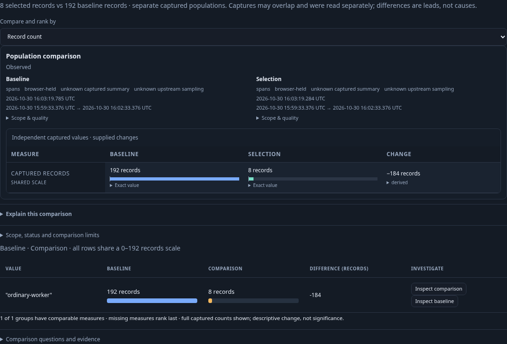
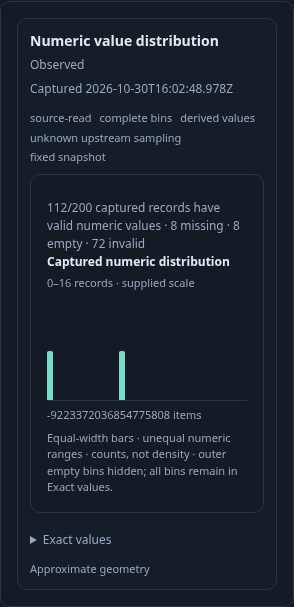

# Exact numeric distributions

269 brings the display onto the [shared histogram dataset](SCOPED_HISTOGRAMS.md).
Raw source/API boundaries below remain coefficient strings; shared snapshots use
exact rational human-unit edges. The passive `goo-chart` histogram kind owns
presentation, reusing `goo-time-bars` gestures internally. H1 captured bindings
guard range planning before and after awaits. Retained views require a fresh Run
after withdrawal before source actions resume; local Saved highlighting stays passive.

Implemented in the Go adapter and fixed/saved question UI. This extends the explicit numeric attribute binding;
it does not infer types or units from OTel attribute names. The existing record
question remains the unit of scope and reuse.

## Contract

An optional `numericHistogram: {binning: powers-of-two}` accompanies `numeric`.
The Go adapter derives all half-open ranges from the declared integer type. There
are 65 uint64 bins and 128 int64 bins, including zero and both domain extremes.
[Fixed-scale decimal](FIXED_SCALE_DECIMALS.md) bindings use the same signed
coefficient geometry, with scale-aware decimal labels and exact typed thresholds.
Boundaries and counts are integer coefficient strings. The final upper boundary is max+1;
that histogram boundary is never submitted as an out-of-domain predicate value.

The main count aggregate computes bins alongside numeric coverage in one source
read. Every valid value enters exactly one bin. Missing, empty and invalid values
remain separate coverage states and never enter arithmetic. This is a categorical
count chart with unequal numeric ranges, not a density plot or a linear number
axis. Leading and trailing empty bins may be hidden visually; internal gaps and
exact original bin indices remain intact. Exact counts and boundaries remain
available in a disclosure. All-invalid and no-data results have no selectable
population masquerading as a zero-valued measurement.

## Interaction and ownership

The existing numeric measure form owns the opt-in. The passive `goo-time-bars`
element displays supplied counts and emits selection gestures; it does not parse
records, query a source, or derive predicates. Mouse and keyboard range selection
stage intent. Go's pure `POST /api/numeric-histograms/selection` planner derives
selected/rest queries from half-open bin indices, validates normal query budgets,
and preserves the original selector, source and fixed window.

The rest is the whole parent minus the selected valid numeric range: it includes
missing, empty and invalid values. The planner also supplies explicit count-only
comparison queries, removing numeric arithmetic and other measure requests while
preserving predicates. These projections share the first declared breakdown field,
or service when the parent has none; selected/rest drilldown questions retain
the original grouping. Comparing those populations uses independent source reads;
it does not establish a transactional snapshot. A separate
[Stage numeric comparison with rest](NUMERIC_COMPARISONS.md) action retains the
numeric binding and compares mean/sum/extrema with coverage.
Run remains explicit after staging. Source-read disagreement disables selection.

Questions, immutable captures, links and reusable YAML carry the optional
histogram specification. Omitting it preserves older question/package bytes;
existing captures are not rewritten. Automatic companion signals clear histogram
requests when they clear numeric bindings.

## Delivered milestones

1. Exact Go bins, same-read ClickHouse aggregation and checked range/complement
   planning, with legacy omission and source parity review.
2. Existing-form opt-in, reusable chart adapter, exact accessible ranges and
   source-free gesture staging, with protocol/recovery and UI review.
3. Real telemetry journey, screenshots, property/model trace checks and Bombadil
   actions/invariants; update documentation to implemented behavior only after
   acceptance, then commit and push validated work.

## Storyboard 174 — ordinary telemetry to reusable numeric populations

Executable journey: [numeric-histogram.spec.js](../journeys/numeric-histogram.spec.js).

1. An operator opens a fixed question over ordinary OTel spans, declares an int64
   `work.items` binding and enables **Show distribution**. These edits stage
   configuration without reading telemetry.
2. Run reads the full population and shows coverage next to the distribution.
   The exact-bin disclosure includes zero-count gaps and both integer extremes,
   even though the inspection table shows only its first 100 rows.
3. Space, Shift+arrow and Enter select adjacent bins above JavaScript's safe
   integer limit. The selected range/count stays exact; this gesture performs
   neither a source read nor a planner request.
4. Run selected population asks Go to derive checked predicates, then opens the
   selected population. Stage count comparison with rest instead stages the
   existing population workspace. Run there reads selected and rest independently;
   their counts partition the parent, including nonvalid values in the rest.
   Back retains the captured display without reads; Run the parent explicitly
   before planning another range after its execution binding was withdrawn.
5. Save a capture and build reusable YAML. A fresh use preserves the optional
   histogram request; reopening saved evidence uses stored bins and does not read
   telemetry. The mobile chart scrolls within its panel rather than expanding
   the page. Invalid-only and no-data populations show coverage without fake bars.
6. A separate lifecycle case delays an actual planner response, leaves the
   question and returns. The old response must not open a population. A new
   explicit parent Run creates a current binding before a new gesture can plan.

Backend and live-browser acceptance, native property/model replay and the
Bombadil campaign pass. Executed evidence and limitations are recorded in
[VALIDATION.md](../VALIDATION.md).

Captured frames from the live journey:

[Aligned comparisons](DISTRIBUTION_COMPARISONS.md) now compare two complete
histograms with common keys/scales and exact all-record shares. Their paired chart
can stage an interval and explicitly open either original side. This is separate
from the single-histogram count/numeric comparison-with-rest actions above.
