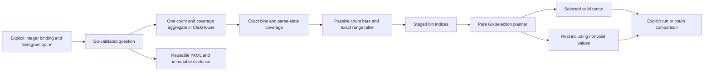

# Exact integer distributions

Implementation in progress. This extends the explicit numeric attribute binding;
it does not infer types or units from OTel attribute names. The existing record
question remains the unit of scope and reuse.

## Contract

An optional `numericHistogram: {binning: powers-of-two}` accompanies `numeric`.
The Go adapter derives all half-open ranges from the declared integer type. There
are 65 uint64 bins and 128 int64 bins, including zero and both domain extremes.
Boundaries and counts are decimal strings. The final upper boundary is max+1;
that histogram boundary is never submitted as an out-of-domain predicate value.

The main count aggregate computes bins alongside numeric coverage in one source
read. Every valid value enters exactly one bin. Missing, empty and invalid values
remain separate coverage states and never enter arithmetic. This is a categorical
count chart with unequal numeric ranges, not a density plot or a linear number
axis. Leading and trailing empty bins may be hidden visually; internal gaps and
exact original bin indices remain intact. Exact counts and boundaries remain
available in a disclosure. All-invalid and no-data results have no selectable
population masquerading as a zero-valued measurement.

## Interaction and ownership

The existing numeric measure form owns the opt-in. The passive `goo-time-bars`
element displays supplied counts and emits selection gestures; it does not parse
records, query a source, or derive predicates. Mouse and keyboard range selection
stage intent. Go's pure `POST /api/numeric-histograms/selection` planner derives
selected/rest queries from half-open bin indices, validates normal query budgets,
and preserves the original selector, source and fixed window.

The rest is the whole parent minus the selected valid numeric range: it includes
missing, empty and invalid values. The planner also supplies explicit count-only
comparison queries, removing numeric arithmetic and other measure requests while
preserving predicates. Comparing those populations uses independent source reads;
it does not establish a transactional snapshot or a numeric mean comparison.
Run remains explicit after staging. Source-read disagreement disables selection.

Questions, immutable captures, links and reusable YAML carry the optional
histogram specification. Omitting it preserves older question/package bytes;
existing captures are not rewritten. Automatic companion signals clear histogram
requests when they clear numeric bindings.

## Milestones

1. Exact Go bins, same-read ClickHouse aggregation and checked range/complement
   planning, with legacy omission and source parity review.
2. Existing-form opt-in, reusable chart adapter, exact accessible ranges and
   source-free gesture staging, with protocol/recovery and UI review.
3. Real telemetry journey, screenshots, property/model trace checks and Bombadil
   actions/invariants; update documentation to implemented behavior only after
   acceptance, then commit and push validated work.
