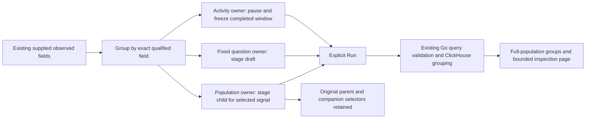
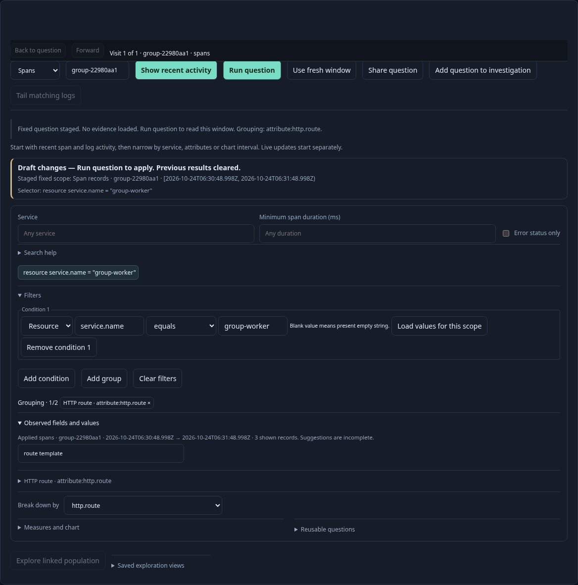
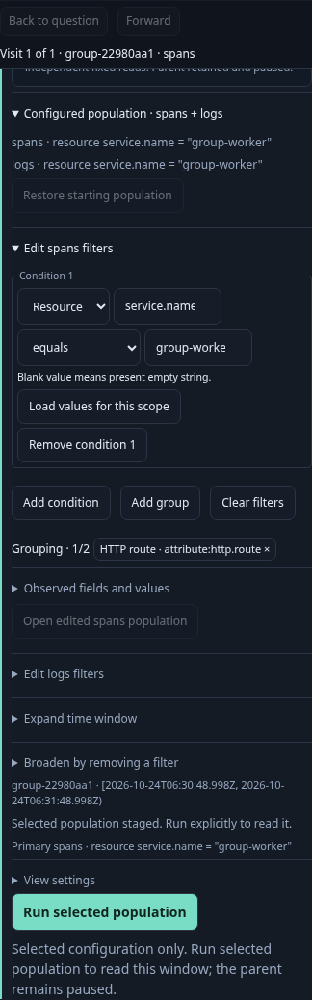

# Group an observed field

Open **Filters → Observed fields and values**, search for a key or its
[OTel meaning](OTEL_FIELD_HINTS.md), and open the field. **Group by this field**
stages a single-field breakdown. It uses the exact qualified key, including
custom keys and legacy spellings. It replaces existing grouping and resets record
paging to the first page; filters, environment and fixed time bounds stay intact.
Split grouped timelines are cleared, while the time bucket width is retained.

The action appears inside the existing field disclosure, alongside value filters
and explicit counted-value lookup. It adds no controls ahead of the default
Activity stream. Owners handle the staged question:

| Surface | Result of choosing a field | Source execution |
| --- | --- | --- |
| Activity | Pause and open analysis of the applied selector in the last completed read window | **Run analysis** |
| Single fixed question | Stage the current fixed draft with the chosen grouping | **Run question**, or **Run analysis** for Activity analysis |
| Fixed population view | Open a grouped child, retaining companion signal questions and the paused parent | **Run selected population** |

Activity requires a clean applied scope and a completed window. Its held buffer may span earlier polls; grouping uses only the last completed window, so presence and totals may differ from the held rows. Dirty scopes
withdraw suggestions. Population grouping is unavailable with pending filter or
facet edits, during a read, or at the existing nesting limit. Apply/clear those
edits or return to a parent first. The child summary and staged question status
identify the chosen grouping before Run. Returning to the parent restores the
original grouping opener and does not refresh telemetry.

A supplied field sample only discovers the key. After Run, the existing source
query computes full matching-population groups with missing and empty values
separate. Held rows are not an aggregate or saved evidence. Existing group limits,
source-read disagreement and capture semantics continue to apply. A new grouping
does not publish a view, alter an existing saved configuration, union aliases or
infer request/business success.

The shared filter editor accepts optional `onGroup(field, opener)` and
`canGroup()` callbacks. It emits detached exact field intent, never queries or
mutates the filter tree on grouping, and displays no grouping action without an
owner callback. `syncGrouping()` updates availability without replacing focused
content. Signal changes revalidate supplied grouping fields. Withdrawn field actions cannot emit stale grouping intent. Existing source
owners withdraw obsolete suggestions; no new execution controller is introduced.
`GooPopulationWorkspace.regroup` provides the existing single-query transform;
`groupQueries` applies it only to the selected signal and clones companions.

## Executable storyboard 166

`journeys/observed-grouping.spec.js` ingests three real spans (two with the same
route and one with a missing route) plus a companion log. It exercises keyboard
Activity-to-analysis staging with exact completed bounds, replacement of a
fixed two-field/split-timeline grouping, and a saved two-signal parent-to-child
handoff. Only explicit Run actions issue the seven expected source requests.
An independent ClickHouse query verifies the two route groups and their counts.
The saved parent stays unchanged, and Back restores focus without reading.

A separate synthetic display contract checks detached callback data, unchanged
predicates, guarded availability, signal-specific validation and withdrawal.
Hegel state/swarm testing changes groupings repeatedly while protecting parent
objects, nested predicates, clocks and companion signals. Quint replays the real
browser read trace and rejects hidden reads, changed bounds, rewritten keys,
altered companions, retained split timelines and dropped filters. A 25-second
mobile Bombadil campaign reads once, discovers a field and stages grouping
without another source query.

The original cut supported one selected grouping field. Its two-field follow-up is delivered below. Arbitrary numeric transforms and preserving held rows as a new aggregate remain outside these actions.

Follow-up delivered: [two-field composition](COMPOSED_GROUPING.md) now adds Add to grouping and removable chips while retaining the single-field replacement action. Unread population children compose in place; applied views still preserve a parent.
