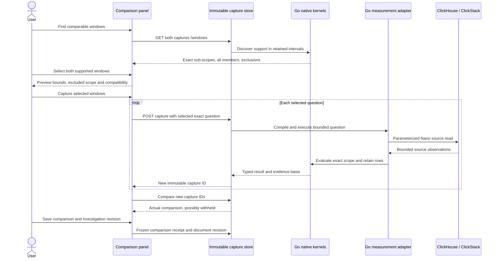

# Find comparable windows

The comparison panel can discover supported sub-scopes in two immutable native
counter or explicit histogram captures. Click **Compare captures**, then **Find
comparable windows**. Discovery is a source-free GET over validated retained
kernel intervals. It never changes the captured question or its results.

Each side shows the original exact scope, source read time, retained stream count,
supported windows and exclusions. Select a window on **both** sides. The preview
shows exact nanosecond boundaries, excluded duration, complete resource/scope/
metric/attribute identity, temporality and validated increments/rates or histogram
population. Support is evidence about observations, not ingestion completeness.

**Capture selected windows** is enabled only when both selected windows have
identical full stream membership, temporality, metric units and histogram bucket
layouts. It performs two new source reads using the selected exact questions.
The new captures are then compared through the existing comparison engine. A new
read can observe late data, lose coverage, fail, or become incompatible; the
preview does not promise a comparable new result. The original captures remain
unchanged. Save a comparison and finding, then save the investigation revision to
share the frozen result and both new evidence IDs.

If either capture fails, completed captures remain in the capture library and
the panel displays their IDs. It does not compare a partial pair or silently
replace one original capture. Navigating away prevents automatic selection of
late results; any completed capture remains independently recoverable.

## Support policy

The Go metric layer intersects actual validated boundaries across **all** streams
retained in that capture. Adjacent compatible supported segments become one
maximal window. Missing coverage, boundary crossing, no-recorded-value flags,
reset/epoch taint, excessive gaps and layout changes cannot be interpolated away.
A stream with no supported intervals withholds the entire candidate set. Histogram
layout changes split support; incompatible layouts across sides disable capture.
Overflowing aggregate histogram populations are withheld.

No values are prorated. Asynchronous streams without common interval boundaries
produce no candidate. Different captures may have different supported durations;
actual durations determine exact counter rates. Histogram bucket populations are
combined before deriving percentile ranges, with no scalar percentile averaging.
Discovery preserves reset-tainted intervals from the original evaluation rather
than reevaluating a narrow interval to hide its prior reset.

Responses expose the first 32 candidate windows and 64 exclusions, with total
counts and explicit warnings when the output is bounded. Narrow the original
question to inspect later support. Discovery is not a claim that every possible
sub-window is enumerated: it offers maximal supported runs and withholds a run
whose aggregate population overflows. Gauges, lifecycle cohorts, member selection,
rebinning and interval realignment remain outside this workflow.

## Processing and custody

The two reads are sequential, not transactional. Scope/event time, each source
read, each immutable capture's custody time and the later comparison receipt time
remain separate. New sub-scopes are new questions, not refresh children claiming
the same original question. Discovery does not mutate or silently link them as
matching evidence to the old question card.

The existing shared measurement step preserves exact string `fromNS`/`toNS` bounds
and enclosing millisecond bounds. All selected captures use that contract. Native
comparison receipts remain algorithm v2; no receipt algorithm changed here.

After recapture, either comparison side can be
[added as a reusable question](REUSABLE_COMPARISON_QUESTIONS.md), with its exact
selected scope and new capture ID already linked. This is a separate explicit
draft action and does not alter the original broad-scope question.
