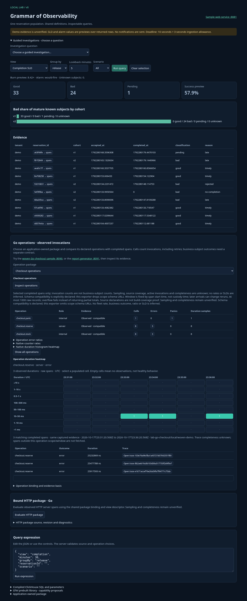
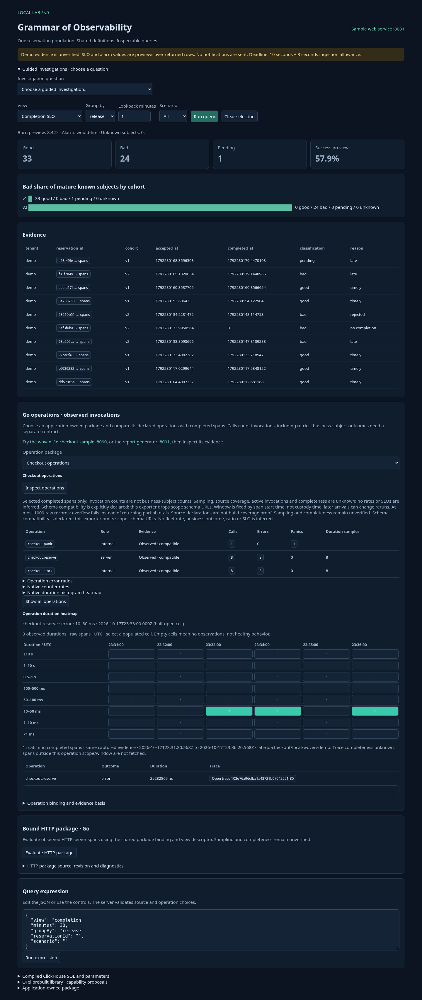
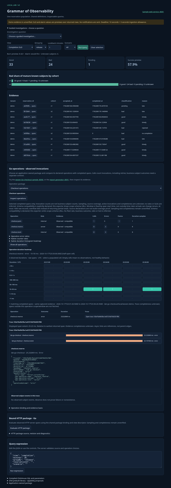

# Operation durations and trace drilldown

The live operation panel now retains the validated source evidence behind its
counts. Click an operation name or calls, errors or panics count to select matching
invocations. The raw duration heatmap and span list use that same captured response.
A populated heatmap cell selects its exact contributing spans; **Open trace** then
shows all observed operation spans for that trace in the captured resource/window.
The existing relative-time waterfall renderer is reused.

## Real user storyboard

Playwright journey 09 executes this sequence with the woven Go sample and actual
collector/ClickHouse ingestion:

1. Trigger a failed checkout. The sample's nested `checkout.stock` operation does
   bounded simulated dependency work (25 ms before error, 2 ms before success).
   Its span is a child of `checkout.reserve`; both record the propagated error.
   These two invocations are separate calls, not two failed business subjects.
2. Inspect operations for five minutes. Click the reserve error count to select
   only that operation/role/outcome. Read its raw duration heatmap.
3. Click a populated cell. The test independently checks exact timestamp/duration
   bounds, membership and displayed contributor count against returned evidence.
4. Open a contributing trace. Inspect the reserve/stock parent-child waterfall,
   then a span's attributes and exact IDs. The test changes the lookback control
   before drilling down and verifies that no additional operation query ran:
   resource, original bounds and basis remain the captured ones.





Run `npm run test:journeys` against the default stack. **Inspect operations**
explicitly refreshes the evidence; row/cell/trace selections do not. Changing the
lookback input alone does not mutate the captured question. The selection panel
continues to display the original UTC bounds and resource identity.

## Evidence contract

The Go adapter now returns deduplicated logical `spans` alongside the conformance
report, derived from the same validated rows. It retains trace/span/parent IDs,
exact decimal-string start/duration nanoseconds, operation/role/outcome and span
attributes. Parent IDs are validated, and conflicting raw copies still fail.
Totals, heatmap and inspection share the same full bounded population; there is
no additional row cap before computing distributions. Overflow of the existing
1,000 raw-span or 8 MiB source guards fails instead of producing partial totals.

`ui/operations.js` owns selection over this logical evidence. It does not contain
ClickHouse columns or source attribute lookups. One-minute UTC cells use exact
BigInt bounds with duration bands <1 ms, 1–10 ms, 10–50 ms, 50–100 ms, 100–500 ms,
0.5–1 s, 1–10 s and >=10 s. Bounds are lower-inclusive/upper-exclusive; the last
duration band has no upper cutoff, including UInt64 maximum. These are raw span
observations, not merged histogram points or reconstructed percentiles. Empty
cells and unobserved operations do not establish health.

Opening a trace expands the selected cell to the trace's other operation spans,
but retains the original resource, source scope, time window and evidence basis.
It does not fetch a complete distributed trace or cross-service context. Parents
outside the response are explicitly marked by the waterfall. Completeness and
sampling remain unknown. The evidence basis labels the captured query result;
it is not immutable custody, durable saved-session storage or a build attestation.
A bounded [scoped subject navigation](SUBJECT_NAVIGATION.md) layer now follows
declared events across captured traces. General async subject joins remain future work.

## Verification

- Node tests cover exact modern-epoch boundaries, duration edges, UInt64 maximum,
  composed operation/role/outcome/trace filters and nonmutation of input evidence.
- Hegel executes the actual browser selection kernel with 100 generated cases,
  checking selected IDs against an independent Go reference, cell partitioning
  and selection stability after another navigation action.
- A bounded Quint fixture models error → duration cell → trace → reset. quintgo
  validates observations emitted by the actual browser kernel, including exact
  membership encoded as a bitset and a retained evidence marker. A wrong-cell
  membership mutation must be rejected. This verifies the kernel fixture, not
  a formal model of browser DOM events, general source completeness or all traces.
- The real browser journey checks the DOM and live source integration separately.

Commands from the root:

```sh
npm run test:visualizations
npm run test:journeys
cd verification
go test -run 'TestHegelOperationHeatmapSelection|TestQuintObservedOperationNavigation' -v .
```

Quint reports are retained in artifacts/verification. Use the documented Go cache
and XDG_CACHE_HOME settings in verification/README.md for native checks.
