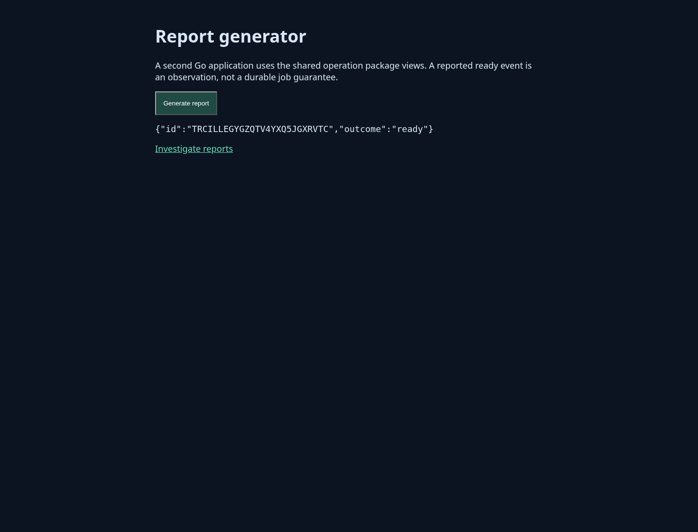
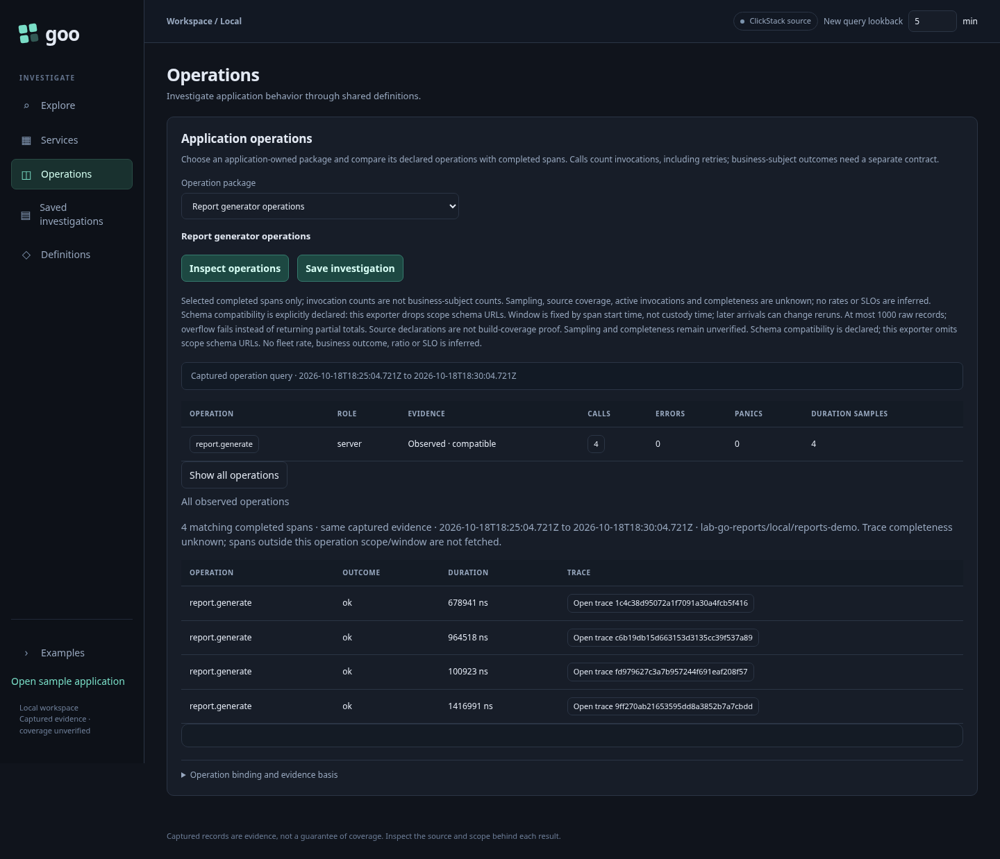
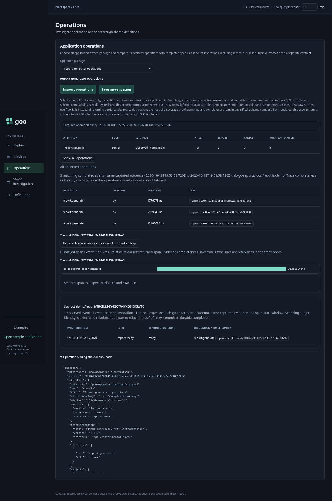
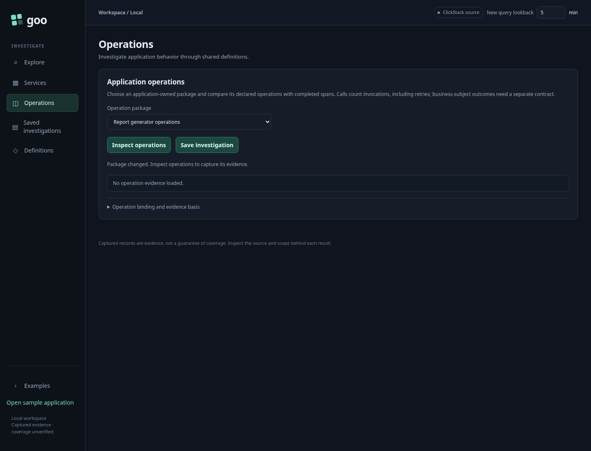
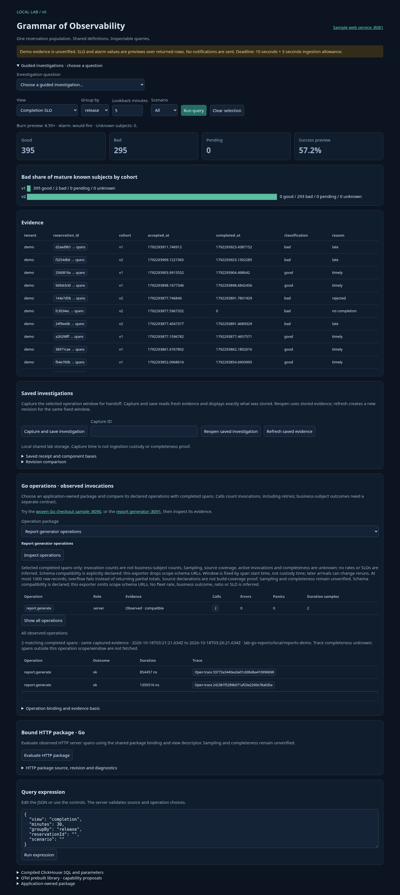

# Declarative operation packages

Operation/subject bindings and enabled investigation views now live in validated
YAML. The CLI and running Go service use the same loader and planner; the browser
selects a named package and renders the shared operation components. No operation
name or application-specific view branch was added for the report application.

Implemented package files:

- `config/operations/checkout.yaml`: existing checkout app; overview, heatmap,
  trace waterfall and reservation-subject navigation.
- `config/operations/reports.yaml`: separate woven report-generator app; overview,
  trace waterfall and report-subject navigation. It deliberately omits the heatmap.

## Author and inspect

```yaml
apiVersion: goo/operation-package/v1alpha1
name: reports
title: Report generator operations
sourceDirectory: ../../examples/report-app
adapter: clickhouse.otel-traces/v1
resource:
  service: lab-go-reports
  environment: local
  instance: reports-demo
instrumentation:
  name: github.com/casselc/goo/instrumentation
  version: 0.1.0
  schemaURL: goo://instrumentation/v1
operations:
  - {name: report.generate, role: server}
subjects:
  namespace: report
  events: [report.ready]
  identity: [environment, service, namespace, tenant, id]
views: [operation-overview, trace-waterfall, subject-events]
evidence:
  sampling: unverified
  completeness: unverified
  schema: declared
```

Run from the root:

```sh
go run ./cmd/goo plan-operations -package config/operations/reports.yaml
scripts/build_report_app.sh "$PWD/artifacts/report-app"
```

`sourceDirectory` resolves relative to the YAML file. These are trusted local
configuration files that require the selected Go source package to be present;
this is not a remote package downloader or a source-free registry format.
Unknown fields, duplicate keys, aliases/merges and multiple YAML documents reject.
The input is bounded at 1 MiB. Package names are stable bounded identifiers.

The planner scans the selected source contract. Instrumentation name/version/
schema must agree; operations and roles must cover its unique operation set
exactly. If subjects are enabled, their event names must cover the declared event
set, and identity must retain all five scope components in the shown order.
Subjects can be omitted to leave subject relations disabled. Unknown/duplicate
views reject; subject-event navigation requires a subject binding and trace view.
The initial view vocabulary is fixed, with `operation-overview` required.

Evidence fields explicitly retain current limits. Claims of verified completeness
or sampling reject rather than override observation semantics. The schema remains
a declaration because the exporter drops scope schema URLs. Static diagnostics
travel with the plan; runtime rows still report unobserved operations and event
identity gaps. Source declarations do not prove running-build coverage.

A normalized plan contains the package, source manifest, physical resource binding,
diagnostics and a content revision. Operation/event declaration ordering does not
change that revision; source content, resource, instrumentation, identity and view
changes do. Views retain authored order in the artifact, although the current UI
uses its fixed panel order. The plan revision contributes to the captured evidence
basis. Mutating a bound plan is rejected before source execution.

## Serve and explore

Default Compose now loads both files through repeatable flags:

```sh
goo serve-http ... \
  -operation-package config/operations/checkout.yaml \
  -operation-package config/operations/reports.yaml
```

The remaining HTTP package flags are unchanged. With no operation-package flags,
the service defaults to config/operations/checkout.yaml. The old operations-dir
flag is replaced by each YAML file's sourceDirectory. Invalid packages or duplicate
names fail startup; files are loaded once, so restart after editing.

`GET /operation-packages` lists configured plans. `GET /operations?package=reports`
selects one; omitting package uses the first configured plan. Unknown names reject
with HTTP 400. The existing query service exposes same-origin counterparts under
`/api/`. Credentials remain process configuration and do not live in package YAML.
Source limits, typed SQL values, exact-ns evidence and unknown-completeness
semantics are shared with [the existing operation adapter](LIVE_OPERATIONS.md).

Changing the browser's package clears captured rows, heatmaps, subjects and basis
explanation. A generation guard discards late responses from an earlier selection.
The chosen package's views control available heatmap, trace and subject components;
it cannot add arbitrary HTML, scripts or source queries. The current table columns
and renderer kinds are fixed rather than a general visualization language.

## Executable onboarding storyboards

Journey 11 runs the separate report Go app on loopback port 8091. A user generates
a real report, selects **Report generator operations** in the investigation UI,
inspects `report.generate`, follows its report subject and checks its YAML-backed
plan revision. The heatmap is absent as declared. Traffic travels through the
actual OTLP collector and ClickHouse; no telemetry is mocked.





Journey 12 delays delivery of an actual upstream checkout response, switches to
reports, and verifies the late checkout result cannot repopulate the view. It then
captures report evidence. Only delivery timing is altered; response data stays real.




Run `npm run test:journeys`. The report app is a separate module and actual woven
binary with its own source manifest, operation name, resource and subject namespace.
It uses the same runtime/OTLP libraries and contains no query/UI implementation.
`scripts/build_report_app.sh` validates its annotation contract before weaving.
The dedicated Dockerfile follows the existing optional proxy-CA secret pattern;
this environment uses the established host-built binaries/offline image workflow.

## Boundaries and checks

This is a typed YAML observation-package slice, not a complete IaC resolver,
provider, deployment engine or unified language for all goo resources. It does not
choose CEL/KCL, introduce arbitrary expressions, generate operation metric-view
SQL for Databricks, or implement reset-aware metrics or business lifecycle policy.
The prior portable aggregate compiler remains a separate bounded compiler target.

Root tests exercise strict parsing, stale contracts, full identity, view validation,
CLI planning, source/plan provenance and rejection of mutated plans. Hegel runs
150 generated planner cases for deterministic nonmutating planning, typed resource
binding and revision sensitivity. Existing operation/subject Hegel and Quint
navigation checks remain relevant; no new formal deployment model is claimed.

The useful next step is package-level native metric contracts: temporality,
resets and compatible histogram buckets before declaring rate/distribution views.

A bounded [native counter rate declaration](NATIVE_COUNTERS.md) now enables
`counter-rates` for the checkout package. This adds explicit temporality/max-gap/
outcome semantics, not native histogram, ratio or fleet aggregation operators.

Native metric views: optional `rates`/`counter-rates` and `histograms`/`histogram-heatmap` contracts are now supported. Checkout declares cumulative duration buckets and a maximum gap; reports remains trace-only. See [counter contracts](NATIVE_COUNTERS.md) and [histogram contracts](NATIVE_HISTOGRAMS.md) for exact source constraints, unknown states and separate evidence bases.

`ratios` can reference an exhaustive calls rate and declare error outcomes; `error-ratios` enables the guided ratio view. See [policy and alignment](OPERATION_ERROR_RATIOS.md) and checkout.yaml for supported syntax. Policy contributes to the package revision.

Optional `fleet` references a declared ratio, lists 2–4 expected instances including the selected one, and enables `fleet-coverage`. Membership is fixed across the question window and contributes to revisions. See [source and coverage limits](FLEET_COVERAGE.md).

Fleet `comparison: {mode: bounded-skew, maxSkew: 1s}` enables side-by-side actual-window comparison without relaxing exact fleet totals. Positive tolerance is limited to one second, and policy contributes to revisions. See [comparison semantics](FLEET_COMPARISONS.md).
