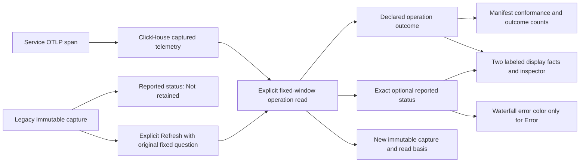
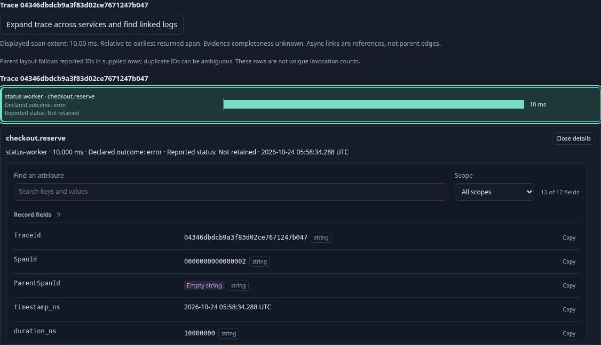
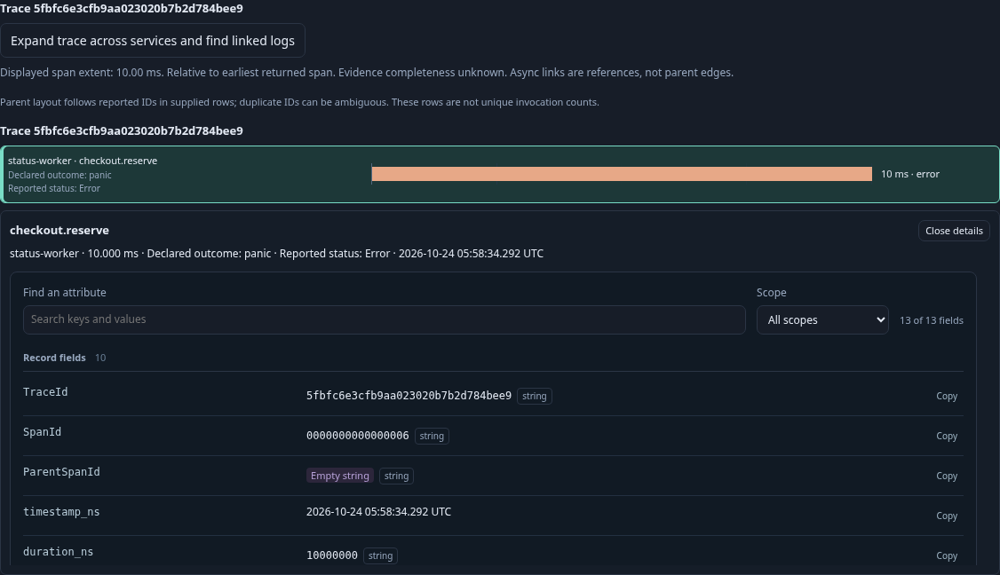
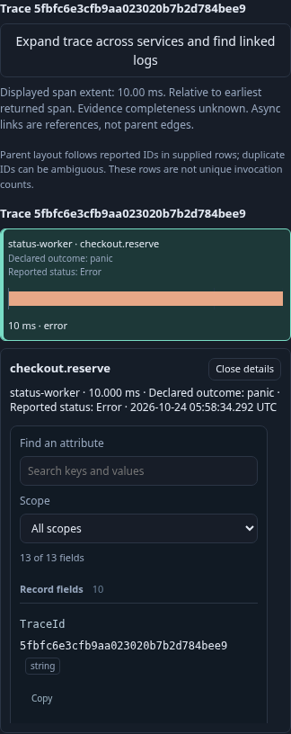

# Declared operation outcome and reported span status

Operation waterfalls and their cached inspectors show two independent facts:
`Declared outcome` is the instrumentation contract's `goo.operation.outcome`;
`Reported status` is the exporter’s exact OTel `StatusCode`. For example, an
operation can declare `error` while the exporter reports `Unset`. Only a reported
`Error` colors the waterfall bar as an error. Neither `Unset` nor missing status
proves that a request or business operation succeeded.

The native operation query now retains `reportedStatus` as an optional string.
Absent means **Not retained**, including captures created before this field
existed. An empty retained string displays **Unknown (empty)**; unfamiliar values
display **Unknown (value)**. Declared outcome continues to drive manifest
conformance and outcome counts. Reported status participates in the source read
basis and conflicting-row checks, independently of outcome accounting.

Existing captures remain immutable. Opening a capture or selecting one of its
traces does not reread telemetry or backfill status. Explicit Refresh repeats the
same fixed question and publishes a child capture; its basis can change as the
new projection retains status. Old JSON omits the optional field and preserves
legacy identities. This is a projection change, not a package revision change.

The reusable waterfall accepts optional per-row `{label,value}` facts, aligned
with original input indexes even after parent-first sorting. These are supplied
display data, kept outside source records. The element has no operation policy,
fetching or subscriptions; the operation adapter supplies both facts.

Executable storyboard: `journeys/operation-status.spec.js` ingests six real OTLP
spans covering contradictory declared/reported values, creates evidence with the
previous native binary, upgrades an isolated owner, inspects the old capture,
refreshes once, and inspects all six traces without further reads. A separate
ClickHouse query establishes the oracle. Quint validates the observed read trace
and rejects five mutations; Hegel checks the actual JavaScript projection.
Bombadil explores six supplied trace selections and inspectors on mobile.

This does not infer HTTP success, add outcome policy to raw span queries, migrate
historical captures, or change metric semantics.

The compatibility journey is opt-in: set `GOO_STATUS_OLD_BINARY` to a previous executable without `reportedStatus`, and `GOO_STATUS_NEW_BINARY` to the current executable. Both must be local runnable native binaries; the test copies them into its disposable owner. Without both paths it reports a skip rather than creating a fabricated legacy receipt. Component, JavaScript, Hegel and native semantic checks run independently.
