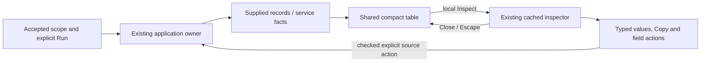

# Operator workbench polish

The UI now uses a shared workbench hierarchy: scope and primary actions, results,
then contextual detail. This pass covers Activity, fixed records, service
discovery/dashboard widgets and Saved evidence. It does not add a query engine,
new acquisition path or a second inspection owner.

## Design decisions

- Sections describe document structure; an explicit card or display frame owns
  a surface. Page-wide section rules no longer turn every nested detail into a
  padded card, including at mobile breakpoints.
- A narrower navigation rail, consistent outline icons, compact tabs and shared
  controls leave more space for data. Routine page descriptions and repeated
  coverage disclaimers no longer compete with the result. Scope, uncertainty,
  units and read facts remain available in their appropriate result context.
- Record tables use inline actions and compact previews, retaining the original
  full message, UTC timestamp and exact timestamp tooltip. Hover is not required
  to discover inspection or selection.
- At 1440px and wider, selected record details dock beside the results. Smaller
  layouts retain inline details. The original row, inspector cache, source
  identity and owner remain in place; CSS changes the presentation. Opening
  record inspection focuses its heading. Close and Escape restore the opener.
- Attribute rows keep Copy visible. Other operations use a named, keyboard
  accessible ellipsis disclosure. Opening or closing that menu does not read
  telemetry. A closed or unavailable action cannot be invoked through a retained
  callback to bypass its current UI state.
- Accepted service discovery folds its editor and keeps the accepted environment,
  namespace and fixed UTC window visible. Optional absent declarations live in
  the registry disclosure; actual read failures remain visible. Each dashboard
  visual has one title and one compact action/evidence footer.
- Mobile Activity gives the message full row width with actions beneath it, and
  provides a full-width local Find field. Progressive enhancement keeps native
  tables, buttons, details, labels and keyboard behavior.

## Reference patterns

The pass uses these public references for interaction and hierarchy, without
copying vendor branding or implying feature parity:

- [Datadog Log Explorer documentation](https://github.com/DataDog/documentation/blob/master/hugo/content/en/logs/explorer/_index.md)
  and its public screenshot: scope/query controls, dense records and contextual
  investigation tools.
- [HyperDX / ClickStack](https://github.com/ClickHouse/ClickStack), especially its
  public search screenshot: records remain visible beside trace/attribute detail.
- [Grafana](https://github.com/grafana/grafana): reusable panels, scope-preserving
  exploration and restrained visual framing.
- Honeycomb's query/refinement workflow informed the design review. Its public
  documentation could not be fetched under this session's network policy, so
  this is not a fresh screenshot or authenticated-product audit of Honeycomb.

The pass also fixes a discovered interaction bug: **Break down and run** from a
collapsed fixed editor now executes the selected grouping instead of rerunning
the ungrouped question. The original environment, time bounds and other intent
remain unchanged, checked against the actual request/result in the storyboard.

## Ownership and verification

The [executable storyboard](journeys/operator-polish.md) compares the same fixed
OTel bank before and after, checks exact records and scope, and records actual
desktop/mobile frames. Activity uses fresh observations in each pass because its
server-clock window is live. See [validation](../VALIDATION.md) for the checks
actually run and their limits. The original query, custody and held-return
contracts continue to apply.
