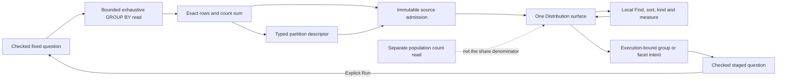

# One ordinary breakdown surface — 267

Ordinary single-field breakdowns now use one shared surface in Distribution.
Records focuses on the captured record page instead of repeating the same group
chart. The surface uses admitted snapshots and execution-bound actions, with local
kind, measure, scale, Find and sort controls. Selecting a group or facet stages a
checked question; Run performs the read.

## A share needs a partition

A count bar relative to its largest neighbor is not a population share. Ranked
source data can carry this optional descriptor:

```json
{"partition":{"kind":"disjoint-record-groups","measure":"count","total":"4"}}
```

`disjoint-record-groups` means the denominator is the exact sum of counts from the
same exhaustive GROUP BY read, including missing and present-empty groups. It
inherits the snapshot's dimensions, scope and revision. Go never takes this total
from the independently read population count or the displayed record page.
The descriptor is emitted only for an exhaustive coherent grouped result; overflow
omits it rather than wrapping the denominator. An empty partition can have total
zero, but its share is unavailable, not zero percent.



Structural validation checks the measure's captured-record unit, canonical counts
and exact total. Complete grouped data must sum exactly to the partition total;
partial/unknown or held data can retain an advisory original total only when it is
at least the visible sum. The descriptor alone grants no authority. Full-population
shares additionally require the private runtime groups witness and a positive
denominator. Importing or projecting rows cannot recover that witness.

## Local presentation preserves the population

The chart accepts these closed display options over its original frozen handle:

```js
chart.display = {
  kind: 'bar', category: 'category', value: 'count',
  scale: 'population', query: 'worker', order: 'value-desc',
};
```

`scale` is `population` or `max`. Population scale is count-only; captured numeric
and duration values retain their units and use the full supplied scale. The UI
names these choices explicitly. Missing proof never silently turns a selected
population share into a max-relative bar. An unavailable measure remains
unavailable; negative measures keep the exact table fallback where bars are not
supported.

`query` performs literal case-insensitive Find over supplied group labels, and
`order` is `source`, `label`, `value-desc` or `value-asc`. Neither changes the
snapshot, scope, source bindings, full partition total or full scale. Exact integer
and rational ordering avoids tying adjacent large counts through floating-point
rounding; unavailable values sort last and ties are stable. Percent labels retain
an exact count/total explanation; tiny positive shares do not become a false zero.

Finding one of four captured records still shows its share of those four. It does
not become a 100% population just because other groups are hidden. A scope filter
is a separate action that stages a new question; it is never the local Find input.

## Supported and remaining paths

This cut adopts the ordinary canonical single-field fixed/Saved breakdown path.
Saved results retain read-only source/custody semantics; baseline capture retains
the original question. [268](STATUS_FRACTIONS.md) adds ordinary status counts and
recorded-error fractions. Existing special pattern, histogram,
multidimensional/error-triage and population-workspace presenters remain explicit
where their typed semantics have not migrated. They are not quietly replaced by
count-only charts. Trace IDs still identify matching captured spans; opening a
trace does not infer a complete trace or root/end-to-end latency.

No new query, automatic read, Plotly adapter or authored-view editor is introduced.
The next family migrations must preserve their own numerators, denominators,
temporality, support and uncertainty in the same model.

## Inspection is not refinement

`context.inspect` validates the current binding and selected aggregate datum but
does not append a filter to the parent question. The selected-trace action still
validates the trace-ID dimension and identifier, then uses the existing inspector
for spans and linked logs in the captured window. A parent already at the legal
condition limit can therefore open trace context even though staging an additional
filter is refused. Neither a grouped datum nor an inspection result authorizes
keeping records or claims that a whole trace was captured.

The [executable trace journey](../journeys/267-trace-inspection.spec.js) checks that
boundary against real telemetry and independently verifies the two-service trace
and both scoped inspector reads.
