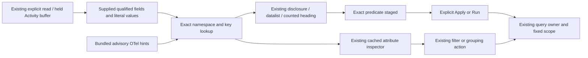
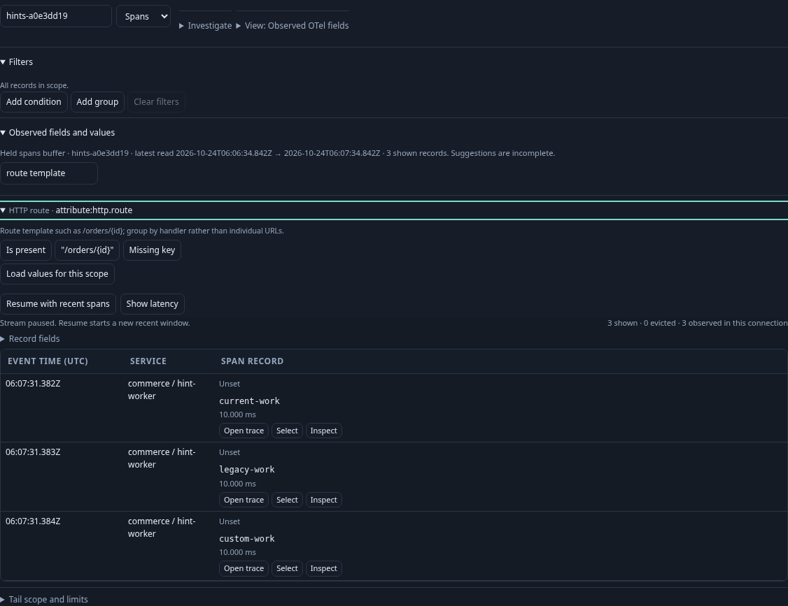
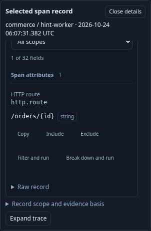

# Discover fields by meaning

Activity, single-question filters and fixed population editors now enrich their
existing **Observed fields and values** disclosure with compact field names and
context. Search accepts exact keys, names such as **HTTP request method**, and
terms such as **route template**, **Database**, **RPC** or **Messaging**.
Only the supplied field list is searched; recognizing a convention never adds an
unobserved key or queries for it. Sample limits and missing/empty distinctions
remain those of [observed discovery](FILTER_EDITOR.md#observed-fields-and-values).

Each recognized row keeps its qualified key visible, for example
**HTTP route · attribute:http.route**. Open the row for its short description and
the existing value/presence actions. Selecting a value stages the exact predicate;
Apply or Run still performs the read. Counted-value headings and typed-field
suggestions use the same names while preserving exact option values.

Record inspectors use the same catalog. Labels sit above exact keys; descriptions
are available on the key tooltip and accessible group description. Search still
accepts original exporter names such as `TraceId` and `StatusCode`, literal keys,
values and semantic terms. Existing Include/Exclude, Filter and run, and Break
down and run actions retain their original ownership and execution behavior.
The breakdown tooltip identifies the conventional name and exact grouped field.

| Family | Representative recognized fields |
| --- | --- |
| Service | resource `service.name`, `service.namespace`, `service.instance.id`, `service.version`, `deployment.environment.name` |
| HTTP | attribute `http.route`, `http.request.method`, `http.response.status_code` |
| RPC | attribute `rpc.system.name`, `rpc.method`, `rpc.response.status_code` |
| Database | attribute `db.system.name`, `db.namespace`, `db.operation.name`, `db.collection.name` |
| Messaging | attribute `messaging.system`, `messaging.destination.name`, `messaging.operation.type` |
| Error/status | attribute `error.type`; logical column `status` describes exporter-reported span status |

Earlier spellings remain separate fields labeled **(legacy)**:
`http.method`, `http.status_code`, `rpc.system`, `rpc.service`, `db.system`,
`db.name`, `db.operation`, `messaging.destination`, and resource
`deployment.environment`. Selecting `attribute:http.method = GET` never becomes
`attribute:http.request.method = GET`. `rpc.service` is not resource
`service.name`. Namespace mismatches and custom lookalike keys receive no hint.

The catalog is a curated advisory display subset, checked against the project's
cached OTel Go v1.46.0 registries: [semconv v1.43.0](https://github.com/open-telemetry/opentelemetry-go/tree/v1.46.0/semconv/v1.43.0)
and earlier v1.17.0/v1.26.0 registries for older spellings. A recognized key does
not validate values, establish schema compliance or stability, or prove that a
record follows that schema version. In particular, RPC method naming depends on
the instrumentation version. HTTP/RPC response codes, reported span status and
declared operation outcome remain separate. Numeric-looking attributes keep the
existing string grammar; no numeric coercion or new operators are added.

`GooFieldPresentation.hint(field)` returns detached `{label,group,description,legacy}`
metadata or null. `searchText(field)` combines that metadata with the exact
qualified key. Existing selector text, wire fixtures, predicate validation,
source bindings, saved formats and IDs are unchanged. Native instrument capability plans remain Go-owned. The catalog performs no
fetching, schema translation, rewriting, grouping or publication. Attribute and
filter adapters fall back to their ordinary exact-key display when the optional
presentation module is absent.

## Executable storyboard 165

1. Start a paused saved Activity view over an unfamiliar span population, then
   pause its stream. Search **route template**, open **HTTP route**, and inspect
   its observed values. Search **HTTP request method** to see both spellings.
2. Select the legacy `http.method` value. It stages that exact key without reading.
3. Run the original fixed question explicitly. Inspect a span with HTTP `503`
   and reported span status `Unset`. Search by meaning, then use its existing
   route breakdown action. The fixed bounds and exact route key are retained.
4. Select and run the legacy method predicate. An independent ClickHouse query
   proves that only the legacy record matches.
5. Reopen a fixed population view, explicitly run it, and discover both database
   system spellings. Stage a child using the older key without a new read.

`journeys/otel-field-hints.spec.js` executes this against three real OTLP spans
(current, legacy and custom keys), plus a separately labeled synthetic detached
adapter contract for focus, disclosure retention, cloning and action identity.
Hegel generates namespace/key/value combinations against actual JS projection;
existing Quint staging replay rejects hidden reads and changed predicates,
windows or environments. Bombadil performs one explicit read and semantic search,
then stages an exact legacy field on mobile without another source query.

Full registry coverage, automatic schema migration, alias union, value validation,
population ranking and automatic query suggestions remain outside this cut.

Observed fields now also offer [Group by this field](OBSERVED_GROUPING.md). Meaning-based discovery keeps the exact key; app owners stage a fixed draft/child and require Run for full-population counts.

[Plot values](CONTEXTUAL_NUMERIC_PLOTS.md) is also available on qualified
attribute/resource keys in the inspector and observed-field browser. It collects
an explicit numeric declaration and stages the originating scope. The hint
catalog supplies advisory descriptions; it never infers type/unit/scale or
changes aliases. Empty/invalid source values remain eligible field entry points.
