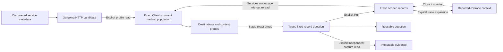

# Outgoing HTTP observations

Implemented in milestone 385. See [validation](../VALIDATION.md) and the
[executable storyboard](journeys/385-outgoing-http.md).

Open a discovered service and choose **Outgoing HTTP**. As with the other service
profile buttons, this is an explicit read of the same fixed service scope. It
selects reported `Client` spans with a nonempty current `http.request.method`.
The service, exact namespace, environment policy and fixed window remain in every
question. Ordinary OTel data is sufficient; no Goo manifest is needed.

The profile counts Client-span records. It does not count unique requests or
physical attempts, identify a callee service from a hostname, or establish remote
health. The [pinned OTel convention](HTTP_CLIENT_CONVENTION_385.md) permits different
retry span representations. Recorded span Error remains separate from reported
HTTP response status and does not authorize a new failure policy.

## Explore the observations

Population activity/duration and **Reported destinations** are primary. A compact
**Method, port and response context** disclosure groups three additional views.
Its summary exposes pending, unavailable and changed-read states even while
closed. Opening it does not start telemetry reads.

| View | Full population grouping |
| --- | --- |
| Client-span activity/duration | Reported span name; not a replacement for method |
| Reported destinations | Qualified `server.address` |
| Methods | Current `http.request.method`, preserving literal case and `_OTHER` |
| Ports | Literal reported `server.port` |
| Response status | Literal reported `http.response.status_code` |

Each widget is an independent bounded source read of the same checked population.
Counts and duration/status aggregates retain full scope; a displayed record page
or group list does not define the population total. Read clocks/bases remain
independent. An absent/empty destination or port remains visible rather than
removing the span from the population. No default port or alias is inferred.

A field name in discovery is a metadata candidate, not proof of a matching Client
record. The actual questions carry the kind/method predicate. Selecting an empty
or failing profile keeps that choice and its no-data/refusal state; it does not
silently fall back to incoming HTTP or all spans. Existing automatic profile
priorities remain unchanged; outgoing HTTP is an explicit choice.

## Follow and preserve

A destination/method/context group stages an ordinary typed question with its
exact qualified value, missing or empty predicate. **Run** reads explicitly.
Save the question or capture its fixed scope using the existing investigation and
immutable evidence workflow. Capture is an independent server read, not an archive
of the earlier browser response.

Expanding a reported trace uses the established trace-context flow. Whole-trace
questions retain the environment/window and reported trace ID while explicitly
omitting narrower service, namespace and other population predicates. The inspector visibly names those omissions. Retained origin context distinguishes
that broader association from an identical population or a complete trace.
Close the trace inspector; choosing **Services & resources** returns to the held
service dashboard without a profile rerun. Ordinary widget/group links use this
workspace return, while Customize/native actions have their own contextual Back
affordance.

Native `http.client.request.duration` remains a separately discovered instrument;
this profile does not adopt a native HTTP-client execution binding. Generic native
availability is not a claim that its population is identical to these span reads.
