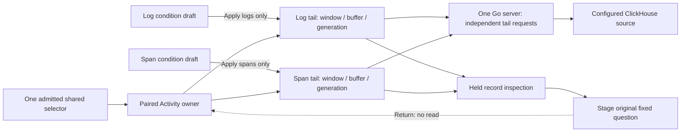

# Logs and spans together

In Activity, choose **Logs + spans**, then **Start streams** or **Apply scope**.
Choosing the option stages locally and pauses the previous monitor. Starting
opens two ordinary tail connections over the same explicit environment and
complete shared filter, plus each lane’s [independent condition](PAIRED_ACTIVITY_FILTERS.md).

Each lane has its own recent window, loaded observations, Find, columns,
Pause/Resume, source refusal and Retry. A span failure does not erase or restart
the log lane. An empty lane remains coverage-unknown. The two windows are
independent; there is no merged chronology, combined population count or shared
health verdict.

## Inspect and investigate

Inspect pauses that record's lane and opens the shared detail panel using held
data. Its sibling may continue streaming. **Analyze observation window** pauses
both lanes and stages a fixed question with the selected record's original
family, environment, full parent filter and read window. **Run** is still explicit.
**Return to paused activity** restores held rows, Find, scroll and focus without
reconnecting. Resume or Retry is a new explicit recent-window acquisition.

Opening a saved single-signal view also pauses both streams. If the current
Activity differs, the discard/keep decision remains visible above the lanes.
Adopting the saved view stages its configuration; it does not start telemetry.

## Scope and limits

Shared predicates must be valid for both logs and spans. Resource/record
attributes and common fixed fields work through the existing grammar. A log Body
or span-only condition in the shared toolbar is refused as a whole; Goo keeps the filter for correction
and disables Apply. No branch is silently removed.

Named, empty and unreported environments retain their existing typed selection
policy. Choose an observed empty/unreported scope through single-signal **Find
data** before pairing. That discovery control is unavailable in paired mode.
**All environments** remains logs-only. Blank input never means All.

Use **Views** to save the applied shared scope, lane conditions and columns as a
[reusable Activity view](ACTIVITY_VIEWS.md). Reopening stages empty paused lanes;
Start streams explicitly acquires new windows. Saved definitions contain no
held observations or per-lane Find state. Existing per-lane
observation selection remains scoped to its own connection. Shared single-family
comparison/explanation tools are not retargeted to an arbitrary lane; use the
record's fixed-question handoff. A pair consumes two of the server's four tail
slots, with the existing capacity/refusal policy intact.

The [shared Activity controls and measured storyboard](ACTIVITY_COHERENCE.md)
cover responsive layout, UTC inspection, admission and capacity isolation.

## Ownership

The pure paired planner validates both families before either read. The
coordinator composes two existing Tail owners and the shared inspector; it does
not merge transports or duplicate the singleton Activity controller. Tail-local
callbacks keep state/Find events scoped to their owner. Diagnostic global events
carry owner and family tags. User callbacks reject inactive, hidden, inert,
disabled or retired controls, while parent pause/reset still work during
navigation. Late canceled delivery cannot replace held rows.

See the [executable storyboard](journeys/paired-activity.md),
[independent acceptance](reviews/PAIRED_ACTIVITY_444_ACCEPTANCE.md) and
[validation](../VALIDATION.md).
