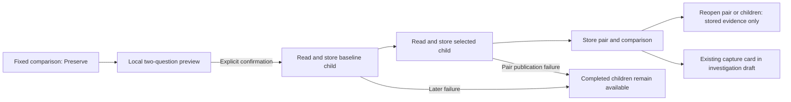

# Capture both sides of a fixed comparison

In an ordinary one-group fixed Count comparison, **Preserve → Capture comparison**
opens the existing evidence confirmation form. It keeps the baseline and selected
questions in order. **Capture selected query** remains a separate, single-question
choice; saving a view definition stores configuration rather than observations.
This entry requires one configured log/span question, one shared categorical
grouping and matching environment policy. Other measure profiles retain their
existing capture paths.

## Preview, then capture

Opening the form is local. Review both fixed questions, their environment,
predicates, grouping and UTC bounds before confirming. The existing capture
destination can keep the pair alone or add its reference to an investigation.
Adding to a draft still requires saving that draft's revision.

Confirmation rereads both complete questions on the server. It does not archive
the earlier browser comparison. A late arrival can change the new result while
the held comparison retains its earlier read clocks and evidence. Counts describe
captured telemetry, not unique requests or complete upstream populations.

The existing general capture store publishes the baseline child, the selected
child and then the comparison. Each has its own immutable ID and receipt.
The reads are independent and nontransactional; no shared database snapshot or
ingestion-completeness guarantee is inferred. Inspection row limits do not define
aggregate totals. Empty or inconsistent evidence retains its diagnostic meaning.

## Reopen or recover

Saved pair and child links reopen stored evidence without querying telemetry.
The existing child inspector provides bounded saved paging and explicit live
context actions. Live context is a fresh read, separate from the stored pair.

A failed later read or publication can leave a completed child in Saved captures.
There is no rollback and no automatic retry. The current investigation remains
available; an explicit full-pair retry rereads both questions. Leaving or cancelling
retires UI adoption, but cannot undo a server publication that already completed.

Unsupported comparison profiles refuse before sending a capture request. This
entry uses the existing general `SavedComparison` capture family. It does not
create the separate `EvidenceComparison` saved-receipt family or loosen that
family's selector-compatibility rules. Checked CEL source remains definition
metadata; the capture retains the executed typed questions and source receipts.

See [general captures](GENERAL_CAPTURES.md), [preservation](PRESERVATION.md),
[storyboard](journeys/paired-capture.md), [review](reviews/PAIRED_CAPTURE_428.md)
and [executed validation](../VALIDATION.md).
