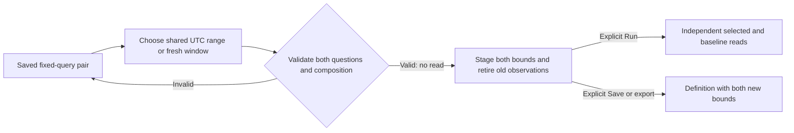

# One window for both comparison questions — 309

> Delivered in 309. See [validation](../VALIDATION.md) and the
> [executable storyboard](journeys/309-paired-window.md).

The original saved fixed-query profile compares two populations within the same
time window. 321 also admits a [preceding equal-duration window](PREVIOUS_WINDOW_COMPARISON.md). Moving that window must change both questions together. It must not change
either population's predicates or replace a held observation with a new question.

## Stage a shared UTC range

In **Applied population** (or **Configured population** before Run), open
**Comparison window** to edit the UTC start and
exclusive end, then choose **Stage window**. **Use fresh comparison window** uses
one current clock value and preserves the window duration.
Both actions update the selected root and its `baselineQuery` together. Same-window
pairs remain aligned; preceding-window pairs recompute an adjacent baseline of
the new selected duration. Both preserve
environment policy, distinct predicates, signal, grouping, measures, delivery limits
and presentation. Page offsets remain zero. Captured baselines and temporary
held-parent comparisons do not acquire this query transformation.

The complete proposed definition is validated before changing the draft. Invalid,
reversed or overlong ranges are refused; a timeline that would exceed its existing
240-interval budget is refused without silently changing its bucket width. A bad
range leaves the current definition and observations intact.

Unapplied window edits block Run and Save until staged or discarded. **Discard
window draft** restores the current definition and keeps its held observations
without reading. Retired forms cannot change a replacement view.

A successful stage retires the previous selected result, baseline and comparison,
then focuses **Run population view**. Staging reads no telemetry and does not Save.
Run independently reads both configured questions through the existing acquisition
owner. Their read clocks remain distinct; a common event-time window does not mean
an atomic source snapshot or complete upstream telemetry.

Timeline selection and **Reset starting window** use the same paired transition.
The broader **Restore starting population** action stays disabled for fixed pairs:
the original root alone cannot reconstruct the original baseline question. Grouping
and measure-profile changes remain outside this window operation.

Save/export after staging persist the changed questions only. Opening that view
stages the same definition for explicit Run. Existing stored revisions and held
parent observations are unchanged.

See [saved query comparisons](SAVED_COHORT_QUERIES.md),
[architecture review](reviews/PAIRED_WINDOW_ARCHITECTURE_309.md) and
[design review](reviews/PAIRED_WINDOW_DESIGN_309.md).
