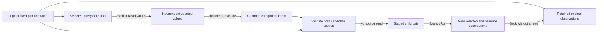

# Facets over fixed-window comparisons

338 extends this initial 337 contract with [both-window category values](CATEGORY_PAIRS.md).
The selected-only acquisition described below records the original cut; common
filtering, scope preservation and staging/Run boundaries continue to apply.

Keep a categorical facet while comparing two fresh fixed queries. The facet's
**Selected window values** come from an explicit independent read of the applied
selected query, including its existing filters. They are not loaded-row totals,
self-excluding values, baseline values or a promise of complete telemetry.

Choose Include/Exclude values, then **Filter both windows**. This stages a child
pair and reads nothing. While choices are pending, parent Run is disabled; clear
the choices or use Filter both windows before running. A retained old Run handler
also refuses without clearing those choices or reading data. The same categorical intent is conjoined with each
operand's whole original predicate tree; each exact window, checked environment
policy, grouping and existing selector remains its own. Included values use OR;
fields and exclusions use AND. Excluding a present value retains missing keys;
missing and present-empty strings are distinct choices.

Both candidates must validate before either is staged. Invalid values, another
field or signal, an unsupported operand or either predicate budget refusing the
intent leaves both original definitions unchanged. Old value gestures retire on
replacement; pending choices and observations are never serialized as definitions.

Run uses the existing pair reader. New observations do not rewrite the retained
parent's supplied facts. A group count still stages only that operand's supporting
records; it does not inherit another comparison. Back restores the parent pair,
facet values/Find and control focus without a source read. Save, YAML export and
reopen preserve the facet and both checked questions; opening stages configuration.

The five existing unique roles—aggregate, records, timeline, comparison and
facet—can coexist within the bounded composition. Existing timeline width and
query requirements still apply. A facet is a control and cannot be the only
visible data child. No recursive layout, new facet kind or query engine is added.

This cut supports ordinary logs/spans and fresh fixed-query count pairs only.
Captured baselines and temporary selected/rest/overlapping-parent comparisons keep
their own custody and set contracts. Baseline-only categories and per-category
comparisons over both windows are the next depth task, not implied by this list.

See [roadmap](ROADMAP_2026_11_05.md),
[architecture review](reviews/PAIRED_FACET_ARCHITECTURE_337.md),
[design review](reviews/PAIRED_FACET_DESIGN_337.md) and
[validation](../VALIDATION.md). Implementation, generated semantic checks, observed model replay and both-signal
native/actor acceptance pass. See the validation record for limits and counts.
