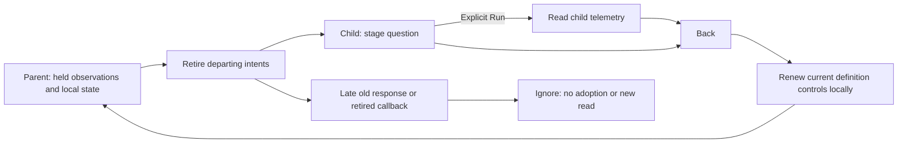

# Returning to a retained population

Drilldown opens a separate child question. Back returns to the held parent: its
original questions, observations, source receipts and permitted local edits.
Returning or editing a local definition does not read telemetry again. Run stays
explicit.

Definition controls and observation-bound actions have different lifetimes. On
departure, the parent retires its old action bindings and unfinished comparison,
page and metadata work. On return, one local renewal path gives current controls
fresh handlers without replaying those requests. Calling an old retired handler
cannot regain authority merely because the parent is visible again.

The renewal preserves raw local text, selections, caret positions and exact
disclosure state when remounting existing definition editors. New handlers and
disabled state belong to the current owner; they are not copied from the old
controls. Existing navigation guards still apply: an unapplied facet or window
definition must be discarded or applied before its blocked continuation can run.
The live return contract covers reachable local state such as unsaved view
titles, Find text, metadata search and disclosures.

An ordinary uncustomized distribution retains its existing adapter and frozen
comparison. Only its local group actions are rebound from held data. Baseline
values, read clocks, comparison data and the Compare surface are not reconstructed
from a saved query or reread. This action rebinding is bounded to ordinary
single-field profiles; it does not generalize specialized pattern, histogram or
grouped-time owners. Adapter-level controls that continue to own the held
definition are distinct from retired snapshot-bound child actions.

Generated schedules exercise the production handler/state helpers, including
hidden, detached, replaced-question and repeated-return cases. They do not
substitute for a mounted application: the executable live storyboard checks
actual controls, request counts, questions, receipts and focus. See the
[architecture review](reviews/PARENT_RETURN_ARCHITECTURE_342.md),
[interaction contract](reviews/PARENT_RETURN_DESIGN_342.md), and
[validation record](../VALIDATION.md).
