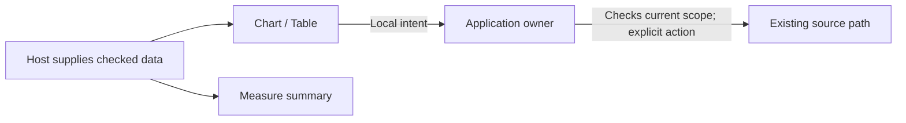

# Embed supplied displays

Import `display.mjs` to register the shared display elements, including
`goo-chart`, `goo-scope-facet`, `goo-measure-summary` and `goo-measure-comparison`.
The public entry now includes the existing `ScopeView` and `MeasureSummary`
modules alongside other display features. Direct feature imports remain available
for a smaller dependency graph:

```js
import './scope-view.mjs';
import './measure-summary.mjs';

const table = document.createElement('goo-chart');
table.snapshot = suppliedSummary;
table.display = {kind: 'table', title: 'Population'};
host.append(table);
```

The same supplied summary can feed `goo-measure-summary`. A ranked dataset can
switch between supported Bars/Table kinds without changing its data. A summary
and ranked dataset are different shapes; the component does not compute one from
the other. Check each kind's data contract before choosing it.

The [standalone reference](../ui/display-examples.html), served at
`/display-examples`, demonstrates JSON HTML attributes with readable fallback,
properties before registration, detached property assignment, and local kind
changes. Its fixtures are explicitly synthetic and retain unknown coverage and
sampling. They are not observed telemetry or a completeness witness. The reference
bootstrap belongs to that page, not to the public display import graph.

Elements consume supplied data and emit typed local intents. Import, upgrade,
reattach and display changes do not fetch, subscribe, save, navigate or modify
application scope. Hosts retain acquisition and current-read authority; a supplied
intent alone is not permission to run a query. Attributes contain JSON data,
never executable expressions. Caller values remain separate from frozen inputs.



Load feature styles separately (`components.css`, `chart-frame.css`,
`scope-view.css`, `measure-summary.css` for this reference). Page layout stays
outside reusable component styles. No framework, bundler, registry or executable
kind is required. See [component contracts](UI_COMPONENTS.md), the
[executable storyboard](../journeys/408-display-embedding-storyboard.md) and
[validation](../VALIDATION.md).
