# Pod state semantics and native execution

`metrics.EvaluatePodPhases` is a storage-independent decoder for the pinned
Collector Contrib v0.137.0 `k8sclusterreceiver` unitless `k8s.pod.phase` gauge.
The native measurement kind `state` binds this decoder through
`stateProfile: k8scluster-pod-phase/0.137.0`. Existing measurement execution,
YAML publication and individual capture/reopen paths support it; no endpoint is
added. Exact-resource discovery and planning now recognize the pinned phase profile.
A compact categorical component is shared by pod panels, native inspection and
individual saved captures. Ordinary OTLP/browser acceptance for this UI slice is
recorded separately below.

The decoder requires the exact receiver scope, version, empty instrumentation
schema and empty unit, plus a matching reported pod UID. Full resource maps,
resource schemas and point attributes remain independent streams. The caller
must select a known-schema resource variant: the existing Stream type cannot
distinguish unknown resource schema from known empty by itself.

Codes 1–5 mean Pending, Running, Succeeded, Failed and Unknown respectively.
Numeric ordering does not imply severity, health or progress. Container readiness
is not pod phase and is rejected by this profile.

Observation `state` retains observed/stale/unknown independently of `codeState`:
supported codes have a label; unsupported finite codes retain the raw code and
`codeState: unsupported`, without a label. This also preserves staleness for an
unsupported code. A fresh code 5 is observed with label Unknown, not missing data.
Conflicts and no-recorded-value samples have neither code nor label. Empty input
produces no series, not a manufactured Pending or healthy state. No latest-value
fallback, aggregation, arithmetic or health conversion is performed.

The kernel reuses gauge timestamp grouping, window, freshness and conflict rules
through a private unitless path. Existing service, host and pod scalar gauge
entry points retain their nonempty-unit requirement. Results own their resource
maps; input points remain unchanged.

```mermaid
flowchart LR
  Q[State definition and exact stream] --> S[Compile parameterized gauge query]
  S --> A[Exact pinned receiver gauge points]
  A --> B[Validate profile and pod UID]
  B --> C[Group full streams and observation times]
  C --> D[Preserve conflict, missing and stale quality]
  D --> E[Decode code independently into phase label]
  E --> F[Native result with raw rows and StateResult]
  F --> G[Individual immutable capture]
  G --> H[Source-free replay validation]
```

## Native binding

A definition must declare `kind: state`, the exact `stateProfile` above,
`grain: per-stream`, and `source.resource: {kind: kubernetes-pod, id: <reported UID>}`.
It must include the full `source.exactStream`, empty services, no namespace
selector, and the matching scope/version/metric/empty unit. All ordinary package
name/environment/window/freshness and identity bounds still apply. Stock-domain
and histogram-bucket policies are refused. Other measurement kinds cannot carry
`stateProfile` and continue to require nonempty scalar units.

The compiler selects `otel_metrics_gauge` with half-open exact bounds, full sorted
raw resource/attribute map equality, resource schema, receiver identity and unit.
It never fabricates service identity or widens to a service selector. Existing
10,000-row and 8 MiB source refusal limits apply. State source rows must explicitly
retain known string resource schema, scope, version, instrumentation schema, name
and unit: null/missing is not known empty. Numeric parsing rejects nonfinite codes
and decimals that would round into a supported integral phase. Raw source strings
remain in result rows. This is not proof of source authenticity.

The result uses `states`, never scalar `gauges`. Overall result `state` is
`unknown` when the latest sample is stale/missing/conflicting or has an unsupported
code; the sample retains the separate quality and domain information above.
No rows means `no_data`. Stored results are re-evaluated from the same raw rows,
question and read clock. Invented labels or unrelated result sections fail replay.
Individual captures reopen without a telemetry read. Generic capture comparisons
return unsupported for categorical states; phase subtraction is not meaningful.
Existing native record-context and live counter paths do not admit state results.

## Discover and inspect

From Services & resources → Kubernetes, select a known-schema resource variant
and choose Observe metrics. Exact-resource metadata keeps the physical instrument
kind gauge while its executable definition uses state and the pinned decoder.
Only the actual receiver scope/version, empty unit and instrumentation schema,
zero temporality and nonmonotonic metadata qualify. Other versions, unit aliases,
container-ready metrics and sum instruments are not phase aliases.

Memory defaults retain priority and the existing at-most-two native-read budget.
A phase-only inventory selects one exact phase stream. When supported memory is
present, phase remains an explicit Preview candidate, followed by Run. Candidate
and source bounds remain unchanged: 16 instrument descriptors, 25 previews per
instrument and 16 retained candidates; omissions are disclosed. Many memory
candidates can exclude phase from the retained choices, so metadata omission is
not absence of phase telemetry.

The compact view shows one supplied category, its independent observation quality
and a UTC sample time with exact-nanosecond tooltip. History is closed by default,
with the latest 200 of at most 10,000 supplied samples and an explicit total.
Reported Unknown remains observed; stale values stay marked stale; unsupported
codes retain their raw value without a category label; conflicting/missing latest
samples withhold the value. No numeric phase axis, severity scale or health colors
are used. Exact-stream/profile details remain available in a disclosure.

The framework-neutral `goo-state-observations` component is a generic supplied-data
display with no Kubernetes mapping or IO. The `state-measurement.js` application
adapter checks the pinned receiver/code mapping and exact question/stream proof.
It allows the historical Go omission of an empty binding unit only with an
explicitly empty exact-stream unit, and rejects null or mismatched identities.
Native Inspect stages the same fixed question; Run and capture remain explicit
reads. Back restores held resource context, and closed/changed panels withdraw
pending work without late follow-on reads or rendering.

## Accepted workflow

Source `8d785ee` passes source/property/API and ordinary OTLP/browser acceptance.
The main journey passes in 24.6s; phase and prior memory owners in 14.6s/17.3s;
the separate synthetic component cases in 2.5s/8.8s. Corrected Bombadil passes in
31.0s with 379 snapshots and nine phases. Independent native validation passes in
0.627s, rejecting twelve main and four owner mutations. Initial actor-selector and
observer event-sequence diagnostics remain preserved; neither changed application
source or required repeating the accepted main journey.

The main records 27 logical source operations and 17 pure plans across explicitly
opened default, boundary and refusal resources. Native staging, retained Back and
frozen reopen add no telemetry reads. The individual 6,145-byte capture stays
byte-identical through public/UI reopening. This is generated ordinary OTLP,
not a running receiver, Kubernetes API/RBAC or real ClickHouse outage claim.
See the [actual storyboard and frames](../journeys/203c-pod-phase-storyboard.md)
and [compact evidence receipt](evidence/pod-phase-203c.json) for exact costs,
capture/frame digests and limits. Readiness still requires its own container-grain
contract; no pod-health alias is introduced.

The next [container readiness contract](CONTAINER_READINESS.md) now has a native
identity/decoder/API prerequisite. It uses actual container.id plus reported pod
UID/container-name context, not pod authority. Discovery/UI and live acceptance
remain separate work; it is not a pod-readiness or health alias.
