# Pod state semantics and native execution

`metrics.EvaluatePodPhases` is a storage-independent decoder for the pinned
Collector Contrib v0.137.0 `k8sclusterreceiver` unitless `k8s.pod.phase` gauge.
The native measurement kind `state` binds this decoder through
`stateProfile: k8scluster-pod-phase/0.137.0`. Existing measurement execution,
YAML publication and individual capture/reopen paths support it; no endpoint is
added. Automatic discovery/planning and UI presentation remain pending. Existing
memory UI and screenshots are unchanged.

The decoder requires the exact receiver scope, version, empty instrumentation
schema and empty unit, plus a matching reported pod UID. Full resource maps,
resource schemas and point attributes remain independent streams. The caller
must select a known-schema resource variant: the existing Stream type cannot
distinguish unknown resource schema from known empty by itself.

Codes 1–5 mean Pending, Running, Succeeded, Failed and Unknown respectively.
Numeric ordering does not imply severity, health or progress. Container readiness
is not pod phase and is rejected by this profile.

Observation `state` retains observed/stale/unknown independently of `codeState`:
supported codes have a label; unsupported finite codes retain the raw code and
`codeState: unsupported`, without a label. This also preserves staleness for an
unsupported code. A fresh code 5 is observed with label Unknown, not missing data.
Conflicts and no-recorded-value samples have neither code nor label. Empty input
produces no series, not a manufactured Pending or healthy state. No latest-value
fallback, aggregation, arithmetic or health conversion is performed.

The kernel reuses gauge timestamp grouping, window, freshness and conflict rules
through a private unitless path. Existing service, host and pod scalar gauge
entry points retain their nonempty-unit requirement. Results own their resource
maps; input points remain unchanged.

```mermaid
flowchart LR
  Q[State definition and exact stream] --> S[Compile parameterized gauge query]
  S --> A[Exact pinned receiver gauge points]
  A --> B[Validate profile and pod UID]
  B --> C[Group full streams and observation times]
  C --> D[Preserve conflict, missing and stale quality]
  D --> E[Decode code independently into phase label]
  E --> F[Native result with raw rows and StateResult]
  F --> G[Individual immutable capture]
  G --> H[Source-free replay validation]
```

## Native binding

A definition must declare `kind: state`, the exact `stateProfile` above,
`grain: per-stream`, and `source.resource: {kind: kubernetes-pod, id: <reported UID>}`.
It must include the full `source.exactStream`, empty services, no namespace
selector, and the matching scope/version/metric/empty unit. All ordinary package
name/environment/window/freshness and identity bounds still apply. Stock-domain
and histogram-bucket policies are refused. Other measurement kinds cannot carry
`stateProfile` and continue to require nonempty scalar units.

The compiler selects `otel_metrics_gauge` with half-open exact bounds, full sorted
raw resource/attribute map equality, resource schema, receiver identity and unit.
It never fabricates service identity or widens to a service selector. Existing
10,000-row and 8 MiB source refusal limits apply. State source rows must explicitly
retain known string resource schema, scope, version, instrumentation schema, name
and unit: null/missing is not known empty. Numeric parsing rejects nonfinite codes
and decimals that would round into a supported integral phase. Raw source strings
remain in result rows. This is not proof of source authenticity.

The result uses `states`, never scalar `gauges`. Overall result `state` is
`unknown` when the latest sample is stale/missing/conflicting or has an unsupported
code; the sample retains the separate quality and domain information above.
No rows means `no_data`. Stored results are re-evaluated from the same raw rows,
question and read clock. Invented labels or unrelated result sections fail replay.
Individual captures reopen without a telemetry read. Generic capture comparisons
return unsupported for categorical states; phase subtraction is not meaningful.
Existing native record-context and live counter paths do not admit state results.

Next: metadata discovery/planning and UI presentation, followed by ordinary
OTLP/browser, custody and ownership acceptance before phase dashboards can be
claimed. Readiness requires its own container-grain contract; no unit or pod-level
health alias is introduced here.
