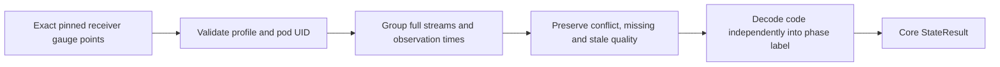

# Pod state semantics — core prerequisite

`metrics.EvaluatePodPhases` is a storage-independent decoder for the pinned
Collector Contrib v0.137.0 `k8sclusterreceiver` unitless `k8s.pod.phase` gauge.
This is implemented Go core behavior, not a discoverable dashboard, API endpoint
or published measurement kind. Existing memory UI and screenshots are unchanged.

The decoder requires the exact receiver scope, version, empty instrumentation
schema and empty unit, plus a matching reported pod UID. Full resource maps,
resource schemas and point attributes remain independent streams. The caller
must select a known-schema resource variant: the existing Stream type cannot
distinguish unknown resource schema from known empty by itself.

Codes 1–5 mean Pending, Running, Succeeded, Failed and Unknown respectively.
Numeric ordering does not imply severity, health or progress. Container readiness
is not pod phase and is rejected by this profile.

Observation `state` retains observed/stale/unknown independently of `codeState`:
supported codes have a label; unsupported finite codes retain the raw code and
`codeState: unsupported`, without a label. This also preserves staleness for an
unsupported code. A fresh code 5 is observed with label Unknown, not missing data.
Conflicts and no-recorded-value samples have neither code nor label. Empty input
produces no series, not a manufactured Pending or healthy state. No latest-value
fallback, aggregation, arithmetic or health conversion is performed.

The kernel reuses gauge timestamp grouping, window, freshness and conflict rules
through a private unitless path. Existing service, host and pod scalar gauge
entry points retain their nonempty-unit requirement. Results own their resource
maps; input points remain unchanged.

Next: bind this contract to native definition validation, exact-source compilation,
metadata discovery and UI presentation. Those changes need ordinary OTLP/browser,
custody and ownership acceptance before phase dashboards can be claimed. Readiness
requires its own container-grain contract; no unit or pod-level health alias is
introduced here.
