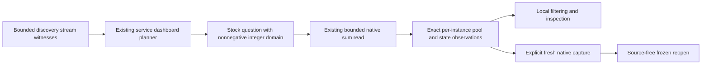

# Named-pool connection observations

This C2c slice builds on [native stocks](CUMULATIVE_STOCKS.md): a compact named-pool
section within existing service dashboards, keeping each instance, pool and
reported state separate. It adds no top-level service profile, source-read owner,
capacity ratio or database-health policy.

## Binding and meaning

The binding follows the pinned [OpenTelemetry v1.37.0 database pool convention](https://github.com/open-telemetry/semantic-conventions/blob/v1.37.0/docs/database/database-metrics.md#metric-dbclientconnectioncount):
`db.client.connection.count`, UpDownCounter, unit `{connection}`,
`db.client.connection.pool.name` and `db.client.connection.state`. The well-known
states are `idle` and `used`; the convention permits custom states, which remain
literal labels. This development convention is an explicit binding, not an
assumption that all exporters or older versions conform.

An automatic candidate requires the exact pinned scope schema, cumulative
nonmonotonic stock shape and a supplied observed stream with a nonempty instance,
pool and state on that same stream. A union of observed keys is insufficient.
Only retained positive stream witnesses qualify; a truncated discovery preview
cannot establish absence, source completeness or validity of numerical values.
Other gauges, schema versions and generic stocks remain available through their
existing paths.

The dashboard derives a detached stock definition with
`stockDomain: nonnegative-integer`. Go validates this stock-only opt-in on every
recorded selected value: integer, nonnegative and below 2^53. Invalid selected
values refuse the measurement; they are not filtered from the source or replaced
with zero. Missing-value flags remain unknown. Generic stocks without this
opt-in retain signed fractional observations, and the omitted field preserves
historical package/result/capture serialization.

## Presentation and custody

Rows keep full resource, resource-schema, instrumentation scope/version/schema,
metric/unit, pool and every other attribute. Only the connection-state attribute
is separated into displayed states; extra dimensions or replacement instances
are never silently merged. Latest samples retain their own observation and epoch
clocks. Unknown or stale latest reports never fall back to an older healthy value.
No sum, utilization percentage, saturation threshold or simultaneous pool
snapshot is inferred from separate state reports.

The section uses a common count scale for comparing reported states, with local
filtering and disclosure over already retained observations. It does not add
telemetry reads for those interactions. Existing native inspection and fresh
capture use the original domain-constrained question. Frozen reopening retains
the original evidence and evaluation clock. Missing capacity or wait instruments
are prerequisites, rather than zero-valued health panels.

[Connection wait time](https://github.com/open-telemetry/semantic-conventions/blob/v1.37.0/docs/database/database-metrics.md#metric-dbclientconnectionwait_time)
is a separate seconds histogram. Capacity and wait-time joins, pool-to-record
scope expansion, automatic runtime/host/Kubernetes panels and numeric stock
comparisons remain follow-ons with their own identity/time/coverage contracts.

The executable service-to-pool/native/capture flow, accepted desktop/mobile frames,
source-effect journal and original diagnostic are recorded in
[journey 196](../journeys/196-pool-connections-storyboard.md).

[Pool capacity and acquisition-wait context](POOL_SIGNALS.md) now stages
independently evaluated exact-stream measurements from a selected named pool.
Default service reads remain bounded; explicit Run and individual capture retain
the original window, identity and separate clocks. Numerical capacity/utilization
joins, causal attribution and automatic runtime/host panels remain follow-ons.

The [compact pool view](POOL_VIEW.md) now compares selected capacity and wait
beside held count states. Only matching latest reported used/maximum endpoints
with equal nonzero epochs and positive capacity can yield a fraction. Custom
states remain unsummed; wait remains a separate population. This does not add
pool-to-record scope expansion or infer saturation/database health.
