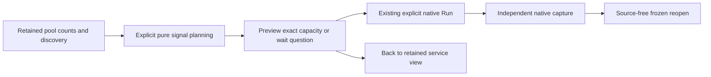

# Inspecting capacity and acquisition wait

A named pool can offer related capacity and acquisition-wait measurements through
retained discovery metadata. This is a contextual continuation of
[named-pool observations](POOL_CONNECTIONS.md), not a background enrichment of
existing results or a numerical utilization join.

The pinned [OTel v1.37.0 convention](https://github.com/open-telemetry/semantic-conventions/blob/v1.37.0/docs/database/database-metrics.md)
defines `db.client.connection.max` as an UpDownCounter in `{connection}` and
`db.client.connection.wait_time` as a histogram in seconds. Capacity uses the
cumulative nonmonotonic stock evaluator with `stockDomain: nonnegative-integer`;
wait uses the existing delta/cumulative histogram evaluator and percentile ranges.

## Exact contextual planning

`POST /pool-signals/plan` is a pure bounded planner. It takes the original count
question, one held exact count stream and compact supplied candidate metadata.
The parent must have the pinned count binding and count domain. Candidates must
match the full resource map and resource schema, instrumentation scope/version/
schema and every attribute after removing **only** the count's connection-state
attribute. Missing labels, different instances, extra dimensions and aliases
cannot be joined by pool name alone.

The planner pins the candidate's exact stream, preserves the original millisecond
and optional nanosecond window, retains the candidate's kernel policy, and forces
the capacity count domain before hashing its question. Package names do not create
duplicate physical signals. Input is limited to 16 instruments and a 64 KiB body;
only the first 25 supplied stream previews per instrument qualify. Preview and
omission counts are bounded before arithmetic. Up to two options per signal kind
are disclosed with explicit omissions. Unconfirmed or omitted discovery evidence
never proves that a signal is absent.

## User flow and evidence

Open **Inspect pool signals** in a pool row to request metadata planning. Preview
capacity or acquisition wait stages the existing native measurement interface;
only **Run** reads telemetry. **Back to service** restores the retained service
view. Default service reads and its two-native-instrument budget do not grow.

Each result has its own source read time, basis, observations and epochs. Capacity
is an observed maximum-open-connection tally, not a derived used fraction. Wait
histograms describe acquisition observations, not the connection-count population.
Sharing a question window and identity establishes context, not simultaneous
measurement, common epochs, causal attribution or a verified denominator.

Capture uses the existing fresh native-read path independently for each signal.
Reopening count, capacity or wait evidence remains source-free and preserves its
original bytes; no composite receipt or paired result store is introduced.
Standalone historical count captures do not automatically discover newer signals.

The metadata request is canceled or ignored when its parent is closed, removed,
left or replaced. It cannot publish options into a departed service. This reuses
the existing pending-scope and native navigation owners, with no new telemetry
subscription or automatic refresh.

Actual flow, frames and receipts are recorded in [journey 197](../journeys/197-pool-signals-storyboard.md).
