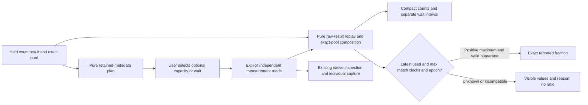

# Compact pool observations

Status: implementation and acceptance in progress. This document records the
approved contract; it does not yet claim live acceptance.

A pool row keeps its reported counts, optional maximum connections and optional
acquisition-wait interval together. It builds on [named-pool observations](POOL_CONNECTIONS.md)
and [exact related-signal planning](POOL_SIGNALS.md). Ordinary pinned OTel metadata
and full stream identity determine eligibility; manifests are not required.

## Interaction and effects

Opening the pool panel plans against retained metadata without reading telemetry.
One explicit action loads the selected capacity/wait questions through the
existing measurement endpoint: one independent read per selected signal. The
existing default two-native-widget budget stays unchanged. Values and source
failures remain separate. Changing a selection, closing/leaving the panel or
replacing its parent withdraws pending work; late responses cannot republish it.

The in-place view uses compact count/value rows and UTC observation timestamps.
Detailed stream identity, source bases/read times and epochs belong in one
provenance disclosure. Existing measurement previews provide full inspection and
individual fresh captures; returning restores held service observations. There
is no composite capture, automatic refresh or new result store.

## Composition and numerical boundary

`POST /pool-signals/view` is a pure operation over supplied count, capacity and
wait results. Each result is replay-validated from its retained raw rows before
composition. This checks internal evidence consistency, not authenticity of a
caller-provided source clock or an attestation that the server fetched it.
The request is bounded to 2 MiB with a two-second enclosing pre/post acceptance deadline;
the synchronous bounded calculation is not interrupted mid-execution. There is
no source I/O, custody write or source-read admission token.

The count result must retain its certified nonnegative integer domain and pinned
pool convention. The selected anchor must occur in its actual stock series.
Capacity and wait must be exact-stream questions for the same environment,
window, full resource/schema and instrumentation scope/version/schema. Candidate
attributes equal count attributes after removing only connection state. Extra
attributes, different instances, missing-versus-empty namespaces and alias names
never merge. Each input retains its own source basis and read clock.

A **reported used / maximum** ratio requires all of the following:

- Literal `used` state; idle and custom states never enter the numerator.
- The latest count and capacity samples are both observed and valid integers.
- Their exact observation nanoseconds and explicitly reported nonzero accumulation
  epochs match. OTel zero start means unreported, not a certified shared epoch.
- Maximum is positive and used does not exceed it.

The result retains an exact reduced rational. Zero maximum, missing/unknown/stale
samples, mismatched latest clocks/epochs and used above maximum withhold the
ratio with a reason. Older matching samples never replace a newer incompatible
sample. A matching reported ratio is not proof of a transactionally consistent
snapshot, saturation, physical database capacity or health.

Acquisition wait is a separate histogram population. Its latest retained interval,
observation count and bucket-bound p95 remain distinct from stock endpoints.
Neither matching windows nor matching interval endpoints supply a denominator
for the connection counts; no scalar percentile averaging is introduced.

## Acceptance gates

Use ordinary OTLP through the actual collector/ClickHouse and compare independent
raw observations with the composed response and rendered values. Cover aligned
counts, zero maximum, used above maximum, latest timestamp/epoch mismatch,
unknown/stale/conflicting exports, custom states, partial/missing signals and
exact identity/window rejection. Check explicit read counts and actual delayed
response withdrawal, retained source-free navigation and immutable individual
capture reopening. Refresh desktop/mobile and keyboard journey frames, extend
Bombadil actions/invariants and use meaningful generated/observed checks. Do not
accept mocked positive source/UI responses as live acceptance.
