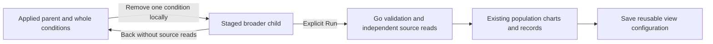
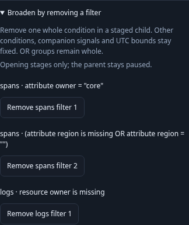
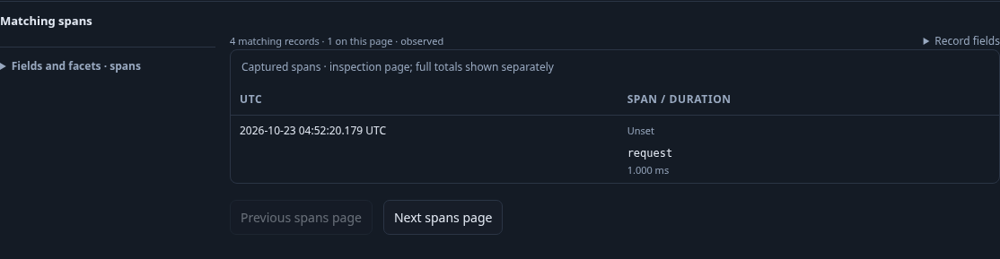

# Broaden a population by removing a condition

Open **Applied population → Broaden by removing a filter**, then remove the
condition beside its signal and selector summary. The action opens a staged child;
**Run selected population** explicitly reads it. Back restores the paused parent,
its existing results and the removal button's focus without rereading telemetry.

Only whole direct conjuncts are removable. For `A AND (B OR C)`, the choices are
`A` or the entire `(B OR C)` group. Removing only `B` could narrow membership,
so nested groups have no individual branch-removal controls. A single predicate
or root OR is one whole condition; removing the last condition removes `where`.
No generic Boolean rewriting or inferred equivalent predicate is introduced.

The broader question keeps its environment, exact half-open UTC window, source,
measures, grouping and page limit; only the selected signal resets its page offset.
Every companion question stays byte-for-byte equivalent as JSON configuration.
Go validates, compiles and evaluates the resulting query. For fixed record values,
parent membership is a subset of child membership; independent source reads can
still observe late or corrected records. Counts describe complete populations,
not the bounded inspection page.

The control lives inside the existing scope disclosure, rather than adding chrome
above Activity. Unapplied facet selections block broadening until applied or
cleared. Existing busy/child-depth limits apply. The child does not inherit a
comparison baseline automatically. Save the child through the existing view
controls; reopening restores configuration without executing telemetry reads.

Journey 125 uses ordinary manifest-free OTLP spans: missing/empty region values
match two parent records; removing their whole OR group reveals four records while
retaining owner scope and a one-row inspection page. It exercises draft blocking,
mobile layout and keyboard focus, full SQL membership, parent return and saved
configuration reopening. A final-condition removal then verifies all five records
inside the unchanged environment/window without a `where` predicate. Hegel checks membership monotonicity against Go's evaluator
and compiler, including a last condition and nested ORs. An observed Quint ledger
uses the existing drilldown model with rejecting controls for hidden reads, changed
scope, incorrect removal and invalid return depth. Bombadil explores the source-free
scope disclosure, staging and return path.

