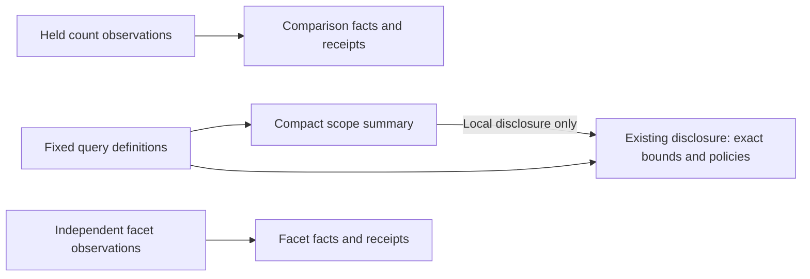

# Compact population scope and owned controls

Status: implemented; source, full frontend, native, actor and visual acceptance
pass (339). Related category/window regressions are recorded in validation.

The existing Applied/Configured population disclosure now summarizes the
environment and selected UTC window, with a previous/fixed-baseline badge where
applicable. Open it to inspect exact half-open bounds, environment policies,
predicates and the existing scope-editing controls. This reuses the existing
disclosure rather than adding another panel. Status and actionable feedback stay
outside; opening the disclosure never reads telemetry or changes a definition.

Open state and summary focus survive a local rebuild only when the whole selected
and baseline definitions still match. Read clocks and observations are not scope
identity. A different window, predicate, policy or other query definition resets
the disclosure. Count comparisons and newer independent facet reads retain their
own facts and receipts; the page summary does not merge or replace them.

Application control rules now target application-owned controls. Passive comparison
selectors own their compact layout, and nested component notices are not hidden
by page-level mobile rules. Standalone and embedded rendering use the same
component styling.

The shared count-cell helper accepts `geometry: false` to withhold bars while
preserving an exact known value and its normal known styling. It no longer needs
a null sentinel with replacement display text. Null/unavailable data remains
unavailable independently of the geometry setting; zero remains known.

The native storyboard measures fresh-document desktop and narrow entry views
separately from later interaction frames, using the same genuine UI-saved query
before and after. See [journey](journeys/339-population-chrome.md),
[architecture](reviews/POPULATION_CHROME_ARCHITECTURE_339.md),
[design](reviews/POPULATION_CHROME_DESIGN_339.md),
[control styling](reviews/CONTROL_STYLE_REVIEW_339.md) and
[validation](../VALIDATION.md). No new source executor, query mode, saved grammar
format or observation authority is introduced.

Fresh-document measurement uses the same saved questions at actual scrollY zero:
content starts 28.78px earlier at 1280×1000 and 32.20px earlier at 390×844.
Standalone/nested selectors both measure 99×37px with visible notices. This is a
bounded gain: the narrow comparison still starts below the initial viewport.
See validation for source-effect checks, actors and capture limitations.
