# Explain a selected population

Implemented and independently reviewed. Journey 177 main/ownership, native/model,
Bombadil and legacy numeric/distribution regression checks pass. Final review and
push are recorded in [actual validation](../VALIDATION.md).
A contextual explanation compares two fixed record
populations over one to six explicitly chosen qualified fields. It extends the
existing comparison and range-selection flows, without a new dashboard or an
inferred anomaly/causal model.

## Full aggregates and exact descriptive differences

The request is versioned `goo/explanation/v1` and retains original baseline and
selection questions, their complete selectors, signal/environment and independent
fixed windows. Typed numeric predicates and reported-edge constraints remain intact.
Execution projects count-only queries: numeric arithmetic, histograms, duration,
status summaries, charts and inspection pages are not read for each field.

Go reads one full count per side and full groups per field/side: at most fourteen
ClickHouse reads, each with a three-second child budget and the existing cancellable
55-second request budget. Every group read retains its own read time and basis.
A group sum disagreeing with its side's independent count is changed-between-reads;
no shares or ranking are asserted for that incomplete field. Equal counts still do
not prove a transactional snapshot, sampling completeness or stable source data.

Shares use all matching source records as the denominator. Differences are exact
rational percentage points, ranked by absolute change with deterministic qualified
field/value ties. Missing keys (`null`) and present empty strings remain separate.
One-sided values have known zero counts on the absent side; an empty population
has undefined shares. Differences describe populations and are not statistical
significance, causality, request uniqueness or inferred application health.

Each field must have complete groups within 1,000 values per side and a 128 KiB
serialized field-result bound. Exceeding either limit withholds the whole field;
no truncated top-N set is presented as complete. Field failures remain visible
alongside successful fields. A failed parent count prevents a valid explanation.
The complete result remains within the shared 2 MiB observation bound. Global
ranking references field/row indices instead of duplicating large values.

## Use the contextual explanation

1. In an applied comparison, open **Explain this comparison**. A numeric brush
   or supported span region offers **Explain this selection** using its checked
   selected/remainder pair. A log time selection instead says **Explain selection
   versus parent** and explicitly identifies the overlapping populations; it does
   not invent a remainder.
2. Keep **column:service**, or add/remove up to six exact `column`, `attribute`
   or `resource` fields. Observed-key suggestions and OTel display hints help find
   service versions, routes, regions and recorded status. They are incomplete and
   do not rewrite namespaces, infer aliases or validate instrumentation conformance.
   Custom keys are allowed. Field editing does not read telemetry.
3. Click **Run explanation**. The contextual result shows full side counts,
   ranked descriptive share differences, per-field states and missing-key counts.
   Inspect each field's exact values and independent read clocks. Local **Show
   more** controls reveal already returned rows without another query.
4. Use **Selection actions** or **Baseline actions** on a value. **Stage include**
   and **Stage exclude** call the pure Go filter planner and expose a staged-question
   link. **Open side question** stages that matching fixed question directly.
   Its existing **Run** action is still required to read records. Missing keys and
   present empty strings remain distinct throughout these continuations.
5. Click **Save observed explanation** to preserve the result currently shown.
   Reopen it from the capture link or Saved evidence. **Reuse explanation request**
   stages the original pair and field list; it does not execute them.

Ranked leads use one semantic table with shared Field/Value and side headers,
preserving Go's global ranking instead of repeating a card/table per value. Raw
case-sensitive values keep their original casing in both ranked and independent
field tables. The paired rows share a 0–100% population-share scale. Displayed percentages round
locally to two decimal places; exact rational shares and percentage-point changes
remain in tooltips and the stored result. Mobile rows keep Baseline and Selection
labels beside their own values. If all comparable differences are zero, the UI
says **No share differences observed in the complete requested fields** instead of
presenting those rows as an anomalous explanation.

A failed or high-cardinality field stays visible with its reason. A field whose
reads disagree has no comparable rows or ranking; independent known value counts
can still be inspected without inventing a missing side. The overall result can
be partial while other fields remain useful. Empty sides have unavailable shares,
not healthy zero percentages.

Long observed values remain explainable. Values above the existing 1,024-byte
predicate budget have disabled filter/inspection actions labeled **Value exceeds
filter budget**. Field keys are limited to 128 UTF-8 bytes. Unsupported columns,
`duration_bucket`, invalid Unicode and duplicate fields are refused locally or by
the authoritative Go planner before source execution. Recorded span status belongs
to span questions; log severity belongs to log questions.

| Action | Effect |
| --- | --- |
| Edit fields, inspect supplied values, reveal more rows | Local UI only |
| Stage a row filter or side question | Pure Go plan; no telemetry read |
| Run explanation | Bounded full-count/group source reads |
| Save observed explanation | Promote the held server result; no telemetry read |
| Reopen saved explanation | Read immutable saved evidence |
| Reuse explanation request | Stage fields and original questions locally |

Cancellation, field changes, disclosure closure and owner navigation withdraw
pending results. Returning to a retained parent permits a new explicit interaction;
an old completion must not open or overwrite the current investigation. Pending
listeners/observers are released when the request ends or its owner disappears.

## Observed evidence, save and reuse

Run holds a typed server-produced observation in the existing bounded result
snapshot pool: two-minute lifetime, 2 MiB per result, shared 64-entry/64 MiB limits.
Save observed explanation sends only its token and title. The server publishes that
exact held result as a new immutable capture of kind `explanation`, without another
telemetry read, client-authored aggregates or raw inspection-record pages.

The explanation's source read clocks/bases stay unchanged; capture custody time is
recorded separately. Retrying the same token/title/store while held returns the
same capture ID, including after a lost acknowledgment. Expiry or capacity refuses
saving explicitly and never reruns a question automatically. Tokens are omitted
from durable payloads and hashes, and are process-local capabilities rather than
user identities. Legacy result tokens, capture kinds and hashes remain unchanged.

Reopen loads stored evidence without a source read. Reuse stages its request and
field list; a new explicit Run creates a fresh observation and leaves old evidence
unchanged. This cut reuses capture requests as reusable definitions rather than
introducing a second saved-resource format.

```mermaid
flowchart LR
  A[Selected/rest or baseline questions] --> B[Explicit qualified field list]
  B --> C[Pure Go count projection]
  C --> D[Bounded full counts and per-field groups]
  D --> E[Validated exact differences and ranking]
  E --> F[Contextual paired values and failure states]
  F --> G[Source-free side filter plan]
  G --> H[Staged original-side question and explicit Run]
  E --> I[Expiring typed server observation]
  I --> J[Save exact observation without telemetry read]
  J --> K[Immutable explanation capture]
  K --> F
  K --> B
```

## Storyboard 177 — explain and preserve a selected population

The final compact journey 177 main passed in 53.9 seconds; ownership checks passed
in 15.9 seconds.
The frames below come from the actual browser run. Native/model replay also
passes with 21 main and 11 ownership rejecting controls; a 60-second Bombadil
campaign completes all ten phases with two explicit source runs, one observed
promotion and one pure filter plan. Legacy journeys 174 and 176 pass as well.

| Frame | User action | Explanation/evidence contract |
| --- | --- | --- |
| [177a: Selected population](journeys/screenshots/177a-explain-selected-ordinary-work.png) | Explain a checked ordinary-OTel numeric selection versus its remainder across six fields | Fixed pair, full counts, exact descriptive ranks and independently timed field reads |
| [177b: Mobile saved observation](journeys/screenshots/177b-mobile-frozen-observation.png) | Reopen the observed capture on mobile, then reuse its request | Both sides stay readable; reopen/reuse read no telemetry; a fresh Run may observe late arrivals |
| [177c: Partial field](journeys/screenshots/177c-partial-field-with-complete-leads.png) | Run a high-cardinality field beside a complete field | Partial status and the refused field remain visible without fabricated rows or top-N success |

The executable scenario is [population-explanation.spec.js](../journeys/population-explanation.spec.js).
It also exercises missing-versus-empty side plans, controlled late arrivals,
lost-acknowledgment promotion retries and delayed request ownership. See [VALIDATION.md](../VALIDATION.md) for the native/model, Bombadil and legacy
regression evidence, plus final artifact review and push status. The screenshots
alone do not establish semantic or state-machine correctness.

## Review gates

PE1 passed in `cb4f5af`: Go projection/aggregate/ranking/filter semantics, bounded
failures and shared snapshot/immutable capture compatibility, independently reviewed.

PE2 is delivered in `017f32b` after independent review and the final compact
ranked-layout/raw-case/mobile browser check. It covers
contextual fields, paired results, row intents, observed save/reopen/reuse and
lifecycle cleanup using existing UI primitives.

PE3 acceptance is delivered: ordinary OTel browser stories, late-arrival observed
save/reuse, cardinality and ownership checks, native/model replay with 32 rejecting
controls, a completed 60-second Bombadil campaign and legacy journeys 174/176 pass.
Final artifact review and push are recorded in VALIDATION.md; no additional commit
ID is implied here.
