# Explain a selected population

Implementation in progress. A contextual explanation compares two fixed record
populations over one to six explicitly chosen qualified fields. It extends the
existing comparison and range-selection flows, without a new dashboard or an
inferred anomaly/causal model.

## Full aggregates and exact descriptive differences

The request is versioned `goo/explanation/v1` and retains original baseline and
selection questions, their complete selectors, signal/environment and independent
fixed windows. Typed numeric predicates and reported-edge constraints remain intact.
Execution projects count-only queries: numeric arithmetic, histograms, duration,
status summaries, charts and inspection pages are not read for each field.

Go reads one full count per side and full groups per field/side: at most fourteen
ClickHouse reads, each with a three-second child budget and the existing cancellable
55-second request budget. Every group read retains its own read time and basis.
A group sum disagreeing with its side's independent count is changed-between-reads;
no shares or ranking are asserted for that incomplete field. Equal counts still do
not prove a transactional snapshot, sampling completeness or stable source data.

Shares use all matching source records as the denominator. Differences are exact
rational percentage points, ranked by absolute change with deterministic qualified
field/value ties. Missing keys (`null`) and present empty strings remain separate.
One-sided values have known zero counts on the absent side; an empty population
has undefined shares. Differences describe populations and are not statistical
significance, causality, request uniqueness or inferred application health.

Each field must have complete groups within 1,000 values per side and a 128 KiB
serialized field-result bound. Exceeding either limit withholds the whole field;
no truncated top-N set is presented as complete. Field failures remain visible
alongside successful fields. A failed parent count prevents a valid explanation.
The complete result remains within the shared 2 MiB observation bound. Global
ranking references field/row indices instead of duplicating large values.

## Contextual interaction

Explain selection uses an existing checked selected/rest pair or a pinned baseline.
An arbitrary baseline is not called a remainder or assumed disjoint. Field edits,
local inspection and filter staging do not read telemetry. Available qualified
field hints are advisory, with custom attribute/resource keys allowed and no
semantic-convention conformance inferred.

Run explanation explicitly reads the aggregate populations. Ranked values show
counts, shares and missing/empty coverage, with per-field failure and source clocks.
A row can stage include/exclude intent on either original side; Go derives the
predicate, preserving the complete selector and fixed window. Opening the staged
question and its existing Run action is explicit. Values exceeding the existing
filter budget remain explainable but cannot silently bypass query limits.

## Observed evidence, save and reuse

Run holds a typed server-produced observation in the existing bounded result
snapshot pool: two-minute lifetime, 2 MiB per result, shared 64-entry/64 MiB limits.
Save observed explanation sends only its token and title. The server publishes that
exact held result as a new immutable capture of kind `explanation`, without another
telemetry read, client-authored aggregates or raw inspection-record pages.

The explanation's source read clocks/bases stay unchanged; capture custody time is
recorded separately. Retrying the same token/title/store while held returns the
same capture ID, including after a lost acknowledgment. Expiry or capacity refuses
saving explicitly and never reruns a question automatically. Tokens are omitted
from durable payloads and hashes, and are process-local capabilities rather than
user identities. Legacy result tokens, capture kinds and hashes remain unchanged.

Reopen loads stored evidence without a source read. Reuse stages its request and
field list; a new explicit Run creates a fresh observation and leaves old evidence
unchanged. This cut reuses capture requests as reusable definitions rather than
introducing a second saved-resource format.

```mermaid
flowchart LR
  A[Selected/rest or baseline questions] --> B[Explicit qualified field list]
  B --> C[Pure Go count projection]
  C --> D[Bounded full counts and per-field groups]
  D --> E[Validated exact differences and ranking]
  E --> F[Contextual paired values and failure states]
  F --> G[Source-free side filter plan]
  G --> H[Staged original-side question and explicit Run]
  E --> I[Expiring typed server observation]
  I --> J[Save exact observation without telemetry read]
  J --> K[Immutable explanation capture]
  K --> F
  K --> B
```

## Review gates

PE1: Go projection/aggregate/ranking/filter semantics, bounded failures and shared
snapshot/immutable capture compatibility; independent property and architecture
review before exposing source execution.

PE2: contextual field controls, paired results, row intents, save/reopen/reuse and
lifecycle cleanup using existing UI primitives; protocol and component checks.

PE3: ordinary OTel storyboards, late-arrival immutable-save proof, cardinality and
ownership cases, screenshots, Hegel/Quint and Bombadil; final review and push.
