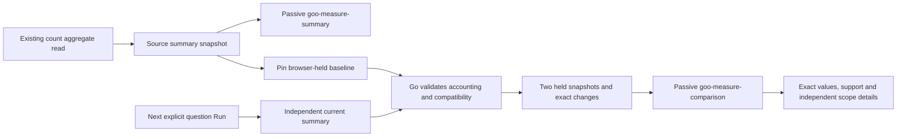

# Population summary and comparison views — 264

268 extends summaries with [recorded status counts/fractions](STATUS_FRACTIONS.md).
Status comparisons deliberately retain their independent percentage-point
presenter and do not emit this canonical comparison envelope. The original
numeric/duration comparison contract below remains unchanged.

Whole-population numeric/duration summaries now use the same exact typed measures
as grouped/interval views. Comparisons keep two independent summary snapshots and
Go-supplied exact signed changes. This is bounded native adoption; the
[pit-of-success review](MODEL_PIT_OF_SUCCESS_264.md) makes constructor/ownership
hardening the next gate before contributed views or more renderers.



`summaryDataset` has shape `summary`, one `population` row, captured count and
supported numeric/duration fields. `summary` completeness describes that one
exhaustive count aggregate and its measures, not a transaction across row/group/
series reads or complete upstream telemetry. Diagnostic parent results withhold
completeness. Summary data has no record/subgroup selection capability.

`viewComparison` has version `goo.comparison/1`, named `baseline` and `selection`
summaries, a state and a field-keyed `changes` map. Each side retains its full
question, source-basis claim, actual supplied read clock and support. Missing
clocks remain absent. A content hash of the actual held cohort is distinct from
its caller-supplied `sourceBasis`. Both sides are `browser-held`, with unknown
extent and no source completeness. These metadata strings are not authentication.

Go computes exact selection-minus-baseline rational changes. Matching units,
aggregation methods and full numeric bindings are required; no automatic scale/
unit conversion, pooled quantile or percentage-from-zero is inferred. A known
empty population can have an absolute count difference, while means/quantiles
without support stay unavailable. Count differences are not normalized rates or
causal estimates. Diagnostic comparisons name the affected side and suppress
changes; incompatible measures retain side values without a misleading shared axis.

The framework-neutral components accept defensive property assignments or JSON
attributes, support pre-upgrade/detached use and perform no IO:

```js
summary.snapshot = response.summaryDataset;
summary.display = {title: 'Population measures', compact: true};
comparison.comparison = compared.viewComparison;
comparison.display = {title: 'Population comparison'};
```

Load `measure-summary.css` alongside the shared component/chart styles. Values
use the existing human-unit/exact formatter. Native disclosures provide selectable
exact fractions, method and support. Comparison rows use one signed scale and zero
point for both sides; out-of-range/unavailable values remain exact text. Each side
has independently inspectable scope, clocks, basis, origin, extent and sampling.

The application replaces supported scalar summary and comparison presentations,
retaining existing distribution/status/native/triage families and their actions.
Pinning or comparing held values does not query telemetry. Changing a filter
stages the question; Run reads the next population and compares against the pinned
baseline. A refreshed comparison follows the **current** typed numeric question;
the old path that stripped measures to preserve an earlier count-only profile is
removed. Declared numeric intent without opt-in and validated summaries refuses.

264 also fixes concrete contract hazards found during review: closed display
options, explicit nullability and declared counts/dimensions, exact numeric data
separate from plotting range, capability-driven action controls, defensive copies
and unknown empty-result presentation. These do not solve trusted construction,
guarantee-aware projection or a host execution epoch. Those remain explicit
H0/H1 work, rather than being disguised as another origin flag.

[Executable storyboard](../journeys/264-summary-comparison-storyboard.md) covers
real telemetry, independent supporting counts and clocks, common scales,
source-free inspection and forged-change refusal. Validation records actual Go,
frontend, Chromium, Hegel, Quint and Bombadil outcomes.
