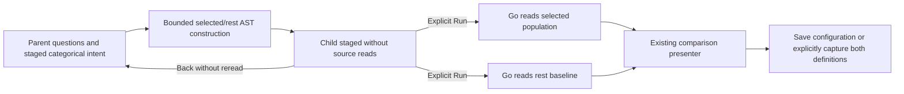
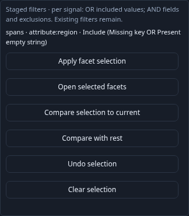
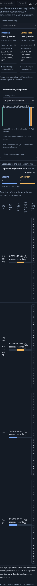

# Compare a selection with the rest

Stage categorical Include/Exclude values in a population's existing facet tray,
then choose **Compare with rest**. This opens a staged child. **Run selected
population** explicitly reads the selected questions and the remainder baseline;
returning keeps the parent's paused results, baseline and selection draft.
The existing comparison measures, common scales and support counts are reused.
Staged facets survive a breakdown change: select a population by region, for
example, then choose service as the breakdown before comparing its measures.

For each selected signal with parent predicate P and staged intent S:

- Selected is P AND S.
- Rest is P AND NOT S, within exactly the same environment and half-open window.
- Unselected companion signals retain their original questions.

The complement applies only to the bounded generated categorical intent, never
the parent. Includes are OR within a field; fields and exclusions are AND. De
Morgan transformations preserve this structure. Missing and present-empty are
separate: the complement of equality includes missing records, while the
complement of missing is exists. Field namespaces stay qualified. Go validates,
compiles and evaluates both typed queries; there is no JavaScript SQL generator
or general-purpose parent-predicate negation API.

This partitions membership for the same record values at one source state. The
UI executes independent reads, not a transaction or frozen shared snapshot.
Counts are full population aggregates, never subtraction of paged results.
Late data or record corrections can change observations between reads. A parent
with no remainder produces a no-data comparison, not a normalized healthy zero.

The action requires applied nonnumeric, one-field breakdowns for selected signals
and an available child slot. Existing node/depth budgets apply independently to
both generated questions; over-budget complements are refused before a read.
No automatic widening or removal of parent filters occurs. The [time/latency region continuation](REGION_PARTITIONS.md) adds a separate
generated rectangle complement. Arbitrary numeric attributes and general predicate
complements remain outside these bounded operations.

Save the child as an exploration view to retain the selected queries and exact
rest baseline configuration. Reopening stages without telemetry reads. Capture
comparison explicitly rereads both definitions through the existing immutable
comparison path; captured evidence reopens without rereading telemetry.
Saved comparisons use the existing baseline/selection labels and independent
read bases; there is no new persistent partition identity or atomicity claim.

Journey 123 uses manifest-free OTel spans with missing, empty, west and east
regions, plus an excluded parent record. Complete SQL result pages verify the
2+2 partition while the UI displays one record per page. It covers mobile staging,
empty rest, parent return, saved configurations and immutable comparison capture.
Hegel checks disjointness/coverage against Go's evaluator for generated selections;
observed Quint traces and rejecting controls check scope, membership and ownership.
Bombadil exercises source-free staging and return.

