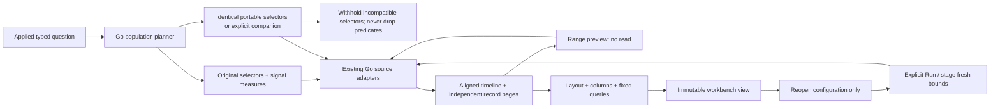
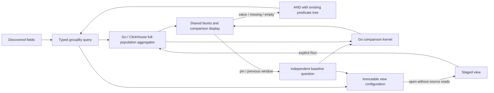

# General population exploration and saved views

Start with any applied span or log question in Explore, including cross-service
resource/attribute predicates. **Explore linked population** asks the Go planner
to compose existing record kernels, then reads one or two signal questions. The
workspace shows aligned charts and matching inspection pages together. Clicking a
chart interval or adjusting UTC handles previews a range without a read. Apply
rereads both configured populations in that range; reset restores the workspace's
original bounds. Record paging changes one inspection page without changing its
full-population totals. Layout and column choices are local presentation changes.
The existing record inspector, trace expansion and surrounding-log actions are
reused; there is no new JavaScript measurement evaluator.

The default companion retains the complete predicate tree, including AND/OR,
missing-key and present-empty-string distinctions, where that tree is valid for
the other signal. Signal-specific measures are planned independently. A span-only
or log-only predicate (or reported dependency edge) makes the default companion
unavailable; predicates are never silently dropped to manufacture a broader
population. That reason is visible. **Configure a separate companion population**
lets the user explicitly replace only the companion's selector with an exact
service and/or attribute filter. Both questions must retain the same environment
and half-open window. Each signal's exact selector, source basis and failure state
remain inspectable. Temporal alignment and shared predicates do not establish
trace identity, a causal relationship or complete source coverage.

**Save this exploration view** stores configuration: a bounded title, one or two
fixed queries, a charts-and-records or records-only layout, and visible record
columns. UTC and summary remain required. The Go workbench store publishes a
content-addressed immutable artifact; saving the same configuration returns the
same ID, while changed configuration has a different ID. Saved views contain no
telemetry, captured result basis or inferred health. The catalog is paginated,
and direct `#exploration-view=<id>` links reopen configuration without source
reads. **Run population view** is explicit. **Use fresh population window** stages
a fresh window of the same duration without a read; a saved revision remains
unchanged. Existing telemetry packages continue to provide declarative reusable
measurement definitions; saved exploration views are presentation/configuration
artifacts referencing the same typed query grammar.

Independent signal reads publish together once they settle, retaining each
successful result and showing failures as unavailable. Cancellation, source-scope
edits, workspace suspension and newer requests prevent stale responses from
publishing into another population. Capture evidence through the existing
per-question/capture workflow when results themselves must be retained.

[Journey 90](../journeys/population-workspace.spec.js) emits generic OTel spans and
logs from multiple services, including populations excluded by resource or
attribute predicates. It exercises missing/empty semantics, range selection,
independent companion filters, presentation changes, save/reopen/run and mobile
inspection. Its observed ledger is checked with Quint/quint-go and rejecting
controls. The Bombadil actor opens a saved view, explicitly runs it and changes
layout. Hegel generates portable-selector properties and state/swarm sequences
for immutable saved-view layout, column and range edits.

## Attribute breakdowns and comparisons

Each successful signal read exposes its discovered record/resource/attribute fields.
Choosing a breakdown reruns the fixed population with that signal's grouping;
it does not copy span-only fields or selectors to the companion. The existing
facet component ranks full-population counts, recorded error percentages and
Go-computed duration measures. Local value search and ranking do not read sources.
Field discovery is bounded; an undiscovered attribute is not proof of absence.

Clicking a value intersects the existing predicate tree, preserving OR branches,
missing keys and present empty strings. Charts and records for that signal rerun
together; the other signal retains its independent selector. Reset value filters
returns to the workspace's original selector at the current time bounds.

For a value-to-value comparison, filter the first value, pin it as baseline, reset
value filters, and filter the second value. Compare previous window instead reads
the immediately preceding equal-duration fixed window. Both use the shared
comparison renderer and Go comparison kernel, with common zero-based scales.
No-data and disagreeing reads withhold normalized differences. Results describe
captured records and do not establish causality or telemetry completeness.

Saved views optionally retain per-signal ranking, comparison measure and baseline
query. Existing version-1 views retain their encoding/content identity because
this new configuration is omitted when absent. Saving/reopening reads configuration
only. An explicit Run reads the signal queries and each configured baseline
independently; a baseline failure is visible and leaves the successful signal
results usable. A failed/interrupted read preserves its baseline configuration for
the next explicit Run. Filtering retains the captured pinned baseline, while Run
refreshes configured baselines. Saved baseline queries start at inspection page zero.
Baseline queries must retain signal, environment and grouping;
time windows and predicates may differ. Numeric cohort comparison remains unsupported.
Fresh-window staging clears old comparison baselines. Captures remain the route
for frozen evidence; a saved view contains no comparison results or source basis.

Journey 91 supplies ordinary OTLP spans for two services, compares worker versus
API, saves/reopens/replays the baseline, verifies an empty previous window, and
changes grouping to distinguish missing and empty attributes. It includes mobile
composition, an observed Quint/quint-go read ledger with rejecting controls, and
optional Bombadil ranking/previous-window actions. It also exercises baseline-source
failure/retry, keyboard tab navigation and a delayed previous-window response
arriving after an explicit refresh. The Hegel state/swarm campaign
also mutates breakdown/baseline configuration while retaining earlier saved views.

