# General population exploration and saved views

Shared timelines now support source-free horizontal brushing as well as native
UTC handles. In the [recent-activity canvas](RECENT_ACTIVITY.md), **Open selected
population** also stages an independently run child while retaining its paused
parent. See [range/drilldown ownership, keyboard/touch behavior and storyboards](RANGE_DRILLDOWNS.md).

Start with any applied span or log question in Explore, including cross-service
resource/attribute predicates. **Explore linked population** asks the Go planner
to compose existing record kernels, then reads one or two signal questions. The
workspace shows aligned charts and matching inspection pages together. Clicking a
chart interval or adjusting UTC handles previews a range without a read. Apply
rereads both configured populations in that range; reset restores the workspace's
original bounds. Record paging changes one inspection page without changing its
full-population totals. Layout and column choices are local presentation changes.
The existing record inspector, trace expansion and surrounding-log actions are
reused; there is no new JavaScript measurement evaluator.

The default companion retains the complete predicate tree, including AND/OR,
missing-key and present-empty-string distinctions, where that tree is valid for
the other signal. Signal-specific measures are planned independently. A span-only
or log-only predicate (or reported dependency edge) makes the default companion
unavailable; predicates are never silently dropped to manufacture a broader
population. That reason is visible. **Configure a separate companion population**
lets the user explicitly replace only the companion's selector with an exact
service and/or attribute filter. Both questions must retain the same environment
and half-open window. Each signal's exact selector, source basis and failure state
remain inspectable. Temporal alignment and shared predicates do not establish
trace identity, a causal relationship or complete source coverage.

**Save this exploration view** stores configuration: a bounded title, one or two
fixed queries, a charts-and-records or records-only layout, and visible record
columns. UTC and summary remain required. The Go workbench store publishes a
content-addressed immutable artifact; saving the same configuration returns the
same ID, while changed configuration has a different ID. Saved views contain no
telemetry, captured result basis or inferred health. The catalog is paginated,
and direct `#exploration-view=<id>` links reopen configuration without source
reads. **Run population view** is explicit. **Use fresh population window** stages
a fresh window of the same duration without a read; a saved revision remains
unchanged. Existing telemetry packages continue to provide declarative reusable
measurement definitions; saved exploration views are presentation/configuration
artifacts referencing the same typed query grammar.

Independent signal reads publish together once they settle, retaining each
successful result and showing failures as unavailable. Cancellation, source-scope
edits, workspace suspension and newer requests prevent stale responses from
publishing into another population. Capture evidence through the existing
per-question/capture workflow when results themselves must be retained.

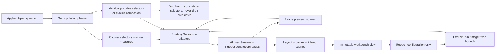

[Journey 90](../journeys/population-workspace.spec.js) emits generic OTel spans and
logs from multiple services, including populations excluded by resource or
attribute predicates. It exercises missing/empty semantics, range selection,
independent companion filters, presentation changes, save/reopen/run and mobile
inspection. Its observed ledger is checked with Quint/quint-go and rejecting
controls. The Bombadil actor opens a saved view, explicitly runs it and changes
layout. Hegel generates portable-selector properties and state/swarm sequences
for immutable saved-view layout, column and range edits.

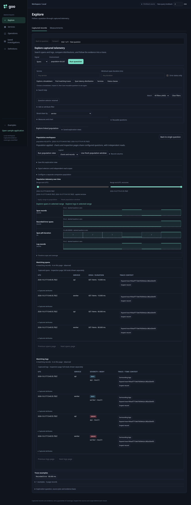
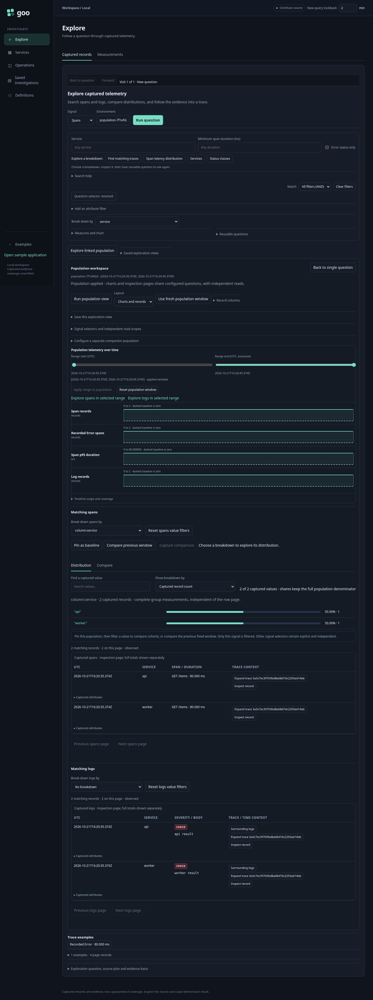
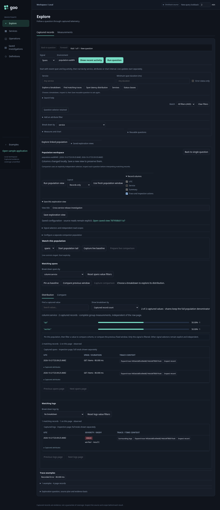
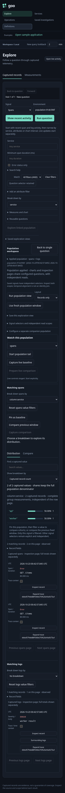

## Attribute breakdowns and comparisons

Each successful signal read exposes its discovered record/resource/attribute fields.
Choosing a breakdown reruns the fixed population with that signal's grouping;
it does not copy span-only fields or selectors to the companion. The existing
facet component ranks full-population counts, recorded error percentages and
Go-computed duration measures. Local value search and ranking do not read sources.
Field discovery is bounded; an undiscovered attribute is not proof of absence.

In recent activity, [Include/Exclude stages categorical intent](FACET_SELECTION.md)
without reading; explicit Apply or Open controls the next step. Legacy population
views retain their immediate value-filter action. Applying intersects the existing
predicate tree, preserving OR branches,
missing keys and present empty strings. Charts and records for that signal rerun
together; the other signal retains its independent selector. Reset value filters
returns to the workspace's original selector at the current time bounds.

For a value-to-value comparison, filter the first value, pin it as baseline, reset
value filters, and filter the second value. Compare previous window instead reads
the immediately preceding equal-duration fixed window. Both use the shared
comparison renderer and Go comparison kernel, with common zero-based scales.
No-data and disagreeing reads withhold normalized differences. Results describe
captured records and do not establish causality or telemetry completeness.

Saved views optionally retain per-signal ranking, comparison measure and baseline
query. Existing version-1 views retain their encoding/content identity because
this new configuration is omitted when absent. Saving/reopening reads configuration
only. An explicit Run reads the signal queries and each configured baseline
independently; a baseline failure is visible and leaves the successful signal
results usable. A failed/interrupted read preserves its baseline configuration for
the next explicit Run. Filtering retains the captured pinned baseline, while Run
refreshes configured baselines. Saved baseline queries start at inspection page zero.
Baseline queries must retain signal, environment and grouping;
time windows and predicates may differ. Numeric cohort comparison remains unsupported.
Fresh-window staging clears old comparison baselines. Captures remain the route
for frozen evidence; a saved view contains no comparison results or source basis.

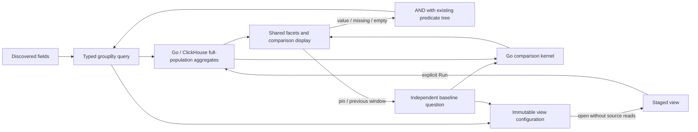

Journey 91 supplies ordinary OTLP spans for two services, compares worker versus
API, saves/reopens/replays the baseline, verifies an empty previous window, and
changes grouping to distinguish missing and empty attributes. It includes mobile
composition, an observed Quint/quint-go read ledger with rejecting controls, and
optional Bombadil ranking/previous-window actions. It also exercises baseline-source
failure/retry, keyboard tab navigation and a delayed previous-window response
arriving after an explicit refresh. The Hegel state/swarm campaign
also mutates breakdown/baseline configuration while retaining earlier saved views.

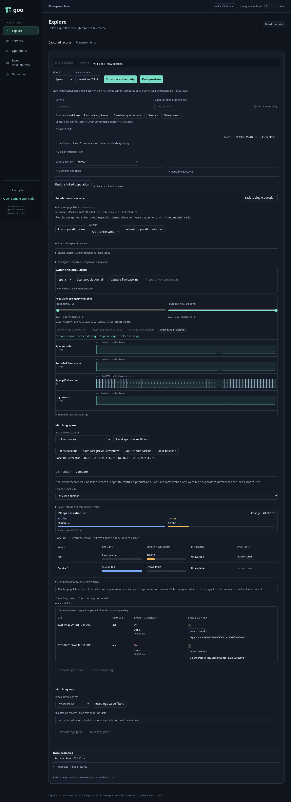
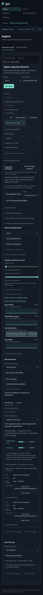

## Watching a population

The live area offers one explicit span or log tail using that signal's current
selector. Start replaces only its fixed time bounds with a rolling 60-second
**event-time** window. Span rows are individual observations, not complete traces.
The SSE transport polls source data every two seconds, retains at most 100 rows /
2 MiB locally, and reports evictions, source limits, disconnection and continuity
gaps. Resume/reconnect starts a recent window; it does not promise replay or
recover arbitrarily late events. Exact UTC timestamps retain nanoseconds in tooltips.

Focusing attributes or opening a reported trace pauses the tail and preserves
its row nodes. Each retained observation keeps its original source-read window.
Trace expansion independently reads that trace in the observation's window,
even after later tail polls have advanced. Navigation, fixed-population reads and document hiding stop
subscriptions; returning requires an explicit restart/resume. Changing selectors
clears incompatible retained rows and baseline settings.

**Capture live baseline** independently captures the fixed selected question.
**Prepare live comparison** validates the stored baseline selector and creates
controls without reading telemetry. **Start live comparison** explicitly starts
full-population refreshes at ten-second intervals, following the baseline duration.
Its scope can differ from the tail's 60-second inspection window, and this is
stated next to the controls. Counts, recorded error share and span latency use the
existing Go capture/comparison kernels and shared fixed scales. Tail rows never
supply totals or percentiles. Explicit rescaling and freeze retain existing
snapshot custody behavior; no-data/unknown/source failures remain visible.

Saved view `tail` configuration contains only the selected signal and optional
immutable baseline capture reference. Saving/opening never starts a stream,
prepares a comparison, captures data or refreshes a current window. Legacy views
omit this field and retain their content identity. Missing or incompatible
baseline references fail visibly when the user prepares the comparison.

```mermaid
sequenceDiagram
  actor User
  participant UI as Population workspace
  participant SSE as Go tail / SSE
  participant CH as ClickHouse
  participant Capture as Go capture / comparison
  User->>UI: Start selected span or log tail
  UI->>SSE: Typed selector, no fixed window
  loop bounded 60-second connection, 2-second polls
    SSE->>CH: Recent event-time window / bounded records
    SSE-->>UI: reset / batch / gap
  end
  User->>UI: Inspect attributes or reported trace
  UI->>SSE: Pause / cancel
  Note over UI: Retain bounded rows; trace is a separate contextual read
  User->>Capture: Capture fixed baseline explicitly
  User->>UI: Prepare and start live comparison
  UI->>Capture: Baseline reference / full current population
  Capture->>CH: Independent rolling query over baseline duration
  Capture-->>UI: Full measures, provenance, expiring freeze capability
  Note over UI: Shared scales; tail rows never define measures
```

Journey 92 uses ordinary OTel HTTP spans/logs without manifests. It tests explicit
starts, bounded span retention, paused trace investigation, baseline measures,
source-free save/reopen, reconnection gaps, switching signals and mobile layout.
It verifies 123 full-population records against a 100-row retained tail, explicit
axis rescaling, paused inspection during a disconnect and selector-mismatch
rejection before any live comparison read.
Its read-initiation ledger uses Quint/quint-go and five rejecting controls;
Bombadil exercises explicit start/pause and bounded rows. Saved-view Hegel
state/swarm rules also mutate tail settings while retaining immutable histories.

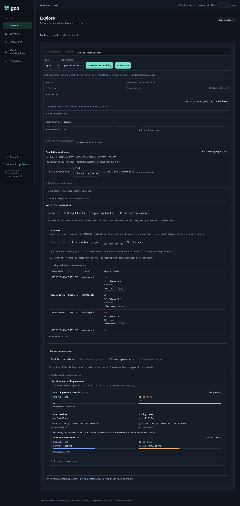
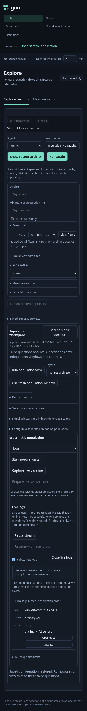

## Contextual selection, comparison and restoration

The compact **Applied population** disclosure exposes each signal's selector;
staged configurations say **Configured population** instead. A failed signal is
marked unavailable. Disclosure itself performs no source read. Existing fixed
UTC bounds and independent source bases remain visible in their owning views.

The staged facet tray now groups Apply, Open and **Compare selection to current**
with Undo/Clear. Compare uses the current supplied **full aggregates** as baseline
for the selected signals, then explicitly reads the selected fixed questions.
Unselected companion predicates remain unchanged. It opens the resulting Compare
view, including the facet disclosure on mobile. Only applied, nonnumeric,
single-field breakdowns are supported; unavailable actions explain the limit.
This is selection versus current, with possible overlap, not selection versus
rest or an inferred anomaly/causality result. Missing/empty field meanings, unknown
source states and full denominators retain their existing Go contracts.

The in-memory baseline is not reread merely to perform this continuation. Saving
a view still stores **questions**, not aggregate evidence: reopening/rerunning a
saved baseline configuration retains its existing independent-source-read rules.
Use Capture comparison for the existing explicit durable capture operation.

**Restore starting population**, inside the scope disclosure, explicitly rereads
the original fixed questions, including selectors, grouping and window. It does
not expand beyond the starting scope, restore an old source basis or undo a draft
selection. Undo/Clear concern the draft; restoration concerns executed questions.
Returning from a retained child still restores its paused parent without a read.

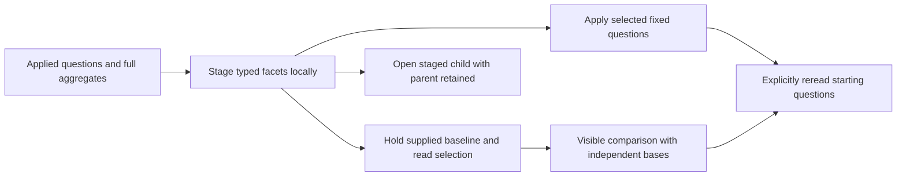

[Journey 116](../journeys/population-context.spec.js) checks a four-record
population with a two-record page, missing/empty selection, exact parent and
companion predicates, no baseline reread and explicit restoration.
[Selection actions](journeys/screenshots/116a-population-selection-actions.png) ·
[Visible comparison](journeys/screenshots/116b-selected-population-comparison.png).
Journey 96 retains observed Go/Quint ledger validation; its expanded
[Bombadil actor](../verification/bombadil/facet-selection.ts) adds compare/restore
to staged selection and parent-return exploration. Actual checks and limits are
recorded in [VALIDATION.md](../VALIDATION.md).

Record pages now offer a compact [observed-field picker](RECORD_COLUMNS.md) with local
column visibility/order and explicit Include/Exclude intents. Population view
configuration accepts optional ordered `fieldColumns` (up to eight qualified
fields); saved layouts do not change query predicates or capture evidence.

## Expanding the time window

Inside **Applied population selectors → Expand time window**, edit exact UTC
bounds to enclose the current fixed window. The preview keeps every applied
signal's predicates, environment, measures and reported-edge binding. It resets
paging and requires a strict expansion within the existing 120-minute/pre-2100
query limits. Misaligned signal windows are refused. Apply or clear staged
facets first, so widening cannot silently discard an unapplied filter draft.

**Open expanded population** stages an independent child using the existing
population owner; it does not read telemetry. **Run selected population** performs
the explicit reads. The parent stays paused, retains its result/baseline and
returns without a reread. Child depth remains bounded to three. Save the child
as an ordinary exploration view to reuse its queries; it is configuration, not
frozen evidence. Expansion does not remove filters or compute selection-versus-rest.

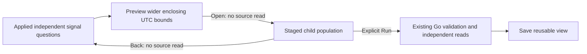

Journey 122 uses ordinary OTel spans inside and before the original window,
checks the companion's independent missing-key selector, full counts versus a
one-record page, mobile layout and paused-parent return. Hegel checks generated
query widening against Go compilation; observed Quint drilldown validation uses
negative controls for hidden reads, altered filters/environment, narrowed bounds
and invalid return depth. Bombadil exercises source-free expansion/return.

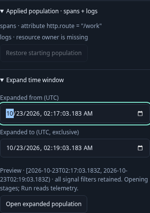
