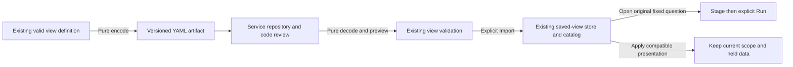

# Portable service and team views — 305

> Delivered in milestone 305. Executed checks are recorded in
> [VALIDATION.md](../VALIDATION.md).

Export an existing view as YAML, commit it beside service code, and import it into
another Goo installation. The file contains checked question and presentation
configuration, not telemetry, captured evidence or a running subscription.
[The checked example](../config/views/service-requests.yaml) declares service span
counts and records using existing public kinds and an ordinary template binding.

## Export and import through the existing catalog

In **Preserve → Export YAML**, choose a namespace, name and revision, then generate
the checked YAML and download it. Export can use the current valid definition; it
does not require saving first. Unfinished query/presentation drafts must be
resolved before export. Changing the definition or labels retires the old download.

In **Saved exploration views → Import view**, paste the YAML and choose **Preview
YAML**. Review its identity, view title, signals, fixed environment/time scope and
any configured baseline questions. Preview validates configuration only. **Import
view** explicitly saves an ordinary view through the existing catalog; it does not
open, apply or run the imported question. Editing or closing a pending preview
retires it; a prior result cannot become the current import.

The existing catalog offers two distinct next steps:

- **Open** stages the artifact's original fixed question. Run explicitly to read
  that scope. The example uses `prod` and a fixed five-minute window on
  2026-01-01; it is not a live dashboard or an automatic current-time selector.
- **Inspect display → Apply composition** reuses compatible presentation in the
  current checked population, preserving its environment, predicates, bounds,
  paging and held data. Template expansion retains its existing explicit
  destination bindings and eligibility rules.

Namespace/name/revision are descriptive labels for the file and code review. They
are not registry keys, authorization, immutable release pins or update commands.
The imported definition uses the existing content-addressed saved-view ID. Importing
another file with the same labels does not replace a prior saved view. These labels
are shown with the import receipt; they are not new persisted catalog provenance.

## Existing grammar, strict transport

The envelope version is `goo.view-artifact/1`, with `namespace`, `name`, `revision`
and an existing ID-free `view` definition. Namespace and name are lowercase slugs
of 1–63 characters; revision is a descriptive 1–64 character label using letters,
digits, dots, underscores or hyphens, starting with a letter or digit. Existing
view/query admission remains authoritative, including explicit valid page limits
and root offset zero. Record-only, composed and supported flat definitions use the
same existing rules; no new kinds, expressions or evaluator are introduced.

YAML is limited to one document and 64 KiB, with bounded depth/structure. Duplicate
keys, anchors/aliases, merge keys, explicit tags, unsupported scalar types, unknown
fields, lossy integer conversions and invalid view definitions are refused. YAML
keys use the existing JSON field names. Invalid files are not partially imported.

Store-local IDs are not portable. A captured-count comparison child or a tail
baseline capture reference causes export/import to fail; remove that configuration
explicitly before exporting. The codec never silently strips it or treats a
foreign capture ID as evidence. Fixed baseline *questions* remain configuration;
opening and running them uses the existing independent-read behavior.

## Code-managed use

`workbench.DecodeViewArtifact` validates YAML offline and returns the admitted
artifact and canonical YAML; `EncodeViewArtifact` validates and emits the same
format. The example file is exercised by a Go regression test to prevent drift.
The pure HTTP counterparts are `POST /api/view-artifacts/decode` (`{"yaml":"…"}`)
and `POST /api/view-artifacts/encode` (`{"artifact":…}`). Neither endpoint saves or
queries telemetry. Explicit persistence remains `POST /api/exploration-views` with
the decoded `artifact.view`. The existing OpenAPI contract documents both codecs.
There is no package registry, automatic file watcher or deployment hook.
[CLI validation and explicit import](VIEW_ARTIFACT_CLI.md) now reuse this codec
without adding another format or persistence path.

See the [architecture review](reviews/PORTABLE_VIEWS_ARCHITECTURE_305.md),
[design review](reviews/PORTABLE_VIEWS_DESIGN_305.md),
[record/aggregate composition](RECORD_AGGREGATE_COMPOSITION.md) and
[whole-flow checkpoint](ADD_BREAKDOWN.md).
