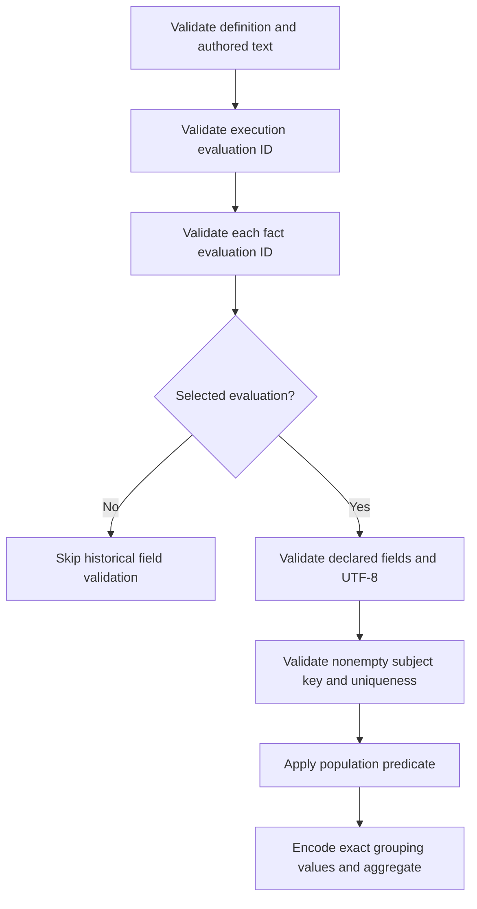

# Prepared subject-fact text integrity — 245

The public Go `subjectfacts` evaluator rejects malformed UTF-8 before it can
collapse JSON-encoded subject identities or dimension groups. Authoring validation
also rejects malformed population literals, count-measure literals and enum values,
so both ClickHouse and Databricks compilers refuse those definitions.

Evaluation IDs are nonempty valid UTF-8. Every row needs a usable routing ID,
including rows that do not belong to the selected evaluation. Once a valid other
evaluation ID establishes exclusion, its historical fields are not inspected.
Within the selected evaluation, every declared string field must be valid UTF-8
before subject identity, population filtering or grouping. A malformed selected
row cannot hide behind a false population filter. Undeclared extra fields remain
outside the typed source contract.

Validation rejects bytes; it never replaces, normalizes, trims or rewrites them.
Valid U+FFFD is a legitimate character. Non-ASCII text, composed versus decomposed
Unicode and permitted empty strings keep their original identities. Existing
nonempty subject-key/evaluation-ID and enum constraints still apply. Valid SQL,
metric YAML and stored evidence identities are unchanged; no digest migration is
introduced. This is a Go-value boundary: it does not recover malformed bytes that
an upstream decoder has already replaced with valid characters, or establish raw
ClickHouse/Databricks source text integrity. Prepared sources must honor the same
contract; source adapters retain their own responsibilities.

Focused tests reproduce the former two-distinct-invalid-labels → one-group bug,
exercise predicate/enum/compiler rejection, population-excluded selected rows,
foreign evaluations and valid Unicode. The original implementation fails the two
regression controls when restored with a Go build overlay. Hegel properties vary
arbitrary bytes and valid text across these boundaries. This is a pure library/
compiler change; it adds no UI flow, source query or storage format.
