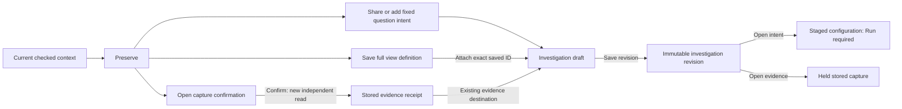

# Preserve a question, view or evidence

Use **Preserve** in the current fixed-question or population context. The choices
keep different things; saving a definition does not freeze displayed telemetry.

| Choice | Keeps | Telemetry effect |
| --- | --- | --- |
| Question | Fixed query, checked scope and selected question view | Share or stage an investigation card without reading; reopen requires Run |
| View definition | All configured queries, components and presentation | Save configuration without reading; reopen requires Run |
| Evidence | An independent bounded capture and its receipt | Opens the existing capture form; confirmation performs a new read |

In a fixed Activity analysis, Preserve is available without opening Edit analysis.
Share question and Add question to investigation use the current checked fixed
intent. Capture evidence uses the applied clean question and the existing capture
confirmation form. The reusable measurement/question package editor remains under
advanced configuration because it is a separate resource family.

For a population with two signals, explicitly choose a signal before preserving a
question or evidence. Switching visible record tabs does not make that choice.
The selected root query starts at offset zero; the current inspection page is not
silently captured as the whole population. Saving a view still saves its entire
configuration, including both queries when present.

Display and composition editors remain under View settings. Preserve contains the
view title, Save action and the existing exact saved-view/finding attachment.
Changing the configuration requires a new saved revision before attaching it as a
definition. Adding a question or definition stages an investigation draft; Save
revision is still the publication action. Pending notes, recovery or another
operation can refuse the addition visibly without discarding that work.

## Independent captured evidence

Opening the capture form makes no telemetry query. Confirming it rereads the fixed
question and stores independent evidence, which can differ from the data on screen
because of late arrival or retention. A saved composition is not an atomic capture
of its independently read record page, aggregate and timeline.

The existing form selects the evidence destination. A receipt can be opened later
without rereading telemetry. A question card, saved-view reference and capture card
keep their own identities; association does not assert identical populations,
causality or complete upstream telemetry.

The disclosure itself does not read or publish. Existing query, page, selection,
draft and destination guards still apply, and retired controls cannot act on a
newer context. No new durable object, capture-fusion operation or storage API is
introduced. Rolling Activity views/Keep and specialized/native preservation paths
retain their existing entry points in this cut.
