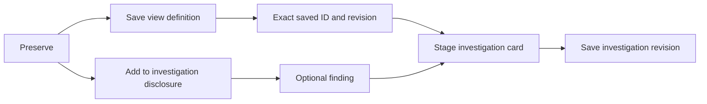

# Optional investigation attachment

Preserve keeps Save view immediately available. Open **Add to investigation** only
when you want to attach the saved definition and an optional finding. Opening or
closing this native disclosure performs no telemetry read or document write.

Save the current definition first. The attachment stages its exact saved ID and
title in the existing investigation editor; save that document revision separately.
The note and disclosure survive redraw and a retained child/Back visit. Pending
query or destination edits refuse attachment and retain the note.

A mounted attachment button belongs to one saved ID, title and revision pair.
Saving a changed definition replaces the button, while keeping the textarea.
Detached, closed, hidden-parent and retired buttons cannot attach or clear the
current note. Old textarea events cannot replace the active draft. This metadata
ownership is separate from source-read execution ownership.

See the [executable storyboard](../journeys/293-preserve-attachment-storyboard.md)
and [architecture review](reviews/RESPONDER_FLOW_ARCHITECTURE_293.md).
