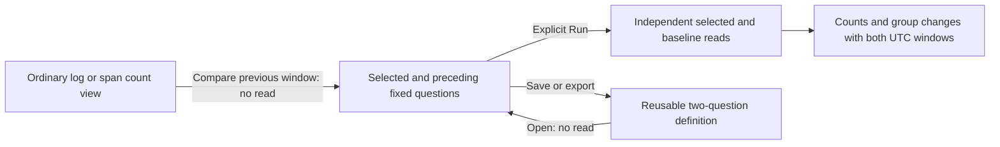

# Compare the preceding window

321 adds a general time-change investigation to ordinary single-query count views.
The existing fixed comparison grammar and executor supply both operands; no new
query language, endpoint, metric evaluator or subscription is introduced.

## Ask what changed

From a compatible log or span count composition, **Compare previous window** stages
one adjacent equal-duration baseline. For a selected interval `[a, b)`, its baseline
is `[a − (b − a), a)`. The generated question preserves the entire selector,
environment policy, namespace, grouping and measure profile. Both queries start at
page zero. It does not infer an earlier population from held rows.

Staging reads no telemetry. **Run population view** explicitly reads the selected
population and the fixed baseline independently, then compares their supplied
counts and groups. The existing aggregate-only baseline path remains available
where its profile is supported. Both UTC windows and source read times are
inspectable. Counts and count changes describe independently observed populations;
they are not rates, statistical significance, causality or upstream completeness.

The comparison declaration still uses `query-count-comparison` with a
`baselineQuery`. It admits existing same-window pairs and preceding adjacent
same-duration pairs. Other differing windows and unequal durations remain outside
this saved-view profile. Existing cohort compatibility checks still apply;
authored pairs can retain different predicates, which must be inspected explicitly.
The generated previous-window action copies the complete selected predicate.

## Reuse and change scope

Save/export preserves both questions, not their observations. Reopening stages the
same fixed definition for explicit Run. Immutable saved revisions and held parents
stay unchanged. A later source read can include late arrivals.

The existing comparison-window controls preserve the relation: moving or resizing
the selected window recomputes an adjacent baseline of the same width for a
previous-window pair. Existing same-window pairs continue to move together.
A pre-epoch baseline or invalid query refuses before draft replacement or reads.
Unstaged edits block Run/Save until staged or discarded; stale commands cannot
change a replacement view.

This first action requires an ordinary compatible single-query count composition.
Facet compositions, multiple signals and specialized numeric/native profiles are
not silently converted. Captured baselines and temporary held-parent comparisons
retain their existing ownership and window rules.

See [comparison window controls](PAIRED_COMPARISON_WINDOWS.md),
[fixed baseline reads](FIXED_BASELINE_READS.md),
[executable journey](journeys/321-previous-window.md),
[architecture](reviews/PREVIOUS_WINDOW_ARCHITECTURE_321.md) and
[design](reviews/PREVIOUS_WINDOW_DESIGN_321.md).
