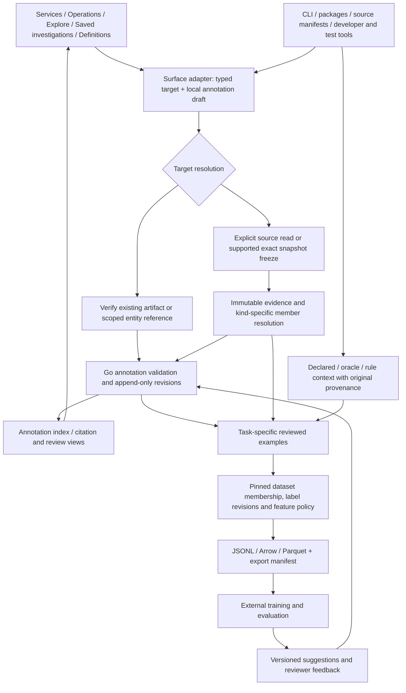
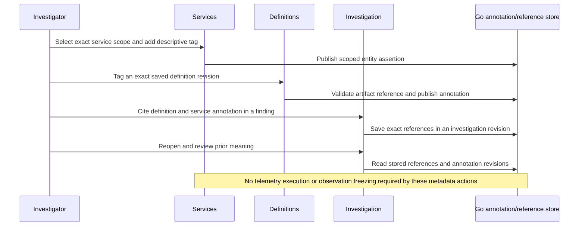

# Shared meaning across goo's product surfaces

> Initial follow-through: [shared tags/notes and optional XTDB evidence retention](WORKBENCH_ANNOTATIONS.md).
> Rich review vocabularies, training labels and dataset exports below remain proposed.

Whole-product design pass, 2026-10-22 UTC. **Proposed architecture and interaction
contracts. An initial shared tag/note store and optional native retained-evidence experiment are now implemented; reviewed task labels, review queues and training export remain proposed.**
This pass responds to the need to annotate throughout goo, rather than treating
Explore or a separate labeling application as the center of the feature. The
[earlier Explore-centered proposal](TRAINING_ANNOTATIONS_DESIGN.md) supplies useful
record-level details; this document establishes the broader product model and
implementation order.

Goo's loop is ask → investigate → preserve → reuse. Annotation makes the meaning
learned during that loop reusable: which service a question concerns, what a chart
interval suggests, why a comparison matters, what an experiment established, or
which captured examples belong to a training task. Training data is one valuable
projection of that accumulated meaning. Every tag does not need to be a label,
and every label does not need to target an individual log or span.

## Current foundations and gaps

This is a source/design review, not customer usability research or a newly run
browser campaign. Implemented foundations were checked in:

- [`ui/workspace.js`](../ui/workspace.js): Explore, Services, Operations, Saved
  investigations, Definitions and Examples; typed staged questions are separate
  from evidence. [Record selection](RECORD_POPULATIONS.md) is a current bounded
  Explore gesture, not the identity model for the whole product.
- [`workbench/documents.go`](../workbench/documents.go): immutable investigation
  revisions, exact capture/comparison/deployment references, question cards and
  authored hypothesis/finding/conclusion/next-step notes. Existing note text has
  meaning today; it is not a task-specific training label or authenticated fact.
- [`workbench/comparisons.go`](../workbench/comparisons.go) and
  [`workbench/deployments.go`](../workbench/deployments.go): frozen ordered
  comparison decisions and separately recorded deployment markers. Occurrence
  time and server recording time are distinct. Temporal proximity is not causality.
- [`workbench/exploration_views.go`](../workbench/exploration_views.go): immutable
  fixed-question configurations and optional baseline queries. Reopening config
  is source-free; future results are not the original evidence.
- [`exploration/capture_store.go`](../exploration/capture_store.go): immutable
  captures of record, inventory, measurement and comparison questions. Ordinary
  capture creation rereads the source. Existing immutable capture references can
  already be annotation targets; annotating a particular *displayed live row*
  still needs a verified exact-member/freezing capability.
- [`exploration/live_comparison.go`](../exploration/live_comparison.go): supported
  server-owned live snapshots can be frozen without another source read. This
  does not establish a universal fixed-dashboard or arbitrary-row snapshot API.
- [Service identity](SERVICE_IDENTITY.md), [automatic service overviews](SERVICE_DASHBOARDS.md)
  and [native histogram semantics](NATIVE_HISTOGRAMS.md): explicit namespace/scope,
  independent widget reads, exact stream identity and native interval meaning.
- [`annotations/manifest.go`](../annotations/manifest.go) and
  [source annotations/weaving](GOO_ANNOTATIONS.md): source contracts and declared
  emission rules. They are distinct from analyst annotations and do not prove
  runtime coverage or business success.
- [Cross-app testing](BOMBADIL_TESTING.md), [bitemporal reasoning](BITEMPORALITY.md)
  and [portable compilation](DATABRICKS_METRIC_VIEWS.md): useful provenance and
  replay foundations with explicit implementation limits.

**Exact observation freezing is a prerequisite for durable observation labels,
not for every annotation.** Saved definitions, investigation revisions, captures,
comparison receipts and deployment markers already have durable references.
A scoped service can also carry a descriptive assertion with explicit applicability,
without pretending that the service identity is an immutable telemetry snapshot.

## One shared language, several kinds of meaning

Use a compact **Annotate** entry point near the selected subject, then show its
actual target and appropriate actions. Reuse the same inspector and chip vocabulary
across surfaces. Keep task-specific labeling optional until the user chooses it.

| Meaning | User intent | Persistence and reuse |
| --- | --- | --- |
| Descriptive tag | “Payments”, “watch next release”, “owned by team A” | A typed tag on a scoped entity or exact artifact; searchable context, with origin and applicability. It is not automatically a classifier target. |
| Note or assertion | “Hypothesis: pool contention”; “this comparison supports the finding” | Authored text and explicit hypothesis/finding/conclusion role with citations. Review can disagree; confidence is not a calibrated probability. |
| Task label | “For failure-shape v2, this captured interval is retry amplification” | A value or abstention under a versioned label definition and target grain, with review and provenance. |
| Relationship | “This finding is supported by these captures”; “suspected relation to deployment X” | Typed links between exact targets, or a citation from an existing investigation card. Correlation and causal claims stay distinct. |
| Label rule or model suggestion | “Suggest retry amplification for future matches” | A versioned derivation, input scope and rule/model origin. Review does not silently convert old predictions into human judgments. |

Existing investigation notes and findings should remain existing document objects.
Allow an annotation to cite an exact note/card in an immutable document revision;
add structured task judgments when needed. Do not copy every note into a second
notebook or infer a training label from its prose. Similarly, source-code
`//goo:operation`/`//goo:event` declarations remain instrumentation contracts, not
analyst judgments or a place to embed aggregate classification policy.

## Surface, gesture, target and reuse

The following annotation gestures are proposed. The underlying product surfaces
and their current capabilities are described by the linked contracts above.

| Surface | Natural gesture and compact presentation | What is actually targeted | Useful reuse and boundary |
| --- | --- | --- | --- |
| Services catalog and discovery inventory | Tag the selected service from its context menu; filter the catalog by tags; expose a small indicator instead of permanent extra columns. | Scoped entity identity: source/workspace, environment, service name and exact namespace mode. A discovery snapshot is a separate evidence target. | Team/domain/context discovery and reusable service scopes. Missing, empty and unspecified namespace must not merge; entity tags are not health verdicts or observed ownership proof. |
| Automatic and distributed service overviews | Annotate a widget, chosen interval or reported edge; attach a note to the current service context. | Exact widget definition or retained widget result/fragment; reported edge evidence; or scoped service entity. | Explain a recurring pattern, preserve a known limitation, collect an interval example. A whole dashboard has independent reads; one tag does not assert an atomic snapshot or complete topology. |
| Operations and measurement results | Mark an operation window as interesting; label a captured result as “expected saturation” under an explicit task; link the operation contract. | Definition revision, operation identity plus declared applicability, or exact captured measurement/window. | Reusable domain semantics and window classifiers. `error`, `panic`, source outcome and human task labels are separate origins and grains. |
| Native metric points, timelines and heatmaps | Brush an interval, select a stream/cell, choose Annotate or Collect examples. | Retained exact stream result, endpoint, validated interval or bucket region, with unit, temporality, schema, boundaries and kernel version. | Time-series anomaly/shape labels and reviewed counterexamples. A histogram cell cannot supply invented individual requests; unknown/reset/clipped intervals remain unknown. Preserve predecessor/baseline evidence needed by the interval evaluator. |
| Span/log records and attributes | Select a record or explicit set, highlight a field/excerpt, annotate from the inspector or selection tray. | Exact retained observations, or a question definition when saving a reusable slice. Excerpt anchors resolve within a frozen value. | Text/event classifiers and field interpretation. Set-level judgments do not automatically label every member. Page position alone is session provenance, not durable identity. |
| Trace waterfall and async navigation | Mark a span, two-span relationship or time segment; add an explanation next to the selected fragment. | Exact retained span observations/trace fragment, explicit interval or relationship, including anchor identity and scope. | Trace-shape examples and causal hypotheses with evidence. A captured fragment is not a complete trace; clock gaps and async links do not establish causality. |
| Log/span tail and live comparison | Mark an observation or pause/select a rolling interval, then explicitly preserve it; save a watching rule separately. | A verified frozen snapshot/member, or an explicitly versioned query/rule definition. | Capture rare events and build reviewer queues. Evicted/expired evidence cannot be silently reread and relabeled; buffers never define whole-population totals. |
| Facets, populations and saved views | Tag/name a reusable question; label a captured slice; collect a bounded example set; promote a reviewed pattern to a suggested rule. | Immutable saved definition/config, retained evidence, or explicit materialized members. | Reusable queries and slice-based dataset collection. A query tag is not a human label on future matches; presentation limits do not define membership or totals. |
| Baselines and comparisons | Attach a finding, classify the ordered contrast (“regression”, “expected change”, “inconclusive”), cite a deployment. | Ordered comparison receipt and exact side IDs; a baseline definition is a different target. | Pairwise ranking/regression tasks, retrieval of past explanations. Preserve incompatibility/unavailable decisions; do not turn a delta into a causal conclusion or reverse pair order. |
| Deployment markers and context | Tag a deployment, link a reviewed before/after investigation, state whether impact is suspected or established under a task. | Exact marker revision, related receipt/card and scoped applicability. | Change-impact datasets and incident context. A user-entered marker is not authenticated release provenance or evidence of impact. |
| Investigations, findings and saved evidence | Annotate a card/revision, mark “needs review”, cite supporting/conflicting evidence; reuse tags to find prior work. | Immutable document/card reference, evidence receipt or comparison receipt. | Shared explanations, review, retrieval/evaluation datasets and label adjudication. Existing authored notes remain separate from a measured result and its integrity checks. |
| Definitions, semantic packages, manifests and IaC | Add descriptive metadata in authoring/review; tag an exact package revision in Definitions; export a proposed definition/rule change for code review. | Exact package/manifest/source revision and explicit declaration or binding. | Task vocabulary, feature contracts and reusable weak-label rules. Code-managed declarations retain machine/declarative origin; no automatic claim of runtime conformance, aggregate policy or human ground truth. |
| Sample apps and developer flows | Mark a controlled run, request or injected condition and follow its observed telemetry into goo. | Exact run/artifact plus verified correlation ledger and separately captured evidence. | Intentional examples and regression evaluation. Scheduled faults, request success and an intended outcome do not prove the corresponding production failure class occurred. |
| Playwright/Bombadil, Hegel and Quint tools | Preserve a failing or interesting run, attach a reviewed explanation, import verified experiment context into a candidate collection. | Artifact/run identity, scenario/model revision, seed/action trace, oracle result and independently linked captures. | Reproducible counterexamples, reviewer tasks and evaluation sets. A UI invariant or model-conformance pass is an oracle about that property, not a domain label on all telemetry. |
| CLI, export and downstream data platform | Apply/read the same typed annotations to exact references; publish a pinned dataset manifest and export selected features/labels. | Versioned target and annotation references plus an immutable dataset revision. | Go/Rust/offline tooling, JSONL/Arrow/Parquet and long-term platform tables. Exported definitions, migrated data and verified target resolution are separate operations. |

An all-namespaces selector is a scope, not one namespace-qualified entity. Either
choose a partition for an entity annotation or annotate the broader saved selector.
Operation identity similarly needs its service/source scope, operation name/role
and relevant binding/instrumentation identity; do not collapse same-named operations
from unrelated libraries. Declared schema metadata stays distinct from exporter-
verified fields, including the current trace exporter's unverified schema URL.

Tag filtering on an inventory filters catalog entities or metadata; it must not
quietly change telemetry totals. Opening a tagged entity set as a telemetry
question requires an explicit, checked scope transform. Distinguish **tagged
artifacts**, **labeled examples**, **rule matches** and **live source results** in
search. A badge on a live row needs an exact verified target match, not merely
matching message text or a reported trace ID.

## Shared contract: targets, assertions and revisions

Implement this in the Go workbench core with a closed, versioned target union and
surface adapters. Keep display components framework-neutral. Avoid arbitrary
client JSON pointers or a generic string key whose meaning varies by page.

| Target kind | Required identity and scope | What it does not assert |
| --- | --- | --- |
| `entity` | Typed scoped service/operation identity, source context, explicit namespace and effective applicability. | Immutable observations, deployment membership, availability or all-time ownership. |
| `definition` | Existing exact saved-question/view/package/manifest revision and a validated declaration/binding reference when applicable. | That newer revisions inherit its metadata or that future matches have been judged. |
| `evidence` | Exact stored receipt; optional kind-validated fragment/member selector, exact value/member digest and occurrence position within retained evidence. | That a live page index is durable, identical log payloads are one event, or an aggregate contains individual observations. |
| `relation` | Exact comparison receipt or validated ordered target references, relation type and cited evidence. | Symmetry, causality or semantic compatibility merely because two targets share a time range. |
| `document` | Exact investigation revision plus optional verified card position/digest. | Stable card position across revisions or automatic label extraction from text. |
| `experiment` | Verified run/artifact identity, source/model/scenario revisions, seed and observed checkpoints, linked evidence references. | That intended actions happened or the test oracle proves an application-level label. |

An annotation revision contains a canonical target, typed meaning, parent revision
or explicit supersession/withdrawal, creation time, author/identity provenance,
origin and optional citations. Task labels additionally pin a label-definition
revision, target grain/cardinality, review decision and value or abstention.
Human, code-declared, test-oracle, rule-derived, model-suggested and imported
assertions retain distinct origins. A human accepting a suggestion creates an
attributed review event; it does not erase the prediction or its model version.

A tag may carry a controlled namespace and value, but vocabularies can be
introduced progressively. Start with tag/note types and add task definitions only
for an actual classification/retrieval/evaluation use case. Do not require users
to choose a training schema merely to bookmark useful evidence.

Persist append-only revisions, validate referenced artifacts and retain integrity
checks. Concurrent alternatives and reviewer disagreement remain visible rather
than becoming accidental last-writer-wins truth. Existing document revisions and
reference cards provide a good publication pattern; they are not a current shared
annotation API. The lab lacks production authenticated author identity, so a
client-supplied author name must not be treated as trusted attribution.

Event/applicability time, source-read time, immutable capture/custody time and
annotation recording time are different clocks. A service ownership tag can have
an effective interval. A judgment about yesterday's captured metric window can
be corrected today. An older dataset still pins the previous annotation revisions;
a corrected revision does not change old training examples or move their event
window. This follows the [existing bitemporal direction](BITEMPORALITY.md) without
requiring a general bitemporal database before useful annotation work.

### Evidence capabilities are target-specific

For an existing capture or saved artifact, annotate its verified exact reference
without rerunning telemetry. For a displayed uncaptured result, the surface must
state whether Save performs a **new read** or freezes the **existing result**.
A server-owned fixed-read snapshot/member capability is needed before promising
exact labels on arbitrary displayed records or dashboard/native fragments.
Supported live freezing provides a useful precedent, not universal coverage.

Capabilities should declare target kind, retained evidence available, fragment
selection support, expiry and verification status. Expiry/tampering/unavailable
members fail explicitly. A browser-authored row may be accepted only as a separately
identified import, not silently certified source evidence. Retain duplicate
observation occurrences, source limits, missing/empty states, exact timestamps,
source/semantic-convention bindings and all native evaluation prerequisites.

Display elements render chips, target/scope previews, review state and history;
they never fetch, subscribe, label or export on mount. Application owners retain
staging, source generations, subscriptions, target capability checks and explicit
publication. Existing Go semantic evaluators remain the authority for measurement;
annotations do not introduce a browser classifier or a second query language.

## Cross-surface storyboards

These are **proposed journeys**, not executed tests or screenshots of implemented
annotation features.

### 1. Service context becomes reusable knowledge, without labeling telemetry

An engineer opens a namespace-qualified service in Services, adds `domain:payments`
and a note about its on-call context, and saves that scoped assertion. They open
an automatic operation widget, preserve its question as a definition and tag the
exact definition `triage:latency`. In a named investigation they cite that definition
and the service annotation, add a hypothesis and later attach a capture. A colleague
finds the prior work by either tag and reopens the investigation source-free.

The service tag concerns an entity and applicability; the definition tag concerns
an exact reusable artifact; the hypothesis concerns an investigation. None labels
all service spans as slow, changes discovery counts or needs record freezing.

### 2. A native heatmap leads to a reviewed interval example and trace context

A user spots an unusual native histogram region in an automatic service overview,
selects its exact stream/interval and reviews unit, bucket bounds and coverage.
They preserve supported evidence, annotate the interval as a candidate for task
`latency-shape/v1`, then follow a separately scoped span question to inspect a
waterfall. A note cites both results as supporting context rather than asserting
that the histogram identifies those individual spans. A reviewer accepts the
interval label but leaves the proposed cross-signal explanation as a hypothesis.

The dataset example is the native interval and its evaluation prerequisites.
Trace fragments are optional cited context, with their own scope/read basis. An
unknown reset interval can be labeled “insufficient evidence” under the task;
it is not a negative/healthy example or a fabricated latency population.

### 3. A comparison, deployment and finding form a pairwise training example

An investigator compares two exact captures, saves the ordered decision and
links a deployment marker. They write a finding about the observed change and
choose a pairwise task label such as `unexpected-regression`, with reviewer context.
Another engineer later concludes the load mix explains it, appends a correction
and cites new evidence. The original comparison, finding and dataset revision
remain reopenable. A new dataset revision can use the corrected judgment.

The target is an ordered contrast, not every member of either population. The
marker contributes deployment context; a “caused by deployment” assertion would
need its own explicit claim/evidence and review, not automatic promotion from time.

### 4. A test counterexample becomes an evaluation set, then a better definition

A controlled sample-app campaign schedules retries. Bombadil explores the app and
goo; Quint validates observed transitions, and source checks establish which
request/trace and captured evidence belong to the run. A failed invariant or Hegel
counterexample becomes an experiment artifact with its exact seed and revisions.
The engineer opens the linked evidence, reviews what actually happened and labels
only supported targets. Successful normal runs supply reviewed counterexamples;
scheduled-but-unobserved faults stay incomplete experiment context.

The reviewed examples form a reproducible holdout dataset. A useful recurring
pattern becomes a proposed package or label-rule revision for code review. A rule
can suggest future examples, but its own outputs do not automatically become the
human ground truth against which the same rule is evaluated.

### 5. A rare live log is preserved without turning the tail into a dataset

A user marks a tail observation, pauses and verifies an exact evidence target
before adding a text-task label and optional excerpt. They save a separate query
for similar future candidates. The live buffer can later evict the observation
without changing the retained example. If exact evidence cannot be frozen, the
UI can still save the question/note, but must not claim to have saved that row.

A later collection explicitly states its sampling method and bounded membership.
Future query matches are candidate examples, not retroactively human-labeled
positives. “Everything else” is not an inferred negative class.

## Instrumentation, IaC and tests contribute context without becoming truth

OTel conventions give portable feature bindings across application languages;
preserve raw exported values, resource/record/attribute namespaces, binding/schema
versions and missing/empty distinctions. A manifest is optional enrichment. Code
review can declare a task's relevant operation/field semantics or propose a weak
label rule using the same typed query contracts. `when:ok` means the annotated
function returned without an error; it does not certify commit, durable business
completion, causal attribution or a production class label.

Source digests, compiler/weaver versions, package revisions, deployment references
and test seeds provide valuable context. Distinguish **declared intent**, **test
condition scheduled**, **condition observed**, **oracle verdict** and **reviewed
judgment**. Correlation ledgers should retain which checkpoints were actually
verified. Opt-in experiment IDs belong in appropriate trace/log context or retained
artifacts; do not add unbounded run IDs to native metric dimensions.

A UI-derived definition/rule can be exported as a reviewable package/annotation
proposal. Code/IaC imports remain versioned declarations with their provenance;
editing a UI tag does not silently rewrite source or cause an automatic deployment.
The same contracts should be callable from CLI/CI and server-rendered or SPA UIs.

## Dataset projection and long-term use

A dataset revision pins exact example membership and target grain, annotation and
review revisions, label vocabulary, feature projection and adapter/compiler/model
versions, event-time applicability and recording cutoff, collection method and
known coverage. Preserve set examples and ordered pairs as those grains; do not
flatten them into per-record labels. Labels can serve classification, ranking,
retrieval or evaluation tasks without pretending they share one universal schema.

Show selection bias and missing classes. A manually selected outlier collection,
a saved-query collection and a genuinely random sample are different sources.
Sampling must be implemented and recorded before describing a collection as random.
Separate source outcome fields, future information, annotations and post-incident
notes from predictor inputs by an explicit feature policy. Group related
traces/incidents/deployments/experiment runs across train/test boundaries, using
source-aware identities and a conservative stated policy when identity is missing.
For forecasting, make feature and target time boundaries explicit.

Start with a manifest plus JSONL; Arrow/Parquet can carry richer native/structured
features later. Missing evidence stays unavailable rather than being silently
reconstructed by a fresh read. Export exact referenced observations or an explicit
projected representation with content identities. Data migration into a long-term
platform is separate from exporting definitions. Databricks metric-view compilation
covers supported aggregate semantics; labeled member tables, annotation revision
tables and joins by verified target identity need their own portable representation.
No Databricks instance or inline model runtime is required to test these contracts.

## Recommended implementation order

1. **Shared annotation targets and revisions, with a cross-surface metadata slice.**
   Add bounded descriptive tags/notes to exact saved definitions and investigation
   revisions/cards, plus scoped service context using the existing exact namespace
   semantics. Reuse one annotation inspector and search/filter vocabulary. A user
   should carry a tagged service → saved definition → investigation citation
   without telemetry reads caused by annotation publication/reopening. Do not make
   record freezing block this slice or introduce a separate labeling application.
2. **Evidence and relationship annotations over existing durable references.**
   Add reviewed task definitions/values only for a concrete use case, with target
   grain and abstention; support capture, comparison and deployment references.
   Preserve existing findings and ordered decision semantics. This already enables
   reviewed window/pair/document examples where captures exist.
3. **Exact displayed-evidence capabilities by signal and surface.**
   Extend verified fixed-read freezing/member resolution for records and native
   fragments, then compose inspector, heatmap, waterfall and tail annotation
   actions. Use the existing live snapshot precedent only where its actual
   capability applies. Bound retention, expiry and payload size explicitly.
4. **Dataset snapshots/export and experiment ingestion.**
   Add pinned membership, feature/split policies, deterministic export and verified
   campaign context. Start with human-reviewed examples and evaluation sets before
   active-learning queues or automated label assignment.
5. **Versioned rules, model suggestions and code feedback.**
   Use reviewer feedback to improve definitions and offer candidate collections.
   Preserve derivation lineage and keep independently reviewed holdouts. Add richer
   tooling only when an actual task demonstrates value.

The first slice should cross existing navigation boundaries with one core API:

### Checks that make the proposed behavior reviewable

- Hegel pure properties for target canonicalization, missing/empty/unspecified
  namespaces, immutable old revisions and deterministic dataset exports; state/swarm
  checks for concurrent corrections, withdrawals and incompatible target grains.
- Quint models/replay for draft→publish→review→supersede/withdraw, target capability
  expiry and explicit capture/read boundaries. Reject controls for hidden source
  reads, wrong ordered pairs, stale targets, forged membership, dropped native
  prerequisites and silent human-label promotion.
- Playwright cross-surface storyboards over actual OTLP/native data and real stored
  artifacts. Capture the service→definition→investigation and native/pairwise paths,
  including source-free reopening. Keep proposed frames distinct from generated
  screenshots until implemented.
- Bombadil actions/invariants for target continuity across navigation, no write on
  disclosure/mount, no automatic source read on tagging, retained scopes, explicit
  save/cancel, native keyboard interactions and bounded review selections.
- Tests that controlled experiment intent cannot become a reviewed label merely
  because a request was submitted, an invariant passed or a model trace conformed.
  Tampered/expired references and unavailable evidence must fail explicitly.

## Decisions that remain task-specific

The shared model and initial vertical slice above need no further product choice.
Before implementing a dataset task, choose its actual grain/vocabulary and review
policy, the feature projection and split grouping, and storage/retention needs for
its evidence. Production attribution and permissions need a real identity boundary;
the local lab must not claim one. A family-level tag that follows future definition
revisions would require an explicit lineage/association contract; current immutable
saved-view IDs alone do not provide that inheritance.
