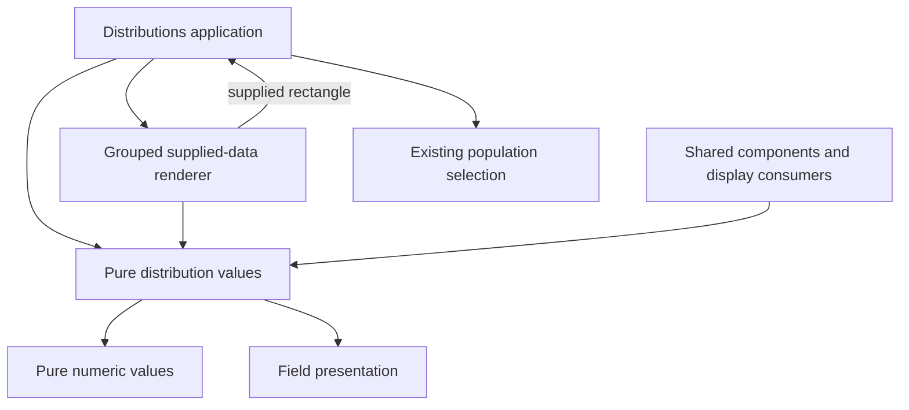

# Pure distribution display helpers

Milestone 399 separates supplied-value formatting and geometry from the
Distributions application owner. [Validation](../VALIDATION.md) records executed
regressions; this is a structural change with no claimed performance gain.

`ui/distribution-values.mjs` owns percentage and duration formatting, group metric
selection/comparison, relative widths and literal category labels. It depends
only on existing pure numeric values and field presentation. It does not read
telemetry, import a source client, access the DOM, preserve evidence or own scope.
Application and component callers import these functions directly. The existing
component `durationMS` API uses the same pure formatter.

The grouped renderer no longer imports Distributions, NumericMeasures controls
or PopulationSelection. For a duration-bucket rectangle it reports the supplied
range to its caller. Distributions converts that range through the existing
PopulationSelection logic before updating selection. Whole-question validation,
cohort snapshots, requests, staging and publication stay application-owned.
This removes the direct and indirect grouped-renderer back edges; it is not a
claim that every application module in the project is acyclic.

Formatting, rounding, null/zero meaning, exact large values, signed numeric
magnitude, literal labels and full-population scales are preserved. No new view
kind, query format, source capability or compatibility facade is introduced.
