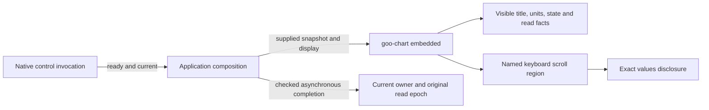

# Quantitative view composition

Numeric population histograms and selected native histogram intervals use the
same passive chart surface. `goo-chart embedded` removes an inner card when its
application composition already owns the surface. The chart keeps its authored
title, units, state, read facts and exact values. It does not change the supplied
dataset, bucket semantics, completeness or source authority.

Histogram bucket regions have accessible names, native keyboard focus and local
horizontal scrolling. Their inner figure captions remain accessible without
repeating the visible chart title. Component styles reset inherited page-section
framing; page layout does not need to reach into the plot.

Invocation uses `nativeControlReady`: the control must be available, visible and
enabled. Checked completion uses `completionControlReady`: the opener's own
temporary native disabled flag may be ignored while its operation completes.
Hidden, detached, inert, explicitly unavailable and disabled-fieldset controls
still refuse. Native first-legend exemptions are preserved. This helper alone
does not authorize a result: each owner still checks current identity, operation
and original-read epoch. A retained redraw never renews source authority.

Display changes and exact-value disclosures remain local. Held views retain
their existing local controls; source-capable actions retain their existing
paused-owner boundaries. Saved highlighting remains source-free. There is no
new acquisition owner, plotting grammar field or query operation.

See the [component contract](UI_CHART_FRAME.md),
[executable storyboard](journeys/411-quantitative-chrome.md) and
[actual validation](../VALIDATION.md).
