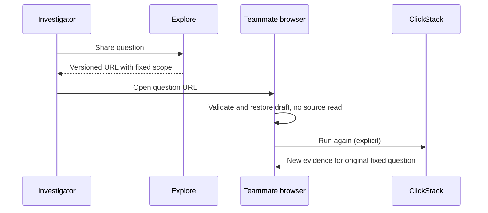
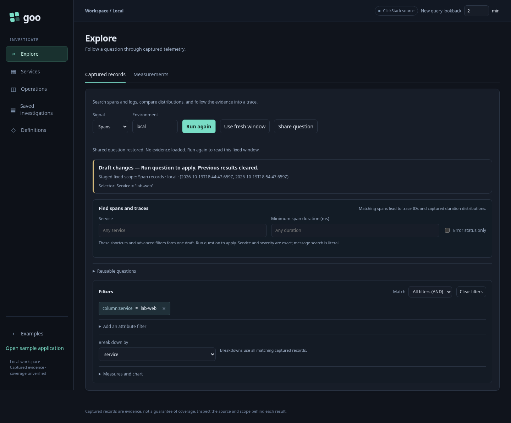
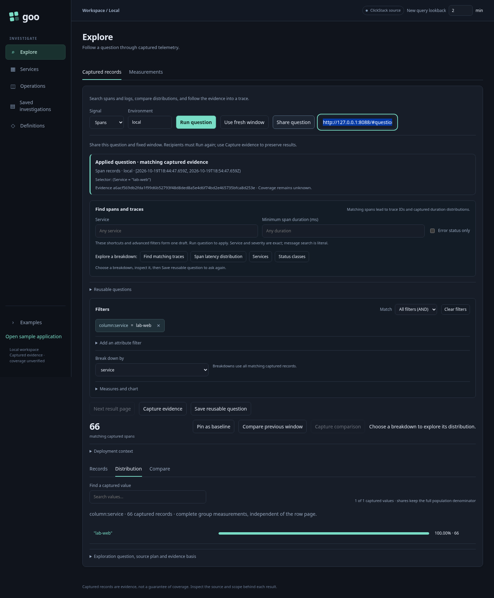

# Resume and share a question

Explore now offers **Share question** beside the scope controls. The selectable
link contains a versioned record question: signal, environment, fixed half-open
window, literal selectors, grouping, measures and the Records/Distribution view.
Copy the displayed link to hand off the question. Sharing an unrun draft pins
its window for the sender as well, so their next Run uses the shared bounds. It contains no result rows,
evidence basis or credentials. Attribute values and environment names are visible
to anyone receiving the URL; the fragment is not an access-control mechanism.

Opening the link, reloading it, or using browser Back/Forward restores a draft
without a telemetry request. **Run again** explicitly reads its original fixed
window. Filters remain editable; **Use fresh window** stages a new lookback.
Returning through history clears previous live evidence so it cannot appear to
answer the restored question. Existing explicit service drilldowns still run.

**Capture evidence** remains a separate action: it rereads the fixed question and
stores an immutable receipt. A `#capture=…` link reopens stored evidence. A question
link can produce different results after late arrivals or source retention. It is
also distinct from a reusable package, which defines fresh-window reuse.

Links are bounded to 16,000 encoded characters, versioned and validated before
restoration. Invalid links clear live results and display an error. Backend query
validation remains authoritative at execution. History stores applied/shared
questions and explicit Records/Distribution switches, not every unsaved keystroke.
Trace-inspector state, baselines, native measurement drafts, selected service-detail
panels and collaborative document editing are not encoded by this first version.
Service selection is retained when expressed as a record-question selector.

Executable storyboard 49 in `journeys/question-links.spec.js` covers real reads,
a second browser, history traversal, malformed input and mobile layout. Navigation
properties run through the actual JavaScript with Hegel; Bombadil explores restore,
Back and Forward; the observed read ledger is checked with quint-go and rejecting
mutations. See VALIDATION.md for executed checks.

