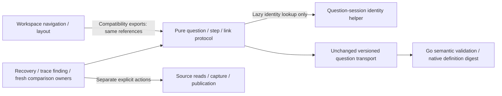
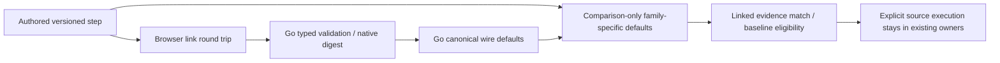

# Shared question wire protocol and native defaults

B2's shared step fixtures cover versioned record/native question envelopes. They
retain fixed environment and time scope, exact native nanosecond strings, native
bindings and definition digests without treating records and measurements as one
population. The transport still contains authored intent, not evidence or execution.

`testdata/protocol/question-steps.json` freezes 16 accepted/refused examples. Go
checks its typed step validation and canonical JSON; a real Node worker round-trips
the same inputs through browser links and returns typed steps to Go. Native fixture
definition digests are pinned before and after that browser round trip. JS also
compares authored and canonical capture questions in both directions, preserving
input objects. These are selected protocol examples, not a complete browser copy
of the Go validators. Go remains authoritative for full definition/source validation.

## Pure protocol owner — N1 continuation

`ui/question-protocol.js` is the canonical browser/Node owner for record/native
steps, versioned links, fixed-scope checks, capture-question projection and
comparison-only default equivalence. `ui/workspace.js` owns navigation/layout and
reexports the identical function references for existing consumers. Load the
protocol script before workspace in server HTML; CommonJS consumers may require
the protocol directly. Neither module executes a source query or publication at
load time. Navigation runs only when its application owner mounts workspace.

The extraction preserves every moved function body, error string, legacy
`#question=` decoding and the existing 16,000/48,000-character transport budgets.
These browser guards remain selected transport checks, not a replacement for Go
semantic validation. Frozen fixture bytes and native definition digests stay the
same. There is no new normalization of stored definitions or evidence.

Evidence comparison still resolves `question-session.identity` lazily at call
time, with its existing pre-session stable fallback. It neither creates a Session
nor makes the protocol depend on a mounted UI. Session lifecycle/generation,
source requests, immutable publication and browser-local draft storage retain
their separate owners. Recovery validation, trace findings and fresh comparison
now import the pure protocol directly; other existing owners can keep the
workspace compatibility surface.

Existing storyboards 114, 169 and 87 exercise real native reuse, exact bounds,
source-free explicit recovery and retained-page trace continuity through this
owner. The shared Go/JS fixture worker and Hegel mixed-step campaign now exercise
both canonical entry and compatibility-reference identity; isolated browser tests
check loading without DOM/history/fetch/Session globals and lazy identity before
and after question-session loads. No new state model is introduced for the
unchanged function movement; existing live Quint rejecting controls remain in use.

## Native default equivalence during reuse

Go's native `Binding` has string scope/version/schema selectors. A valid native
metric requires an explicit scope, metric and unit. Omitted version/schema strings
decode as exact empty selectors, rather than an unconstrained metadata search.
Go serialization materializes those empty strings. Empty attribute maps, empty
namespace value defaults and known optional null fields may serialize as omitted.

Previously a shared authored draft could differ textually from its canonical saved
capture and show **Question definition differs**, despite the same Go binding.
`GooQuestionProtocol.evidenceDifference` (also reexported by `GooWorkspace`) compares a cloned native definition using
only those known Go zero/omitempty defaults. Record comparison retains its existing
record predicate/paging default rules; it is not applied to native definitions.
Scope/environment/family checks remain separate. Neither stored definitions nor
publication digests are rewritten. Malformed null/array native source objects are
refused by the browser step guard as well as by the Go boundary.

| Difference | Reuse comparison |
| --- | --- |
| Omitted/null versus empty native version/schema strings | Same exact empty selector |
| Empty/omitted attribute maps; known optional null fields | Same Go binding representation |
| Empty namespace value versus its omitted string default | Same present-empty namespace |
| Wildcard versus missing/present-empty namespace | Different binding |
| Changed version, schema, metric unit or native kind | Different definition |
| Different exact nanosecond bounds, even within the same millisecond envelope | Different fixed window |
| Record versus native payload | Different signal family |

Journey 114 ingests one ordinary OTel gauge stream with empty scope metadata and
namespace, captures it with exact sub-millisecond bounds, and links its canonical
receipt to a draft with omitted defaults. The draft must match without a source
reread. Explicit document saving preserves the exact bounds; fresh comparison
preview accepts the baseline through the same helper without capturing again.
The new Bombadil actor previews/closes this saved native question, checks default
alias equivalence and exact bounds, and permits no POSTs.

The mixed-step Hegel campaign generates both millisecond-only and exact native
scopes above JavaScript's safe integer range, checks typed Go/browser round trips,
non-mutation and default-equivalent versus changed metadata selectors. Existing
mixed-step, linked-evidence and fresh-comparison journeys retain their observed
Quint ledgers/rejecting controls and execution/draft ownership checks.

## B2 scope

Record-field and service namespace helpers/fixtures are documented in
[Field presentation](FIELD_PRESENTATION.md). This slice adds shared native/record
wire examples and a concrete reuse fix; it does not introduce a universal result
schema, store migration or a generic request owner. The inspected source execution
and retained catalog owners have different lifetimes. A request helper still needs
two actually matching adapters rather than forcing those owners together.

## Bounded B2 acceptance audit

| Acceptance | Delivered evidence |
| --- | --- |
| Family-specific wire/default behavior | Shared record-field, service-namespace and question-step fixtures; native definition digests survive actual Go/JS round trips |
| Passive shared adoption | Live/fixed selector formatting, package field handoffs, namespace/annotation labels and document/fresh-baseline comparison share pure helpers |
| Exact scope and identity | Native nanosecond strings and changed selectors remain distinct; comparison does not rewrite stored payloads or digests |
| Execution/draft compatibility | Mixed-step, linked-evidence and fresh-comparison browser journeys, observed Quint rejecting controls and Hegel question-session state/swarm checks |
| No forced request abstraction | Source execution and retained metadata adapters were compared; their abort/visit/snapshot/cursor lifetimes differ, so the conditional extraction is not justified |

This closes bounded B2. It does not claim exhaustive protocol validation or every
future presentation adoption. At B2 closeout the next cut was C1: freezing store-specific identity/response
fixtures and extracting immutable-file mechanics without changing family semantics.
That cut is now historical; the [current roadmap](ROADMAP_2026_10_24.md) owns status.
