# One scoped question workbench

Implemented first slice of the [entry-point review](ENTRY_POINTS_DESIGN_SPIKE.md).
Current routes and typed record/native metric/lifecycle kernels remain in place.
Library/navigation migrations and a browse-first native-metric experience are
still proposed; this slice changes how the existing record question is composed,
executed and followed into evidence.

## Start and run

Explore has one primary **Run question** action. Service, duration, severity and
message shortcuts, advanced attribute filters, breakdowns and measures build the
same draft. Editing them does not read telemetry. Advanced filters and measures
are initially collapsed; an applied question with measures exposes its selected
measure controls. Unready result tabs, comparisons, capture/reuse actions and source
plan are hidden until a result is published.

Shortcuts are explicit AND constraints over the authored selector, including when
advanced filters use OR. For example `(service = edge OR service = worker) AND
severity = ERROR` preserves the authored OR; the UI does not silently switch its
join selector. Literal values remain literal. Clearing filters clears shortcuts
as well. The existing restriction on value drilldown with an authored OR remains
until a checked narrowing transform supports it.

After execution the scope strip identifies span/log grain, environment, half-open
fixed UTC bounds and a readable selector summary. Long selectors are labelled as
summaries; the full typed question and source plan remain in the disclosure. The
receipt basis identifies evidence, not coverage or a transactional snapshot.

## Draft, requested and applied scope

`ui/question-session.js` supplies a source-free execution lifecycle shared by Explore’s
record entry points. Explicit runs, question/package/recipe handoffs, paging and
one-gesture drilldowns enter the same executor. Every start/edit/cancel advances
its generation. Only a matching response for the active running generation may
publish. The returned normalized question must match the request; omitted optional
defaults and object-key order do not change identity. An omitted predicate value
and an explicit empty-string value both mean the Go predicate default; this does
not collapse a missing telemetry key with a present empty value. Mismatched evidence fails.

Draft edits clear old results and disable/hide capture and reuse; the scope strip
labels the previous applied scope as previous. Failed, cancelled, draft and running
states remain distinct from successful `no_data` or `changed_between_reads`
evidence. Editing while a request is running cancels it locally and requests
upstream cancellation. Late completion cannot republish cleared results. Leaving
a running record query for another workspace or native measurements cancels that
query. Returning from an inspector is local and restores focus without rerunning.
This is not a general navigation-history or durable draft-recovery implementation.

Ordinary filter/measure edits retain the last requested fixed window. **Use fresh
window** stages a newly resolved lookback for the next Run; it does not query. Editing
the lookback also stages fresh bounds immediately. Changing signal/environment
resets that window anchor; switching signals retains the common service shortcut
while clearing signal-specific shortcuts. Frozen evidence ignores live lookback edits. There is
no implicit periodic refresh or automatic widening of empty results.

## Follow evidence through interactions

**Filter and run** and **Break down and run** are explicit one-gesture reads through
the same executor, retaining fixed bounds. They do not require a second Run click.
Captured-series search, chart-measure selection and inspection disclosure remain
local operations. Trace expansion and linked logs are separate explicit context
reads; closing them does not rerun the main question. A trace view is not archived
implicitly as part of the main population capture.

Services → **Discover metrics** now passes service, environment and exact inventory
bounds. Opening discovery performs no telemetry read. **Discover instruments**
then reads bounded native metadata in those fixed bounds, labelled in the destination.
The span-name selector is omitted: this is service/time context over another signal,
not the same population or a causal link. An independently opened native discovery
still uses its labelled fresh two-minute window. Native identity/unit/temporality
and kernel support rules are unchanged.

## Evidence, questions and investigations

- **Capture evidence** rereads the current fixed question and creates immutable
  evidence. The confirmation explains late arrivals and retained record limits;
  this does not archive the displayed response byte-for-byte.
- **Save reusable question** opens the existing package authoring flow, preserving
  filters/measures/charts. A definition is configuration; reuse reads fresh data.
- Saved evidence has a **Frozen evidence** scope strip. **Rerun fixed question**
  creates a child capture; **Explore fixed question** retains original bounds.
  It does not quietly mean “run now.” Use fresh window explicitly in live Explore.
- Investigation notes retain their own explicit draft/revision and evidence-attachment
  rules. This slice does not merge captures, definitions and authored documents.

```mermaid
stateDiagram-v2
  [*] --> Initial
  Initial --> Draft: edit controls
  Draft --> Running: Run or labelled drilldown
  Applied --> Draft: edit; clear displayed results
  Applied --> Running: explicit rerun / paging / drilldown
  Running --> Applied: active generation + matching question
  Running --> Draft: edit; abort old request
  Running --> Cancelled: cancel / leave running view
  Running --> Failed: active request fails
  Draft --> Draft: reject stale completion
  Cancelled --> Cancelled: reject stale completion
  Applied --> Frozen: reread fixed question and capture
  Frozen --> Frozen: reopen / saved paging; no telemetry read
  Frozen --> Running: explicitly explore supported fixed question
```

The diagram combines browser execution state with the existing capture workflow;
Frozen is a separate immutable evidence viewer, not a mutable session result.
Existing backend aggregate budgets, sampling/completeness caveats and independent
source-read accounting continue to apply.

## Executable documentation

[Storyboard 45](journeys/README.md#45--one-question-from-entry-to-frozen-evidence)
uses ordinary OTLP gateway/worker spans and a native gauge through the real
collector/ClickHouse. It checks one Run pipeline, shortcut+advanced conjunction,
fixed-window one-gesture narrowing, trace return with no query, a delayed real
response superseded by an edit, explicit metric-discovery bounds, capture reread,
local reopening and mobile containment. Responses are real; its route interceptor
only delays one actual response to exercise cancellation/generation handling.

Hegel drives the actual JavaScript session through 100 requested state/swarm
sequences of 25 steps, comparing each state to an independent Go oracle. Quint
models generation, execution phase and publication ownership; quint-go validates
observed session transitions and evidence/handoff projections, with rejecting
mutations for stale publication, scope, bounds, local reads and custody. Bombadil's
new entry-point actor explores draft edits and progressive controls without
creating captures or source queries. Acceptance evidence is recorded in
[VALIDATION.md](../VALIDATION.md), not inferred from this design contract.
