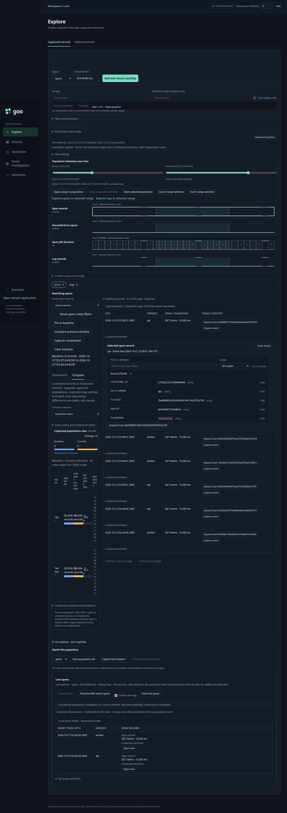
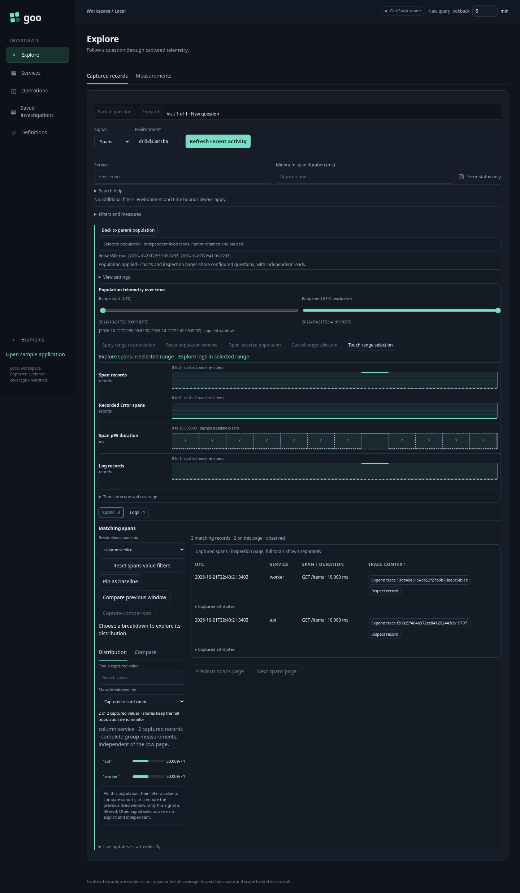
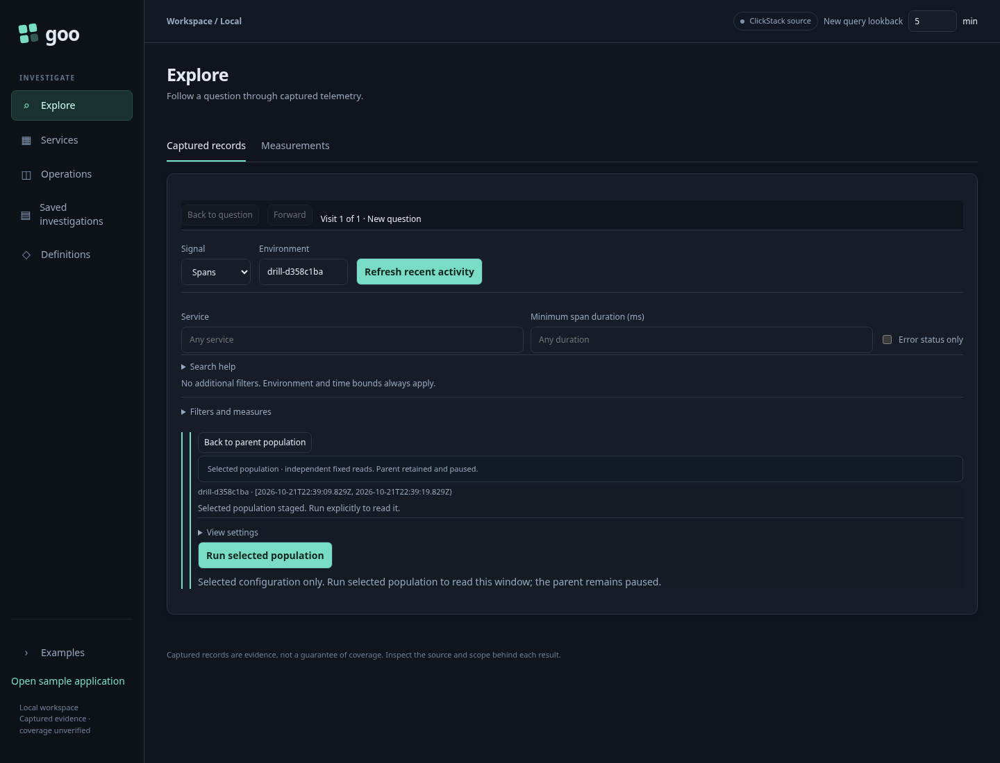
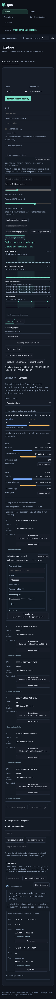

# Select a time range and retain the parent

Recent activity now supports horizontal time brushing and bounded child
populations. Drag across an activity or duration timeline to preview a range on
all aligned lanes. No telemetry read occurs while dragging, on release or on
opening the selected population. **Apply range to population** still reruns in
place; **Open selected population** stages an independent child with a visible
primary **Run selected population** action. The child keeps every signal's original selector and environment,
changes only its time bounds, and starts inspection at page zero.

Brush either direction. **Escape** restores the selection preceding that gesture;
**Cancel range selection** restores the complete applied window. Native UTC range
handles support keyboard input in millisecond steps. Pointer bounds are displayed
as a half-open UTC interval; the adapter rounds outward to supported millisecond
bounds and clips them to the displayed window. Exact supplied nanosecond labels
and values remain unchanged. This is time selection, not a heatmap rectangle,
duration filter, statistical anomaly detector or measurement evaluator.

On touch screens, ordinary swipes retain scrolling behavior. Enable **Touch range
selection** before brushing horizontally, or use the native handles. A click or
keyboard activation of a supplied point still previews its interval. Empty or
unknown intervals remain selectable time context; selecting one does not establish
that records or healthy behavior exist there.

## Parent and child ownership

Starting a selection pauses the population's tail and live comparison owners.
Opening a child suspends parent comparison requests and leaves the parent DOM
connected but hidden. Its fixed results, pinned baseline, record inspector,
bounded tail rows and nested scroll positions remain owned by the parent. The
child has a distinct namespace, query generation, source requests and optional
live controls; it does not inherit or refresh the parent's baseline or subscribe
automatically. Its result is a new independent read, not a subset copied out of
the parent's bounded record page.

**Back to parent population** aborts child work, disposes child owners and restores
the original nodes, scope, baseline, focus and window scroll position. It performs
no telemetry reads and does not resume live updates. Late child responses cannot
publish into the parent. Child facet refinements and explicit refreshes stay with
the child. There can be at most three retained child levels (four canvases);
returning disposes that child rather than accumulating an unbounded history.
Ancestor return controls hide while a deeper child is active, leaving one
unambiguous Back action for the current level.

This is temporary workspace retention, not frozen evidence or a persistent tree.
Use the existing save-view action to store an individual child's configuration;
opening that saved link follows the existing source-free top-level restore path.
Top-level question/source edits, saved-link replacement and workspace disposal
can replace this temporary tree. General record-selection trays, persistent
branches, global trace-inspector retention and multi-item evidence capture remain
separate work. Existing investigation-trail history continues to own whole
question visits.

```mermaid
sequenceDiagram
  actor User
  participant Parent as Parent population
  participant Child as Child population adapter
  participant Go as Existing Go exploration executor
  User->>Parent: Begin / preview / commit brush
  Note over Parent: Pause live owners; display range; no source read
  User->>Parent: Open selected population
  Parent->>Child: Detached fixed questions, layout and columns
  Note over Parent: Keep parent DOM and evidence bases connected
  Note over Child: Staged only; no subscription or telemetry read
  User->>Child: Run selected fixed window
  Child->>Go: Existing typed questions / independent source reads
  Go-->>Child: Scoped results or explicit per-signal errors
  User->>Child: Back to parent
  Note over Child: Abort, invalidate generations, dispose descendants
  Child-->>Parent: Restore retained parent; no source read
  Note over Parent: Still paused; original basis and baseline unchanged
```

## Passive component contract

`goo-value-timeline` opts into brushing with the boolean `brush` attribute.
`touch-brush` enables deliberate touch selection. It emits `goo-timeline-range`
with `phase: start | preview | commit | cancel`; preview/commit include supplied
domain bounds as exact decimal-string `fromNS` and `toNS`. Geometry uses bounded
pointer fractions and integer timestamp arithmetic. The component never maps
fields to predicates, fetches, subscribes, navigates or captures. Disconnect and
replacement cancel an unfinished gesture. The existing `goo-timeline-select`
point-key event remains compatible with native point buttons.

`GooServiceTimeline` maps selection to its declared fixed viewport and exposes
application-owned preview/apply/open callbacks. The population adapter composes
retained children over existing typed queries and Go kernels. No new persistence
schema, query language or JavaScript measurement evaluator is introduced.

## Executable storyboards

[Journey 94](../journeys/range-drilldown.spec.js) emits manifest-free API/worker
spans and logs in three time clusters, independently checks ingestion in
ClickHouse, then runs the actual UI. It pins a six-record baseline, opens a record
inspector, starts a real tail and verifies pause-on-selection. It tests reverse
dragging and Escape cancellation, source-free child staging, a two-span selected
population, nested staging/return, original DOM/inspector/baseline/tail retention,
scroll restoration, cancelled late source responses, keyboard handles and real
touch input at mobile width.

The observed ledger replays a depth/read model through Quint/quint-go. Rejecting
controls cover hidden reads, widened time scope, changed baseline, lost tail rows,
an implicit new subscription and an invalid return depth. Hegel generates brush
and typed range transformations, including missing/empty predicate preservation;
the existing immutable-view state/swarm campaign remains applicable. Bombadil
explicitly runs a recent population, stages a handle-selected child and returns,
checking bounded depth, containment, runtime errors and no implicit tail.

Journey 95 uses the synthetic standalone component reference to verify server
markup, native point/keyboard activation, reverse brushing, detached property
updates, exact large values and cancellation without application API calls. It
complements the real telemetry journey; it is not evidence of ingestion or source
measurement correctness.





