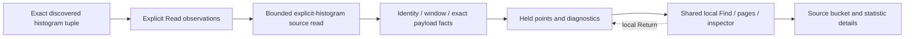

# Inspect explicit histogram points

The [shared compact viewer](RAW_OBSERVATION_CONSOLIDATION.md) keeps exact clocks,
local interaction and family-specific uncertainty.

Discovered explicit histograms offer **Read observations** independently of
measurement readiness. The held viewer shows exported points, exact source
counts and bucket details. It does not calculate a percentile, rate, merged
histogram or service-health verdict.

## Exact source scope

`POST /histogram-observations` accepts the original fixed discovery question and
an explicit instrument tuple: histogram kind, scope, scope version, scope schema
URL, metric, unit and reported aggregation temporality. Empty metadata strings
remain exact values; unknown temporality is diagnostic rather than silently
reclassified. The question keeps one service, the checked narrow environment,
namespace selection and half-open event-time window. All environments and
exponential histograms refuse before reading.

The adapter reads only the explicit-histogram source, using bound parameters.
Wrong identity, tuple or event time refuses the whole response. Row, vector and
byte limits refuse oversized reads rather than returning a successful prefix.
Repeated exports remain separate read-local occurrences; a row key does not
establish a continuous producer identity.

## Point facts and uncertainty

The profile is `goo/raw-histogram-observations/v1`. Shared stream identity,
event/start clocks, flags, diagnostics and source rows follow the existing raw
observation conventions. Histogram rows contain no fabricated scalar value.

| Fact | Meaning |
| --- | --- |
| `count`, `bucketCounts` | Canonical UInt64 strings, including values above 2^53. Bucket totals are checked exactly. |
| `countState`, `boundsState`, `bucketCountsState`, `bucketsState` | Valid, absent or invalid source payload, not completeness or evaluator eligibility. |
| `recordingState` | Recorded, no-recorded-value, or unknown. Unknown flag bits never silently mean recorded. |
| `sum`, `min`, `max` | Source value and numeric validity, with producer presence explicitly unavailable. |
| `rawRow`, diagnostics | Preserve malformed or suppressed source facts for inspection. |

Finite strictly increasing bounds, one more bucket than bounds, and an exact
bucket sum equal to Count form a structurally valid vector. Empty bounds with
one bucket is an all-values bucket. **Empty bounds and empty counts is legal
bucket omission**, distinct from a zero distribution or malformed vector.
Bad payload remains a diagnostic point; it does not become a valid measurement.

Flag 1 suppresses normalized count, vectors and statistics, with a no-recorded
value explanation; raw fields remain inspectable. Unknown flags retain explicitly
uncertain recording state even when their bucket arithmetic is coherent.

The ClickStack exporter’s non-null Sum, Min and Max columns lose optional OTLP
presence. A source zero therefore cannot establish that a producer reported a
zero, minimum or maximum. The profile always marks their presence unavailable.
If an optional source column is absent or incompatible, the adapter projects
NULL using the existing bounded schema inspection; bucket data remains usable.
There is no extra statistics query or durable readiness cache.

## Held interaction

The existing raw-observation viewer supplies local Find, 100-row pages,
inspection and retained Return. Histogram detail adds an accessible bucket table
and presence-qualified source statistics. Bucket pages show exact counts and
announce their range. Event timestamps use UTC with exact clock tooltips.

Changing presentation or returning to held data never reads the source. A new
Read is explicit. A source refusal keeps the prior held result, and a completed
obsolete response cannot replace it after navigation. Source read time remains
separate from event/start time and from evidence custody; this viewer creates no
capture or custody receipt.

[Executed storyboard](journeys/raw-histogram-observations.md) covers real OTLP,
large counts, omitted/invalid buckets, source refusal, obsolete success and
Bombadil exploration. Evaluated histogram distributions, continuity and merged
population charts retain their separate, stricter contracts. Exponential point
inspection remains a separate future profile.

## Bucket bars for one held point

**Inspect** opens one occurrence with local **Bars / Table** controls. Bars compare
source counts across categorical intervals; they do not encode density or merge
points. Unknown recording and invalid/absent vectors refuse bars while retaining
diagnostics and raw fields. Large vectors page without sampling or new reads.
See the [shared component contract](UI_RAW_HISTOGRAM_BUCKETS.md).
