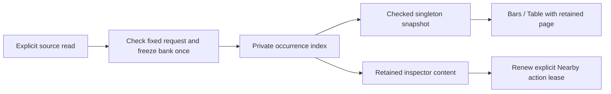
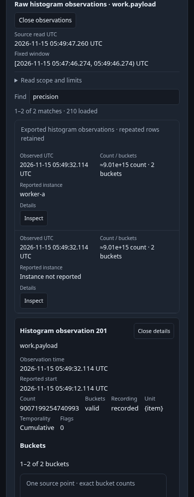
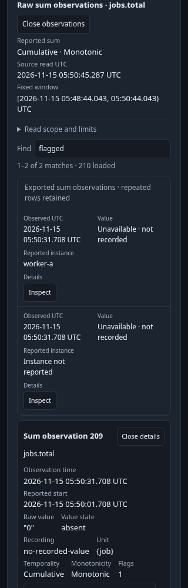

# Compact raw-observation inspection

Gauges, sums and explicit histograms share a compact read context, Find/paging
controls and inspector facts. Exact timestamps remain in native `time` elements
and tooltips; visible clocks use readable UTC milliseconds. The fixed window
keeps its half-open boundaries.

The loaded-point announcement remains available to assistive technology without
repeating the visible page count. Generic source/provenance caveats live in one
**Read scope and limits** disclosure. Recording uncertainty, no-recorded values,
invalid payload and unavailable statistic presence stay explicit in the point
presentation. They are not collapsed into a generic successful-read state.

## Shared presentation

The display-only `goo-stat-list` supports serializable facts, including SSR
`items` attributes and detached SPA property assignment:

```js
UI.stats([
  {label: 'Source read UTC', value: '2026-11-15T12:00:00.123456789Z', format: 'utc'},
  {label: 'Event', value: '2000000000', format: 'unix-ns'},
  {label: 'Window', value: '[1000000000, 61000000000)', format: 'unix-ns-range'}
], {density: 'compact'})
```

Typed formats preserve the exact instant or both range boundaries. Invalid
formatted values show Unavailable. Plain numeric/text facts keep their existing
behavior; facts accept no DOM or HTML payload, own no source read and emit no
acquisition event. Source admission remains in the adapter.

The raw application uses one closed profile map for endpoint, response version,
label and instrument fields. Unknown/exponential kinds refuse rather than
falling through to gauges. Numeric, temporal, bucket and whole-response validators
remain family-specific. Go instrument decoding shares exact-key admission;
case-variant keys cannot override the declared tuple. Empty metadata, zero
temporality and false monotonicity keep their meanings.

## Display state and prepared banks

Gauge Points and histogram Bars/Table share a native display picker. Its labels
retain the scope distinction: **Observation display** chooses the held gauge bank;
**Bucket display** chooses a presentation of one histogram occurrence. Native
radio navigation retains focus and never starts a read.

Histogram Bars/Table preserve the current bucket page and exact counts while the
same admitted snapshot remains mounted. A new supplied snapshot resets the page.
Closing and reopening an inspector reuses its retained content, including display,
page and disclosures; the bounded inspector cache can evict older occurrences.
Nearby actions receive a fresh ownership lease when the point is inspected again.
Selecting a Table occurrence marks its existing row immediately, without replacing
the opener. Histogram source statistics use two columns and one presence-qualified
caption rather than repeating the same caveat for Sum, Min and Max.

The application prepares each successful raw bank once against its original
fixed request. `prepare` owns a deeply frozen, validated clone and an occurrence
index. Single-histogram projection checks only the selected occurrence. The
convenience `dataset(bank, key)` API still validates arbitrary whole-bank input;
there is no public flag to skip admission.

```js
import {prepare} from '/raw-observation-dataset.mjs';
const held = prepare(response, originalRequest);
// Called when the operator inspects a point:
chart.snapshot = held.histogram(occurrenceKey);
chart.display = {kind: 'histogram'};
// For a gauge bank instead: points.data = held.gauge();
```

The handle's `.data` is read-only. Returned snapshots are detached copies with the
ordinary common grammar, original clocks and unknown coverage. Mutating the
original input, readback or a returned projection cannot change the held bank.
Prepared handles are local runtime objects; use the returned snapshots for
portable supplied-data views.



### Projection measurements

Run `node scripts/measure_raw_projection457.mjs`. Five warmed synthetic Node 24
samples compare the full-validation convenience call with projection from one
prepared bank. These are local projection costs, not browser rendering or source
latency measurements. One-time preparation costs are reported separately.

| Synthetic bank | One preparation | Convenience median / point | Prepared median / point |
| --- | ---: | ---: | ---: |
| 1,000 rows / 1.25 MB | 80.5 ms | 87.08 ms | 0.37 ms |
| 5,000 rows / 6.26 MB | 576.6 ms | 402.5 ms | 0.41 ms |

There is no timing threshold in correctness tests. Full-bank admission remains
necessary for arbitrary inputs; the application avoids repeating it during local
inspection. Mutation, membership, expected-request and source-free tests check the
ownership boundary. Live journey checks remain in [validation](../VALIDATION.md).

## Earlier compact read-context measurements (448)

Compared embedded 447 with 448 using the same actual OTLP journeys, held
Find/Inspect state, viewport sizes and zero source work during capture. Table
values are pixels from panel top to the first rendered point, rounded to the
nearest pixel. These are layout measurements, not latency benchmarks.

| Family | Width | Before | After |
| --- | ---: | ---: | ---: |
| Gauge | 1440 | 298 | 253 |
| Gauge | 390 | 438 | 298 |
| Gauge | 320 | 463 | 317 |
| Sum | 1440 | 298 | 253 |
| Sum | 390 | 477 | 320 |
| Sum | 320 | 521 | 356 |
| Histogram | 1440 | 298 | 253 |
| Histogram | 390 | 438 | 298 |
| Histogram | 320 | 455 | 333 |

The first histogram bucket appears 175/322/474 pixels sooner relative to the
inspector at 1440/390/320. No measured viewport overflows horizontally.

Each cold point read still makes one product read request and three SQL calls
(schema/probe/data). Discovery has its own family-dependent work. Find, local
pages, Inspect and held Return add zero requests and zero SQL. Retirement of an
owned pending read is counted separately from acquiring data. No readiness cache,
polling change or measurement-eligibility shortcut was added.





## Executable coverage

The existing gauge, sum and histogram journeys capture the measurements through
[`raw-observation-measure.js`](../journeys/support/raw-observation-measure.js).
`GOO_RAW448_LABEL=baseline` keeps prior-binary frames in artifacts;
`GOO_RAW448_LABEL=consolidated-final GOO_RAW448_SCREENSHOTS=1` refreshes the nine
448 documentation frames. Read clocks are inspected through `time.dateTime`,
with the old text fallback used only by this comparison harness.

Real-source refusal, budget limits, duplicate occurrences, retired successful
responses, native model controls and Bombadil remain acceptance gates. The sum
journey now also meters real SQL for its local actions. Source facts and custody
owners were not merged by this presentation consolidation.
